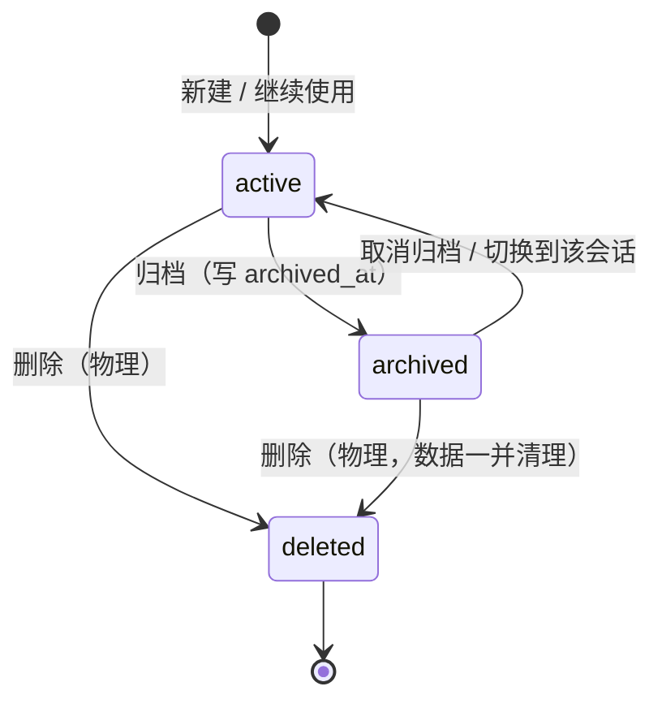

# 对话归档功能设计（Conversation Archive）

> 参考实现：Z.ai 的 coding agent harness [zai-org/ZCode](https://github.com/zai-org/ZCode)（仓库快照 2026-10-11，main 分支）
> 本文档只做设计，不含实现。实现计划由后续 `writing-plans` 流程产出。

## 1. 背景与目标

### 1.1 现状问题

Y-code 的会话目前只有两种归宿：**留在列表里** 或 **物理删除**。

- `sessions` 表（`core/memory.py:341`）字段为 `session_name / memory_summary / summarized_until_msg_id / workdir / created_at / updated_at / source / active_model_id / last_error / permission_mode`，**没有任何归档相关字段**。
- CLI 会话管家（`core/session_selector.py`）只提供 切换 / 重命名 / 删除；`/sessions` 命令分支（`main.py:3415`）只有 `delete`、`all`、`rename` 三个子命令。
- GUI 侧栏（`frontend/src/components/Sidebar.vue`）会话行内操作只有 重命名 / 删除（两段确认，见 `Sidebar.rename.test.ts:213`）。

结果是：用久了列表被大量「已完成但不想删」的会话淹没，用户只能二选一——忍受噪音，或永久删除（不可逆）。

### 1.2 目标

引入 ZCode 式的 **归档（archive）中间态**：

- 归档 = 从默认列表隐藏，**数据零损失**，随时可恢复；
- 归档 ≠ 删除，二者在数据模型与交互上完全分离；
- 覆盖 CLI 与 GUI 两端，行为一致。

### 1.3 非目标（本次不做）

- 不做云端/远程工作区归档（ZCode 的 remote source 路由不在本期范围）；
- 不改动消息、摘要、harness 事件表的结构；
- 不做归档会话的物理清理策略（删除仍走既有 `delete_session`）。

## 2. ZCode 归档机制调研

ZCode 的归档是**分层三态**设计，值得逐层对齐。

### 2.1 CLI 会话存储层

`apps/zcode-cli/packages/adapters/src/storage/session-store/repositories/sessions.ts`

| 事实 | 证据 |
| --- | --- |
| `session` 表有 `time_archived` 列（毫秒时间戳，NULL = 未归档） | `sessions.ts:36`、`sessions.ts:129` |
| 更新会话时 `timeArchived === undefined` 保持原值（支持「只改归档态」的增量写） | `sessions.ts:154` |
| 列表查询默认过滤归档：`time_archived is null` | `sessions.ts:217-218` |
| 列表排序：`order by time_updated desc, id desc` | `sessions.ts:224` |

### 2.2 桌面任务索引层

`packages/services/src/session/taskIndexRepo.ts` —— 独立的 SQLite 索引表，字段含 `archived / pinned / deleted / unread / workspace_key`（`taskIndexRepo.ts:76,129,141`）。

| 能力 | 位置 |
| --- | --- |
| `archiveTask` / `unarchiveTask` | `zcodeTaskService.ts:785,792` |
| `archiveStaleTasks`（自动归档陈旧任务） | `taskIndexRepo.ts:1228` |
| `archiveWorkspaceTasks`（整工作区归档） | `zcodeTaskService.ts:528` |
| `deleteArchivedTask(s)`（删除归档项） | `taskIndexRepo.ts:1888` |
| 列表按 kind 分区：pinned / archived / 普通 | `taskIndexRepo.ts:2175-2179` |
| 事件：`task_archived` / `task_unarchived` / `task_deleted` | `packages/shared/src/task-realtime-core.ts:103` |

### 2.3 UI 层

- 侧栏按 **置顶 / 时间线 / 已归档** 分区（`packages/ui/src/WorkspaceSidebar.tsx`）；
- 归档平铺区默认折叠 20 条（`WorkspaceArchivedTasksFlatSection.tsx`）；
- 行内 hover 操作：归档 / 取消归档 / 删除归档；
- 支持批量「删除所有归档任务」，带二次确认与数量提示（`docs/task/delete-all-archived-tasks.md`）。

### 2.4 必须继承的硬不变量

摘自 `docs/task/delete-all-archived-tasks.md` 的 Must-Preserve Invariants：

1. **归档 ≠ 删除**：删除归档任务只写 `deleted` 标记并清理分组引用，**CLI 会话记录、项目文件、worktree 一律保留**；
2. 归档状态检查与删除必须在**同一事务**内完成（避免确认后状态漂移）；
3. 归档后的列表不能被**迟到的旧快照「复活」**（`conversation-session-grouped-archive-resurrection.test.ts`）；
4. 批量操作以 workspace 为边界，一项失败不阻断其它项。

## 3. 设计范围

| 层 | 本期 | 说明 |
| --- | --- | --- |
| 数据层 | ✅ | `sessions` 表新增归档字段 + 幂等迁移 |
| 记忆层 API | ✅ | archive / unarchive / 列表过滤 / 搜索过滤 |
| CLI | ✅ | 会话管家归档键位 + `/sessions archive\|unarchive\|archived` |
| GUI | ✅ | 侧栏归档区 + 行内归档操作 + 桥接事件 |
| 自动归档陈旧会话 | ⏳ 可选扩展 | 参考 `archiveStaleTasks`，默认关闭 |
| 归档区批量删除 | ⏳ 可选扩展 | 参考 `deleteArchivedTasks` |

## 4. 数据模型

### 4.1 新增字段

`sessions` 表增加一列（**沿用本库既有时间字段的 TEXT ISO8601 风格**，而非 ZCode 的毫秒整数）：

```sql
ALTER TABLE sessions ADD COLUMN archived_at TEXT;   -- NULL = 未归档；非空 = 归档时刻
```

设计取舍：

- **为什么用 `archived_at` 而不是布尔 `archived`**：时间戳同时表达「是否归档」与「何时归档」，归档区可按归档时间排序，且不需要额外列；ZCode 底层同样用时间戳（`time_archived`），布尔标记只存在于上层索引。
- **为什么不复用 `updated_at`**：归档不是「会话有新活动」，混用会污染活跃时间排序与「最近使用」语义。

### 4.2 迁移

在 `core/memory.py` 的 `create_tables()` 兼容升级段（`memory.py:363-375`，与 `workdir` / `created_at` / `permission_mode` 同一处）追加：

```python
if "archived_at" not in columns:
    cursor.execute("ALTER TABLE sessions ADD COLUMN archived_at TEXT")
```

可选索引（归档区查询量小时可不加）：

```sql
CREATE INDEX IF NOT EXISTS idx_sessions_archived ON sessions(archived_at);
```

迁移必须**幂等**且**不重建表**——`memory.py:307-330` 已有一段「检测到遗留 sessions 表就 DROP 重建」的兼容逻辑，新列必须走 `ALTER ADD COLUMN` 分支，绝不能触发那条重建路径。

## 5. 记忆层 API（`core/memory.py`）

### 5.1 新增方法

```python
def archive_session(self, session_name: str, archived_at: Optional[str] = None) -> bool
def unarchive_session(self, session_name: str) -> bool
```

语义：

- 幂等：对已归档会话再次 `archive_session` 不改写原 `archived_at`（返回 True），对未归档会话 `unarchive_session` 同样安全返回 True；
- 只更新 `sessions.archived_at` 一列，**不触碰 `messages` / `session_summary_generations` / `harness_*` / `token_usage`**；
- 会话不存在时返回 False，由调用方提示；
- 复用现有 `self._lock` 与事务写法（对照 `delete_session`，`memory.py:3181`）。

### 5.2 列表接口扩展（向后兼容是硬约束）

`get_all_sessions`（`memory.py:2835`）签名扩展为：

```python
def get_all_sessions(self, workdir=None, source=None, include_empty=False,
                     include_archived=False, archived_only=False):
```

- **默认 `include_archived=False`**：现有 10 余处调用点（`gui_bridge.py:2398/2606/2993/3723/3872/4014/5561/6920/6949`、`main.py:2024/3422/3436/3448`、`core/agent_service.py:706`）行为完全不变，**不显示归档会话**——这是本设计最重要的兼容性保障；
- `archived_only=True` 时只返回归档会话（供归档区视图）；
- 返回值 dict 增加 `"archived_at"` 字段（未归档为 None）。

### 5.3 搜索过滤

`search_sessions_and_messages`（`memory.py:2890` 附近）增加 `include_archived: bool = False`，默认排除归档会话；GUI 搜索弹窗提供「包含已归档」开关。

### 5.4 删除与归档的关系

- `delete_session`（`memory.py:3181`）**不变**：物理删除会话及其消息、摘要代、token 流水；
- 归档会话可以直接删除（先归档后删除是合法路径）；
- **归档不参与** `delete_sessions_by_workdir` 的过滤——该接口按 workdir 物理删除，与归档状态无关，保持不变。

## 6. CLI 交互设计

### 6.1 会话管家（`core/session_selector.py`）

新增键位，与现有 `r/f2` 重命名、`delete` 删除并列：

| 键 | 动作 | 说明 |
| --- | --- | --- |
| `a` | 归档选中会话 | 归档后该行从当前列表移除，光标按现有边界防御逻辑回退（`session_selector.py:157-160`） |
| `u` | 取消归档 | 仅在归档视图中出现该提示 |
| `tab` | 在「活跃列表 / 已归档列表」之间切换 | 复用同一渲染器，切换 `archived_only` 数据源 |

约束（与「禁止删除当前活跃会话」同源的保护，`session_selector.py:143-147`）：

- **当前活跃会话禁止归档**，提示 `⚠️ 不能归档当前活跃会话，请先切换到其它会话。`；
- 归档不需要二次确认（可逆操作），但要在底部状态行给出 `✔ 已归档：<name>（按 tab 查看归档区）` 反馈；
- 底部按键提示行同步更新（`session_selector.py:100`）。

### 6.2 斜杠命令（`main.py:3415` 的 `/sessions` 分支）

沿用现有子命令风格，新增三个：

```
/sessions archive <会话名>      归档指定会话（幂等）
/sessions unarchive <会话名>    取消归档，恢复回主列表
/sessions archived              列出全部已归档会话（含归档时间、消息数、归属目录）
```

- 目标不存在时提示 `❌ 会话 <name> 不存在`，与 `/sessions delete` 的既有提示一致（`main.py:3421-3425`）；
- `/sessions archived` 的输出格式对齐 `/sessions all`（`main.py:3448-3460`）；
- 归档当前会话同样拒绝并提示；
- `/help` 与自动补全列表同步补充这三个子命令。

## 7. GUI 交互设计

### 7.1 后端桥接（`gui_bridge.py`）

| 新增/改动 | 位置参考 |
| --- | --- |
| `get_sessions()` 默认不返回归档会话（依赖 `include_archived=False` 默认值，**零改动**） | `gui_bridge.py:3717` |
| 新增 `get_archived_sessions()`：返回当前 workdir（或全局）下的归档会话，按 `archived_at desc` | 新增 |
| 新增 `archive_session(name)` / `unarchive_session(name)`：成功返回 `{"ok": True}`，失败带 `msg` | 对照 `delete_session`，`gui_bridge.py:3962` |
| 归档/取消归档成功后推送事件 `session_archived` / `session_unarchived`（携带 name、archived_at） | 对照现有 `session_renamed` 推送，`gui_bridge.py:6948` |

### 7.2 前端

| 改动点 | 文件 |
| --- | --- |
| 会话行内操作区新增「归档」（与重命名/删除同级，hover 显现） | `frontend/src/components/Sidebar.vue` |
| 侧栏底部新增「已归档」折叠区：默认折叠、显示数量、展开后按归档时间倒序 | `Sidebar.vue`（对照 `Sidebar.groupCollapse.test.ts` 的折叠模式） |
| 归档区行内操作：取消归档 / 删除（删除沿用既有两段确认） | `Sidebar.vue` |
| store 新增 `archiveSession` / `unarchiveSession` action，成功后局部刷新列表 | `frontend/src/stores/appStore.ts:3357` 一带 |
| 桥接类型声明 | `frontend/src/types/pywebview.d.ts:1017` 一带 |
| 搜索弹窗新增「包含已归档」开关 | `frontend/src/components/SessionSearchModal.vue` |

交互约束：

- **当前活跃会话的归档按钮置灰**，tooltip 说明「当前会话不能归档」；
- 归档动作沿用**行内两段确认**（与删除同一套交互：点 ⤓ 进入确认态，点「确认」才真正归档；点击条目其它区域取消）。虽是可逆操作，但误点会把会话挪出列表、要找回来得进设置页，故不直接执行；
- 归档成功后**静默完成**，不再弹「已归档」提示框（会话从列表消失、归档区出现即为反馈，与删除一致）；失败与「不能归档当前活跃会话」仍走提示框；
- 归档区为空时显示空态文案，不占额外行。

## 8. 状态机与不变量



不变量清单（实现与测试都必须守住）：

1. **归档是纯标记写入**：只改 `sessions.archived_at`，消息与其它表零改动；
2. **归档可逆且幂等**：重复归档 / 重复取消归档不产生额外副作用；
3. **归档 ≠ 删除**：归档后 `get_history`、`recall_history`、`/share` 导出、按回合撤销全部照常工作；
4. **当前活跃会话不可归档**（CLI 拒绝 / GUI 置灰）；
5. **默认列表不显示归档**：所有既有调用点行为不变；
6. **切换到归档会话时自动取消归档**，并给出可见提示——避免「会话处于归档态却正在被使用」的矛盾状态；
7. 归档操作**不触碰** `token_usage`、`permission_grants`、计划绑定（`sync_plan_session`）。

## 9. 边界与异常处理

| 场景 | 行为 |
| --- | --- |
| DB 锁定 / 写入异常 | 归档失败返回 False，UI 提示失败并**保持原状态**，不做乐观更新 |
| 会话不存在 | 返回 False，提示 `❌ 会话 <name> 不存在` |
| 归档当前活跃会话 | 拒绝并提示（见 6.1 / 7.2） |
| 归档会话正被其它进程占用（owner 租约） | 归档只写标记、不影响运行，允许归档 |
| 归档一个已归档会话 | 幂等成功，不刷新 `archived_at` |
| 归档后立即删除 | 允许，走既有物理删除路径 |

## 10. 测试计划

### 10.1 后端（pytest）

- `archive_session` / `unarchive_session`：正常、幂等、不存在、异常回滚；
- `get_all_sessions` 三种模式：默认（不含归档）、`include_archived=True`、`archived_only=True`；
- 归档后 `messages` / `session_summary_generations` / `token_usage` 行数不变（用真实 SQLite 断言）；
- 迁移幂等性：对「无 `archived_at` 列的旧库」执行 `create_tables()`，确认走 `ALTER` 而非重建；
- `search_sessions_and_messages` 的归档过滤开关。

### 10.2 CLI

- 会话管家 `a` 键归档后列表刷新、光标边界正确；
- 当前活跃会话按 `a` 被拒绝；
- `/sessions archive|unarchive|archived` 三个子命令的成败路径与提示文案。

### 10.3 前端（vitest）

- Sidebar 归档区渲染 / 折叠 / 数量；
- 行内归档按钮：活跃会话置灰、点击后调用桥接并刷新；
- 归档区行内「取消归档」「删除」；
- 搜索弹窗「包含已归档」开关的请求参数。

## 11. 可选扩展（设计留口）

1. **自动归档陈旧会话**（未实现）：参考 `taskIndexRepo.archiveStaleTasks`（`taskIndexRepo.ts:1228`）。建议形态：配置项 `auto_archive_after_days`（默认 0 = 关闭），仅归档「非当前会话、无未完成计划、最后活跃超过 N 天」的会话，且**只归档不删除**；
2. **归档区批量删除 / 批量恢复**：**已实现**，见附录 B；
3. **归档会话导出**（未实现）：`/share` 支持 `--archived` 批量导出为 Markdown。

## 12. 实施拆解建议（供 writing-plans）

1. **数据层**：迁移 + `archive_session` / `unarchive_session` + 列表/搜索过滤 + 单测（改动面：`core/memory.py`）；
2. **CLI**：会话管家键位与归档视图 + `/sessions` 子命令 + `/help`（`core/session_selector.py`、`main.py`）；
3. **GUI 后端**：桥接方法 + 事件推送（`gui_bridge.py`）；
4. **GUI 前端**：Sidebar 归档区 + store action + 类型声明 + 搜索开关（`frontend/src/**`）；
5. **回归**：确认既有 10+ 处 `get_all_sessions` 调用行为不变（默认不显示归档）。

依赖关系：1 → 2、3；3 → 4；5 贯穿。

## 附：与 ZCode 的差异说明

| 维度 | ZCode | 本设计 | 理由 |
| --- | --- | --- | --- |
| 存储层标记 | 毫秒时间戳 `time_archived` | TEXT ISO8601 `archived_at` | 对齐 Y-code 现有 `created_at` / `updated_at` 风格 |
| 上层索引 | 独立 `taskIndexRepo` 表（archived/pinned/deleted 三列） | 不新增表，直接扩 `sessions` | Y-code 会话规模与分层复杂度不需要额外索引层 |
| 分区维度 | pinned / timeline / archived | 活跃 / 已归档（置顶本次不做） | 控制范围，置顶可作为后续独立特性 |
| 自动归档 | 有（`archiveStaleTasks`） | 本期不做，留配置口 | 避免误归档用户正在使用的会话 |

## 附录 B：归档区批量操作（2026-10-11 实现）

设置页「会话归档」分区新增批量模式：点「批量管理」后每行左侧出现勾选框（行内单项恢复 / 删除同时隐藏，
避免与批量语义混排误触），顶部操作栏提供全选、已选计数、「恢复选中」、「删除选中」。

| 层 | 实现要点 |
| --- | --- |
| 桥接 | 新增 `unarchive_sessions(names)` / `delete_archived_sessions(names)`，一次处理多个会话、单项失败不阻断其它项 |
| 状态漂移 | 删除前逐项复查 `archived_at`：确认弹窗到落盘之间已被取消归档（或已删除）的会话跳过不删 |
| 运行态保护 | 运行中的会话拒绝删除（与 `delete_session` 的 M21 保护同源），其余项照常处理 |
| 事件 | 批量只推一次（`session_unarchived` / `session_deleted`），负载带最新两侧快照与失败项；逐条推送会让前端反复重算并互相覆盖快照 |
| 前端 | `store.batchUnarchiveSessions` / `store.batchDeleteArchivedSessions`，返回本次真正处理成功的会话名 |
| 交互 | 恢复可逆、不弹确认框；删除弹一次带数量提示的二次确认；只清成功项的勾选，失败项留在勾选里可直接重试 |

返回契约：`{ok, count, names, failed: [{name, msg}], sessions, archived_sessions, current_session}`。
`ok` 表示「**至少**成功一项」而非「全部成功」；一项都没成功时 `names` 为空、`msg` 给出整体原因。
