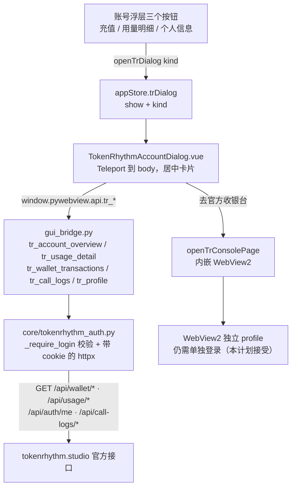

# 基元律动账号「充值 / 用量明细 / 个人信息」原生弹窗开发计划

- **日期**：2026-10-22
- **状态**：待实施
- **范围**：`core/tokenrhythm_auth.py`、`gui_bridge.py`、`frontend/src/stores/appStore.ts`、`frontend/src/components/TokenRhythmAccountDialog.vue`、`frontend/src/components/TokenRhythmAccountPanel.vue`、`frontend/src/types/pywebview.d.ts`，以及对应测试
- **不改动**：会话加密存储格式、登录流程、模型网关调用链

---

## 一、背景与目标

上一轮把账号浮层（`TokenRhythmAccountPanel.vue`）的三个按钮「充值 / 用量明细 / 个人信息」改成打开内嵌浏览器（WebView2，`openTrConsolePage`）。实测不可接受：WebView2 使用独立 user-data-dir（`~/.ycode/browser_profile/EBWebView`），与星瑶Code 后端进程的 httpx 会话完全隔离，打开后仍停在登录页，需要**二次登录**才能看到余额与用量。

本计划改为：三个按钮直接打开星瑶Code 内的**居中原生弹窗**，数据由 `gui_bridge.py` 调用 `core/tokenrhythm_auth.py`，复用后端已有的会话 cookie 请求官方 `/api/*`。用户不再跳浏览器、不再二次登录；只有在后端从未登录过（会话文件缺失）时，才需要先走一次星瑶Code 的登录弹窗。

**目标**

1. 三个按钮 → 居中弹窗，全程不出现浏览器窗口。
2. 充值视图展示可用余额、冻结金额、临时额度、最近流水；用量视图展示分时用量与调用日志；个人信息视图展示账号资料。
3. 未登录时弹窗给明确登录引导（不无限转圈），一次登录后持久化，重启免登录。

---

## 二、事实核查表

| # | 事实 | 证据 | 影响 |
|---|------|------|------|
| 1 | `~/.ycode/secrets/tokenrhythm_session.json` 不存在，该目录下只有 `hunyuan_builtin_key.txt` | `Test-Path $env:USERPROFILE\.ycode\secrets\tokenrhythm_session.json` 返回 `False`；目录列表仅 `hunyuan_builtin_key.txt` | 后端没有持久化会话，新起进程取不到账号数据，必须登录一次后由 `_save_session()` 落盘 |
| 2 | `tokenrhythm_binding.json` 不存在 | `Test-Path $env:USERPROFILE\.ycode\tokenrhythm_binding.json` 返回 `False` | 未绑定专属 Key，不能靠 binding 里的 Key 走 `/v1` 侧查询余额 |
| 3 | `config.json` 中没有任何 `base_url` 含 `tokenrhythm.studio` 的 provider | `~/.ycode/config.json` 的 `providers[]` 逐项检查：`example.invalid`、`127.0.0.1:8080/v1`、`apihub.agnes-ai.cn/v1`、`open.bigmodel.cn/api/paas/v4` 等，均不含 `tokenrhythm.studio`（文件中 `tokenrhythm.studio` 仅出现在 `cache_keepalive_routes`，第 3 行） | 本地没有可复用的基元律动 Key 走 `/v1` 查询，账号数据只能来自会话 cookie 调 `/api/*` |
| 4 | 内嵌浏览器 profile 里存在 `https_tokenrhythm.studio_0.indexeddb.leveldb` | 路径 `~/.ycode/browser_profile/EBWebView/Default/IndexedDB/https_tokenrhythm.studio_0.indexeddb.leveldb` | 登录痕迹在 WebView2 profile 内，后端进程读不到；反证「用内嵌浏览器」路线无法共享登录态 |
| 5 | 有两个 `gui_main.py` 进程在跑 | `Get-CimInstance Win32_Process`：PID 1004、PID 24472，命令行均为 `"…\venv\Scripts\python.exe" .\gui_main.py` | 登录态可能只存在于运行中 GUI 进程的内存里；文档与联调都要以「后端进程会话」为准，不能凭浏览器已登录就认为接口可用 |

**结论**：`/api/wallet/*`、`/api/usage/*`、`/api/auth/me`、`/api/call-logs/*` 全部依赖会话 cookie。若账号浮层长期停在「正在加载…」且余额为空，说明后端会话不存在，需要在星瑶Code 登录弹窗登录一次；登录成功后 `_save_session()`（`core/tokenrhythm_auth.py:127`，DPAPI 加密写入）会持久化会话文件，此后重启免登录。这也是本计划坚持「原生弹窗 + 后端会话」而非「内嵌浏览器」的根本原因。

---

## 三、现状核对（2026-10-22 实读，实施前请先复核）

工作区为 `dev` 分支，基元律动相关文件多为未跟踪（`??`）或在改（`M`）。实读结果如下，**执行者动手前必须先跑一遍下面的核对命令**，避免重复实现或挂出第二个弹窗实例：

| 层 | 已存在的实现 | 位置 |
|----|--------------|------|
| 后端 | `usage_detail` / `wallet_transactions` / `call_logs` / `user_profile` 四函数已存在，`__all__` 已收录 | `core/tokenrhythm_auth.py:1166 / 1188 / 1206 / 1155`，`__all__` 在文件末尾 |
| 后端 | 常量 `_CALL_LOG_PAGE_PATH`、`_WALLET_TXN_PATH` 已存在 | `core/tokenrhythm_auth.py:1139 / 1140` |
| 桥 | `tr_account_overview` 及 `tr_profile` / `tr_usage_detail` / `tr_wallet_transactions` / `tr_call_logs` 已存在 | `gui_bridge.py:10418 / 10636 / 10644 / 10660 / 10673` |
| 类型 | 四个 `tr_*` 声明已在 d.ts | `frontend/src/types/pywebview.d.ts:1413-1416` |
| 状态 | `trDialog` 状态、`openTrDialog` / `closeTrDialog` 已存在 | `frontend/src/stores/appStore.ts:931 / 2367 / 2381` |
| 组件 | `TokenRhythmAccountDialog.vue` 已存在（596 行，Teleport + 三视图） | `frontend/src/components/TokenRhythmAccountDialog.vue` |
| 接线 | 浮层三个按钮已改为 `store.openTrDialog(...)` | `frontend/src/components/TokenRhythmAccountPanel.vue`（操作区按钮行，原计划指的 70-72 行附近） |
| 挂载 | 弹窗挂在 **Sidebar**，不在 Panel 内 | `frontend/src/components/Sidebar.vue:363`（import 在 593 行） |

**两份缺口（本次实施真正要补的）**

1. 缺 `frontend/src/components/TokenRhythmAccountDialog.test.ts`（组件测试未覆盖弹窗三态与三视图）。
2. 文档口径与代码现状不一致：Panel 内**不要**再挂一份 `<TokenRhythmAccountDialog />`，否则会与 `Sidebar.vue:363` 重复实例化；若坚持放 Panel 内，必须先删掉 Sidebar 里的那一份。

> 若执行时发现上述文件被回滚，则按第四、五、六章的规格从零实现；若已存在，则按第七章逐条**核对并补齐差异**，括号内的行号仅作定位参考。

---

## 四、架构



数据流要点：

- **唯一入口**：三个按钮只改 `store.trDialog.kind`，由弹窗内部的 `watch` 触发加载；按钮本身不发请求。
- **唯一出口**：所有请求经 `gui_bridge.py` 的 `tr_*` 同步桥方法（前端 `await` 后拿到 `{ok, ...}`），前端不直接 `fetch` 官方域名，避免 CORS 与 cookie 暴露。
- **鉴权只在一处**：`core/tokenrhythm_auth.py` 的 `_require_login()` 统一判断会话，未登录抛 `TokenRhythmAuthError`，由桥转成 `{ok: False, msg}`。
- **收银台是旁路**：只有「去官方收银台」按钮走内嵌浏览器，属于已知妥协（见第八章备选 B）。

---

## 五、后端改造

### 5.1 常量

在 `core/tokenrhythm_auth.py` 约 780 行的常量区（现有 `_WALLET_PATH`、`_USAGE_TODAY_PATH`、`_ME_PATH` 附近）补齐：

```python
_USAGE_PANEL_PATH = "/api/usage/panel"
_WALLET_TRANSACTIONS_PATH = "/api/wallet/transactions"
_CALL_LOGS_PATH = "/api/call-logs/page"
```

> 现状提示：`_CALL_LOG_PAGE_PATH`、`_WALLET_TXN_PATH` 已在 1139/1140 行存在。落地时统一为一套命名，不要留下同义常量两份。

### 5.2 四个新函数

放在 `account_overview()`（约 1044 行）之后、`__all__` 之前，并加入 `__all__`：

`"user_profile", "usage_detail", "wallet_transactions", "call_logs"`

#### `usage_detail(range_key="today")`

- 时间范围白名单：`today / 1h / 3h / 3d / 7d / 14d / 30d / all`；传入非法值**回退 `today`**，不抛错（前端 chip 传错不应白屏）。
- 请求 `_USAGE_PANEL_PATH`，带 `range` 参数。
- 字段归一：计数一律走 `_as_int(value, default)`；金额一律走 `_amount_text(value)`，**保持字符串**。
- 返回结构：`{"range": <实际生效的 range>, "summary": {...}, "series": [...]}`。

#### `wallet_transactions()`

- **无参 GET**。该接口是严格 schema，多传 `page`/`page_size` 会直接 400，因此不暴露分页参数。
- 返回 `{"items": [...], "total": int}`。
- 每条流水字段：`transactionId`、`type`、`direction`、`status`、`amountCny`、`giftDeltaCny`、`description`、`occurredAt`。
- 金额字段保持字符串（`_amount_text`），缺失时给 `"0.00"` 之类的稳定文本，不返回 `None` 让前端崩。

#### `call_logs(page=1, page_size=20)`

- 入参夹紧：`page = max(1, _as_int(page, 1))`；`page_size` 夹到 `1..100`。
- `modelId` 取值优先级：`actualModelId` → `requestModelId` → `modelId`（前两个常为空，必须逐级回退）。
- 返回 `{"list": [...], "total": int, "page": int, "pageSize": int}`。

#### `user_profile()`

- 直接复用已有的 `_fetch_user_profile()`，不重复请求逻辑、不新增字段解析。
- 返回值直接透出，供「个人信息」视图渲染昵称、手机号（打码在前端做）、邮箱、状态、注册时间、用户 ID。

### 5.3 全局约束

- **金额全程 `str`**：任何一层都不得转 `float`，避免 `0.1 + 0.2` 和精度截断。
- **只读**：四个函数只发 GET，不实现任何 POST/写操作。
- **日志脱敏**：`logger` 不得打印余额数值与手机号，只允许打印 path、状态码、耗时。
- **未登录**：入口先调 `_require_login()`，失败抛 `TokenRhythmAuthError`（不要 `return {"ok": False}`，保持与既有函数一致）。

### 5.4 `gui_bridge.py`

在 `tr_account_overview`（约 10418 行）后新增四个方法：

- `tr_usage_detail(range_key)`、`tr_wallet_transactions()`、`tr_call_logs(page, page_size)`、`tr_profile()`
- 统一返回 `{ok: True, ...}` 或 `{ok: False, msg}`；`except` 写法与 `tr_account_overview` 完全一致（捕获 `TokenRhythmAuthError` 给中文提示，捕获 `Exception` 给通用提示），便于前端只判 `ok`。
- 不在此层做字段归一（归一属于 core），桥层只做「调用 + 包装」。

### 5.5 `frontend/src/types/pywebview.d.ts`

补四个声明（现状已在 1413-1416 行）：

```ts
tr_profile(): Promise<{ ok: boolean; data?: Record<string, any>; reason?: string; msg?: string }>;
tr_usage_detail(range?: string, page?: number, page_size?: number): Promise<{ ok: boolean; data?: Record<string, any>; reason?: string; msg?: string }>;
tr_wallet_transactions(page?: number, page_size?: number): Promise<{ ok: boolean; data?: Record<string, any>; reason?: string; msg?: string }>;
tr_call_logs(page?: number, page_size?: number, status?: string): Promise<{ ok: boolean; data?: Record<string, any>; reason?: string; msg?: string }>;
```

---

## 六、前端改造

### 6.1 `appStore.ts`

在 `openTrConsolePage`（约 1548 行，现为 1563 行）附近新增：

```ts
trDialog: { show: false, kind: 'recharge' as 'recharge' | 'usage' | 'profile' },
openTrDialog(kind) { this.trDialog.kind = kind; this.trDialog.show = true; this.closeTrAccountPanel(); },
closeTrDialog() { this.trDialog.show = false; },
```

要点：

- `openTrDialog` **必须**同时 `closeTrAccountPanel()`，否则账号浮层和弹窗会叠在一起。
- `openTrConsolePage` 保留不动（收银台旁路仍在用）。
- 加载与错误状态可放在 `trDialog` 内（`loading` / `error` / `data`），由 store 的 `fetchTrDialog()` 统一驱动，组件只渲染。

### 6.2 新组件 `TokenRhythmAccountDialog.vue`

**外壳**

- `<Teleport to="body">`，遮罩 `rgba(0,0,0,.55)`，卡片 `width: 560px`、`max-height: 78vh`，撑满时内容区 `overflow-y: auto`。
- 点遮罩（`@click.self`）关闭；`Esc` 关闭（`keydown` 监听，卸载时移除）。
- 三态：`loading` 显示骨架/转圈，`error` 显示桥返回的 `msg` + 「重试」按钮，成功渲染数据。
- 数据加载：`watch(() => store.trDialog.kind, load, { immediate: true })`，切 tab 自动重取。
- 关闭时清空 `error`，避免下次打开残留上一轮报错。

**recharge 视图**

- 数据源：`tr_account_overview` + `tr_wallet_transactions`。
- 可用余额大字展示；旁边小字显示冻结金额、临时额度与到期时间。
- 最近 10 条流水（时间、类型、金额、状态），金额直接显示字符串。
- 底部说明文案 + 「去官方收银台」按钮 → `store.openTrConsolePage(...)`（明确告知会打开内嵌浏览器，可能需登录）。

**usage 视图**

- 数据源：`tr_usage_detail` + `tr_call_logs`。
- 范围 chips：今日 / 7 天 / 30 天（映射 `today / 7d / 30d`）。
- 四宫格指标：请求数、输入 token、输出 token、花费金额。
- 最近 20 条日志表：时间、模型、输入/输出、耗时、状态；空态给一行提示。

**profile 视图**

- 数据源：`tr_profile` + `tr_auth_status`。
- 首字母头像（昵称首字，无昵称用「基」）、昵称、手机号（中间四位打码）、邮箱、账号状态、注册时间、用户 ID、是否已绑定 Key。

**样式**

- 复用 `TokenRhythmAccountPanel.vue` 的 CSS 变量（`--tr-*` 系列）与圆角、边框、字号梯度；不引入任何新依赖（不装 UI 库、不装日期库）。

### 6.3 `TokenRhythmAccountPanel.vue` 接线

- 三个按钮由 `openConsolePage(...)` 改为 `store.openTrDialog('recharge' | 'usage' | 'profile')`（对应原 70-72 行）。
- `openConsolePage` 方法**保留**（可能被其它入口或测试引用），不要删。
- 弹窗挂载点：**以 `Sidebar.vue:363` 为准**（现状如此），Panel 内不再重复挂载；若改成 Panel 内挂载，必须同步删掉 Sidebar 的那一份。

---

## 七、实施步骤与验收

| 步骤 | 文件 | 验收命令 |
|------|------|----------|
| 1. core 四函数 + `__all__` | `core/tokenrhythm_auth.py` | `.venv\Scripts\python.exe -c "from core import tokenrhythm_auth as t; assert all(hasattr(t,n) for n in ('usage_detail','wallet_transactions','call_logs','user_profile'))"` |
| 2. 四个桥方法 + d.ts 声明 | `gui_bridge.py`、`frontend/src/types/pywebview.d.ts` | `Select-String gui_bridge.py -Pattern "def tr_usage_detail"` 有命中 |
| 3. store + 弹窗 + 按钮接线 | `frontend/src/stores/appStore.ts`、`TokenRhythmAccountDialog.vue`、`TokenRhythmAccountPanel.vue` | `cd frontend; npx vue-tsc -b --pretty false` |
| 4. 后端单测 | `tests/test_tokenrhythm_auth.py`、`tests/test_gui_bridge_tokenrhythm_auth.py` | `.\venv\Scripts\python.exe -m pytest tests/test_tokenrhythm_auth.py tests/test_gui_bridge_tokenrhythm_auth.py -q` |
| 5. 前端组件测试 | `frontend/src/components/TokenRhythmAccountDialog.test.ts`、`TokenRhythmAccountPanel.test.ts` | `cd frontend; npx vitest run src/components/TokenRhythmAccountDialog.test.ts src/components/TokenRhythmAccountPanel.test.ts` |
| 6. 构建 | `frontend/` | `cd frontend; npx vite build` |

**顺序**：1 → 2 → 3 串行（core 定 schema，桥才能包，前端才能调）；4 与 5 在 3 完成后可**并行**；6 最后跑。

**全量回归**：`cd frontend; npx vitest run`，基线 **147 个测试文件 / 1365 个用例全绿**，新增用例只能让数字增加，不允许出现红。

**步骤 5 现状**：`TokenRhythmAccountDialog.test.ts` **尚不存在**，是本次必须新建的文件；`TokenRhythmAccountPanel.test.ts` 已存在。弹窗测试至少覆盖：`loading` 态渲染、`error` 态显示 `msg` 且「重试」可再调桥、三个 `kind` 各自调用正确的桥方法与渲染关键字段、`Esc` 与遮罩点击会 `closeTrDialog()`。

---

## 八、风险与应对

| 风险 | 应对 |
|------|------|
| 会话缺失，弹窗一直转圈或余额为空 | 首次使用先在星瑶Code 登录一次，`_save_session()` 落盘后永久免登录；弹窗错误态必须提示「请先登录基元律动账号」并给登录入口，**不能**只显示转圈 |
| 「去官方收银台」在 WebView2 内仍需登录 | 本计划接受该妥协（充值动作低频）；免登录注入列为备选 B，本期不做 |
| 官方接口字段漂移（改名、嵌套变化） | core 统一归一（`_as_int` / `_amount_text` / `modelId` 三级回退），前端渲染全部做空值容错，缺字段显示占位符而非报错 |
| 严格 schema 接口多传 query 直接 400 | `wallet_transactions()` 无参调用；单测断言实际请求 URL **不含 query**，防止后续有人「顺手」加分页 |

**备选 B（一句话）**：通过 `CoreWebView2.CookieManager.CreateCookie` + `AddOrUpdateCookie` 把后端会话 cookie 注入 WebView2，实现收银台免登录，需要 `core/embedded_browser.py` 暴露 `CoreWebView2` 对象，代价中等，本计划不做。

---

## 九、完成标准

- [ ] 点「充值 / 用量明细 / 个人信息」三个按钮，均弹出**居中弹窗**，全程不出现浏览器窗口。
- [ ] 三块数据均为**真实接口**返回（余额、流水、用量、日志、资料与官方页面一致），无 mock、无硬编码。
- [ ] 未登录时弹窗给出**明确的登录引导**（文案 + 可操作入口），不出现无限 loading。
- [ ] `vue-tsc` 无错误；后端 pytest、前端 vitest 全绿（不低于 147 文件 / 1365 用例基线）；`vite build` 成功。
- [ ] GUI 实测：三个 tab 可自由切换，`Esc`、点遮罩、关闭按钮均可关闭，关闭后再次打开状态干净（无残留报错）。
