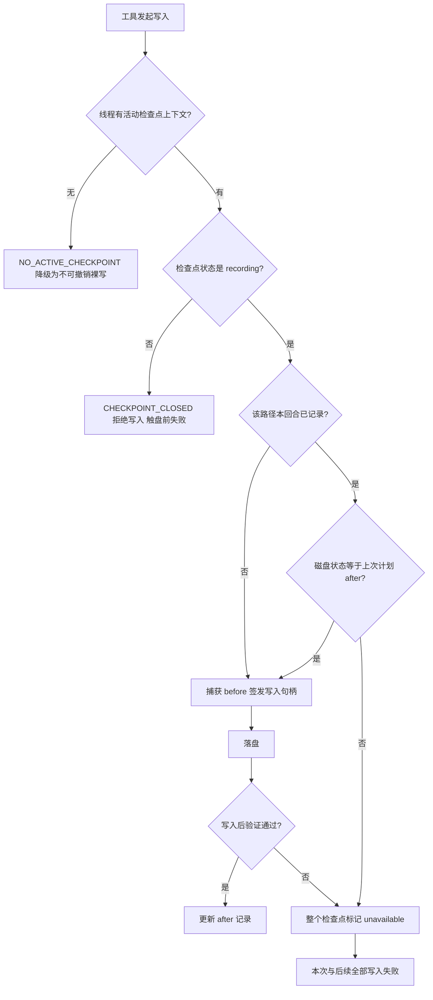

# 按回合撤销：检查点判死导致整回合写入封锁 · 根因与修复方案

> 文档日期：2026-10-29
> 事故会话：`小说模块显示只有这么简陋`（会话 817，回合 `44451dc5a6ac41a1a043f5066d975d0c`）
> 状态：已修复（2026-10-30 实施，方案 A/B/C/D 已落地，见第 10 节实施记录）

---

## 0. 结论摘要

| 项目 | 结论 |
| --- | --- |
| 现象 | 一个回合跑到中途后，所有写文件工具（write_file / edit_file / 图片落盘 / 小说建书）统一返回「该回合的撤销检查点已封闭，迟到的写入已被拒绝」，直到用户开启新回合 |
| 直接原因 | 写入前预检（`prepare_mutation`）发现某个已记录文件的磁盘内容与上次计划 after 不一致，直接把**整个检查点**置为 `unavailable`，此后该回合所有写入在触盘前被拒 |
| 诱发条件 | 同一工作区 `d:\fengchenhao\ycode\xingyao-y-code` 上同时有 3~5 个会话的回合在并行写同一批文件，各回合的撤销记录互相看不见对方 |
| 定性 | 不是崩溃，也不是文件系统故障；是「按回合撤销」的 fail-closed 策略**粒度过粗** + 缺工作区写入互斥 + 报错不可读，属于设计缺陷级 bug |
| 影响面 | 任何长回合（几十次工具调用、多个子代理）只要中途有并发写入或命令副作用改到已记录文件，就会整段丧失写入能力；本轮小说工作台 P4~P6 的前端实现就是被这一条全部挡掉的 |
| 修复优先级 | P0 文件级冲突降级 → P1 工作区写入互斥 → P2 错误可读与降级出口 → P3 泄漏检查点回收 |

---

## 1. 事故复盘（真实数据，可直接复现）

### 1.1 时间线

| 时间（本地） | 事件 |
| --- | --- |
| 16:12:02 | 会话 817 回合开始，创建检查点 `ckpt-7c856881f4ea44419d97a27fd35f61e1`，状态 `recording` |
| 16:16:11 ~ 16:38:18 | 会话 814 的回合 `05d3e01d` 在同一目录并行运行，同为 `recording`，收尾时 `unavailable` |
| 16:24:44 | 会话 809 的回合 `0d4e320e` 在同一目录开始，**至今仍是 `recording`**（未正常封闭） |
| 16:27 ~ 16:46 | 会话 817 内正常写入 `core/novel_service.py`、`tests/test_novel_*.py`、`gui_bridge.py`、`frontend/src/types/pywebview.d.ts`，记录版本累加到 115 |
| 16:43:09 ~ 17:09:44 | 会话 818 的回合 `01e9ccfd` 在同一目录并行运行 |
| **16:50:02** | 会话 817 一次 `prepare_mutation` 判定「文件与上一计划状态不一致」，检查点被置为 `unavailable`（`completed_at_ms` 就是这一刻） |
| 16:50 ~ 17:05 | 该回合内后续所有写入（含 P4/P5/P6 与两次子代理）全部被 `CHECKPOINT_CLOSED` 拒绝 |
| 17:05:23 | 用户另起会话 820 继续任务，检查点重新 `recording` |
| 17:05:52 | 会话 821（当前）继续排查，写入通道正常 |

### 1.2 数据库取证

数据库：`%USERPROFILE%\.ycode\ycode_gui.db`（SQLite），检查点表 `turn_undo_checkpoints`，文件记录表 `turn_undo_files`。

```sql
-- 目标检查点的真实状态
SELECT checkpoint_id, session_id, turn_id, status,
       datetime(started_at_ms/1000,'unixepoch','localtime')   AS started,
       datetime(completed_at_ms/1000,'unixepoch','localtime') AS completed,
       last_error_code, last_error_message, record_version
FROM turn_undo_checkpoints
WHERE checkpoint_id = 'ckpt-7c856881f4ea44419d97a27fd35f61e1';
```

实际返回：

```
status               = unavailable
started_at           = 2026-10-29 16:12:02
completed_at         = 2026-10-29 16:50:02
last_error_code      = checkpoint_unavailable
last_error_message   = prepare 时发现文件与上一计划状态不一致（可能被外部修改）
record_version       = 115
```

同一工作区的并发回合（证明「并行写同一目录」不是推测）：

```sql
SELECT session_id, turn_id, status, description,
       datetime(started_at_ms/1000,'unixepoch','localtime')   AS started,
       datetime(completed_at_ms/1000,'unixepoch','localtime') AS completed
FROM turn_undo_checkpoints
WHERE workspace_root = 'd:\fengchenhao\ycode\xingyao-y-code'
  AND started_at_ms BETWEEN 1793260800000 AND 1793265000000   -- 16:00 ~ 17:10
ORDER BY started_at_ms;
```

会话 817 / 814 / 809 / 818 的区间互相重叠，`turn_undo_files` 中都能查到对 `gui_bridge.py`、`frontend/src/types/pywebview.d.ts` 等同一路径的记录，且各自记录的 `after_sha256` 互不相同。

### 1.3 磁盘与记录的偏差（证明「有人绕过本回合记录写了文件」）

把 `turn_undo_files.after_sha256` 对应的 blob（`%USERPROFILE%\.ycode\undo_blobs\<前两位>\<sha>`）与磁盘现状比对：

| 文件 | 记录 after | 磁盘现状 | 差异内容 |
| --- | --- | --- | --- |
| `gui_bridge.py` | `9da681abe68d` | 不同（多 1944 字节） | 多出 `run_novel_audit()` 方法与 `/skill` 提示词拼接段落 |
| `tests/test_novel_bridge.py` | `6e112f49b576` | 不同（多 3111 字节） | 多出整段测试 |
| `tests/test_novel_service.py` | `31a29a1bd59e` | 不同 | `overdue` 后插入 `planned_overdue` 断言 |
| `core/novel_service.py` | `ccff3a623eb5` | 一致 | — |
| `frontend/src/types/pywebview.d.ts` | `da1fcc821bc3` | 一致 | — |
| `_scratch_check.py` | `67c5acc7ec1d` | **文件已不存在** | 记录为 regular_file |

这些差异内容全部是本轮改造的产物（`run_novel_audit`、`planned_overdue` 都是本会话计划里的东西），说明写入确实落了盘，但没有进入 817 这一份检查点的记录——要么记在别的会话的检查点里，要么走的是「无活动检查点降级写入」。

---

## 2. 代码路径与机制

### 2.1 写入链路



### 2.2 关键函数

| 位置 | 职责 | 现状问题 |
| --- | --- | --- |
| `core/turn_undo/recorder.py:418-423` | `prepare_mutation` 中途外部改动检测 | 命中即 `_mark_unavailable`，把整回合判死 |
| `core/turn_undo/recorder.py:625-655` | `_mark_unavailable` | 只改 checkpoint.status，不区分「单文件冲突」与「整回合不可撤销」 |
| `core/turn_undo/recorder.py:388-394` | 状态非 `recording` 时拒绝签发句柄 | 抛 `CHECKPOINT_CLOSED`，不带触发原因 |
| `core/turn_undo/recorder.py:673` | `verify_after_mutation` 验证失败 | 同样整回合判死 |
| `core/turn_undo/recorder.py:731` | 验证结果落库失败 | 整回合判死（这一条合理，可保留） |
| `core/turn_undo/recorder.py:857-912` | `close_turn` 收尾 | 任一文件 `verified_at_ms IS NULL` 或 blob 缺失 → 整回合 `UNAVAILABLE` |
| `core/turn_undo/coordinator.py:74-79` | `register_active_turn` | **只登记不拦截**，写入路径从不检查同目录是否已有别的活跃回合 |
| `core/turn_undo/transaction.py:188-253` | `preview_revert` 逐文件冲突检测 | 这里已经是文件级 `FileConflict` + `CONFLICTED` 语义，与写入期不一致 |
| `core/turn_undo/storage.py:937-948` | `set_file_undo_result_locked` | 文件级结果字段 `undo_result` / `undo_error_code` 已存在但写入期从未使用 |
| `core/tools.py:734-745`、`1593`、`2485` | 工具层错误映射 | 只对 `no_active_checkpoint` 降级，其余一律硬失败且不带文件名 |
| `core/hunyuan_image.py:164-169`、`core/novel_service.py:327` | 其他写入入口 | 同上 |

---

## 3. 根因拆解

### R1 冲突判定口径过宽

`_state_matches_disk`（`recorder.py:565-577`）只比较 `kind / size / sha256`。任何外部写入——另一个会话、用户手动编辑、命令副作用、`_scratch_check.py` 这类临时文件被删除——都会命中。判定本身没错，错在这个判定结果被当成了「整回合不可撤销」的罪证。

### R2 惩罚粒度过粗（核心问题）

`prepare_mutation` 发现单文件冲突后：

```python
if not _state_matches_disk(planned, canonical_path):
    _mark_unavailable(storage, ctx,
        reason="prepare 时发现文件与上一计划状态不一致（可能被外部修改）")
    raise TurnUndoError(UndoErrorCode.FILE_CONFLICT, ...)
```

`_mark_unavailable` 把 checkpoint 从 `recording` 推到 `unavailable`。之后任何写入在 `recorder.py:388-394` 直接抛 `CHECKPOINT_CLOSED`。**一个文件的一次不一致，报销整个回合剩余的全部工作**。

### R3 缺工作区写入互斥

`WorkspaceCoordinator` 有 `workspace_lock`（RLock）和 `_active_turns`，但：

- `workspace_lock` 只在单次 prepare→写入→verify 的短区间持有，多个回合可以交错写入；
- `active_turn_id` 只在撤销/恢复路径被读取（`transaction.py:478`、`recovery.py:381`），**写入准备路径完全不检查**；
- `register_active_turn` 是覆盖式登记（同一 root 后来的回合直接覆盖前一个），不是借用式。

所以多会话并发写同一目录是系统允许的，但撤销记录模型假设「一个回合独占这个目录」。两者矛盾，冲突必然发生。

### R4 报错不可读、无恢复出口

工具层只回一句「检查点已封闭（unavailable），拒绝新写入句柄」，没有：

- 哪个文件冲突；
- 什么时间发生；
- 为什么（外部修改 / 并发会话 / 临时文件被删）；
- 除了「重新发起新回合」还有什么办法。

模型只能反复重试，用户只能看着它失败。

### R5 与既有设计不一致

`transaction.py:188-253` 的 `preview_revert` 已经实现了**文件级**冲突语义：逐文件生成 `FileConflict`，检查点转 `CONFLICTED`（该状态在 `models.py:27-40` 中本来就存在，且允许重新预检）。写入期却退化成检查点级 `UNAVAILABLE`。同一个「文件状态不一致」，两套处理方式，说明写入期这条路径没有跟上撤销层已经成熟的粒度设计。

---

## 4. 修复方案

### 方案 A（P0）：写入期冲突降级为文件级

**目标**：单个文件状态不一致只影响该文件的撤销保证，不再封锁回合。

**改动点**

1. `core/turn_undo/recorder.py` `prepare_mutation`（418-423 行）
   - 命中冲突时不再调用 `_mark_unavailable`；
   - 改为把该文件记录标记为「放弃撤销」并继续签发句柄：
     ```python
     if existing is not None and not _state_matches_disk(planned, canonical_path):
         with storage._manager._lock:
             cursor = storage.conn.cursor()
             storage.set_file_undo_result_locked(
                 cursor,
                 file_id=existing.file_id,
                 undo_result="skipped",
                 undo_error_code=UndoErrorCode.FILE_CONFLICT,
             )
             storage.conn.commit()
         # 仍允许本次写入：before 重新按当前磁盘捕获，after 以本次内容重新记录，
         # 该文件从此退出本回合的撤销范围
     ```
   - 注意：退出撤销范围后，**本次写入仍需捕获新的 before**，否则同一文件后续再写会再次命中同一条冲突。实现上建议走「重置该文件记录」的路径（更新 before 为当前磁盘、清空 verified、标注 skipped），而不是直接复用旧行。
2. `core/turn_undo/recorder.py` `verify_after_mutation`（673 行）
   - 验证失败同样只标记该文件 `skipped`，不判死整回合；本次工具调用仍然返回失败（因为无法保证写入结果），但后续写入可用。
3. `core/turn_undo/recorder.py` `close_turn`（883-891 行）
   - 把 `undo_result == "skipped"` 的文件排除在「未验证 → UNAVAILABLE」判定之外；
   - 全部文件都被跳过时回合状态仍为 `READY`（可撤销文件为空，UI 显示「本回合无可撤销修改」）；部分跳过时建议转 `CONFLICTED`，让撤销预检走既有的文件级冲突分支。
   - `blob` 缺失仍保留 `UNAVAILABLE`（快照真的丢了，撤销保证无法兑现，这一条语义正确）。
4. `core/turn_undo/transaction.py` `preview_revert`
   - 构建 `files` 列表时跳过 `undo_result == "skipped"` 的记录，并在 `TurnUndoPreview` 的 `skipped` 字段中列出这些路径（若结构体没有该字段，加 `skipped: tuple[str, ...] = ()`）。
5. 工具层文案（`core/tools.py:734-745`、`1593`、`2485`；`core/hunyuan_image.py:164`；`core/novel_service.py:327`）
   - `FILE_CONFLICT` 不再等同于「检查点封闭」，提示改为：「文件 X 在本回合内被外部修改，已退出本回合撤销范围，写入继续；该文件不可通过本回合撤销还原」。

**状态机影响**：`RECORDING` 期间不再出现 `UNAVAILABLE`（除非落库失败等真正的严重错误）；`CONFLICTED` 复用既有语义，无需新增枚举。

**风险**：撤销一个回合时，可能有文件被静默跳过。必须在 preview 里显式列出 skipped 文件，让用户在点「撤销」前看到。

**验收**：同一回合内 A 写 `f.py` → 外部改 `f.py` → A 再写 `f.py` 成功，且 `turn_undo_files.undo_result='skipped'`；A 继续写 `g.py` 成功并被正常记录；撤销该回合时 `f.py` 出现在 skipped 列表、`g.py` 正常还原。

---

### 方案 B（P1）：工作区写入互斥

**目标**：从源头避免多个回合同时写同一目录。

**改动点（二选一，建议 B2）**

- **B1 排队**：`service.begin_turn` 在 `register_active_turn` 前检查 `active_turn_id(root)`；已有活跃回合时阻塞等待（带超时），超时后回合以 `workspace_busy` 失败并提示用户。
  - 风险：多会话并行体验显著变差；长回合会把其他会话全部堵死。
- **B2 快速失败（推荐）**：`prepare_mutation` 在 `_require_active_context` 之后增加：
  ```python
  active = coordinator.active_turn_id(ctx.workspace_root)
  if active and active != ctx.turn_id:
      raise TurnUndoError(
          UndoErrorCode.WORKSPACE_BUSY,
          f"该目录正在被另一个回合写入（turn {active[:8]}），请等待其完成或换一个工作目录",
      )
  ```
  工具层把 `WORKSPACE_BUSY` 映射成「可重试」提示（模型会自行等待/重试，而不是整段失效）。
  - 注意：`ctx.owner_kind == background_task` 的情况要放行（后台任务有独立检查点、按设计允许并发），或在登记时把后台任务计入「同源」白名单。
- **B3 会话级写锁（折中）**：同一 session 内允许，不同 session 之间互斥。对应 `coordinator` 增加 `session_id` 维度登记。

**验收**：两个会话同时对同一文件发起写入，只有一个成功，另一个收到 `WORKSPACE_BUSY` 且回合不被判死。

---

### 方案 C（P2）：错误可读性与降级出口

**目标**：让模型和用户知道发生了什么、能怎么办。

**改动点**

1. `TurnUndoError.detail` 在冲突时带上 `{"file": ..., "reason": ..., "occurred_at_ms": ...}`；`_mark_unavailable`/冲突分支把 detail 写进 `last_error_message`。
2. 工具层错误文案统一带文件名与时间（现在只有错误码）。
3. 增加会话级配置 `turn_undo.unrecorded_write_policy`：
   - `deny`（默认，现有行为）；
   - `warn`（本次写入不记录撤销，工具返回成功但附带警告）；
   - `allow`（silent）。
   由用户在设置页或 `/undo` 面板选择。注意这是**知情同意**的降级，不能默认开。
4. 检查点 `unavailable` 时，在会话 UI 上给一条可见提示：「本回合撤销保证已失效（原因：文件 X 被外部修改），后续写入仍可继续」，而不是让模型自己去撞墙。

**验收**：工具报错文本包含文件路径、原因、恢复建议；用户能在 UI 上看到该回合撤销状态的变化。

---

### 方案 D（P3）：泄漏检查点回收

**目标**：清理异常中断留下的 `recording` 检查点。

**背景**：会话 809 的 `ckpt-2c95744bc43c490eb354cdbb598d9aa0`（turn `0d4e320e`，16:24:44 开始）至今仍是 `recording`。该工作区的撤销/恢复会被 `active_turn_id` 永久阻塞为 `workspace_busy`（`service.py:137` 的注释已明确这个风险）。进程重启后内存登记会清空，但数据库里仍是 `recording`，启动扫描应当处理。

**改动点**：`core/turn_undo/recovery.py` 启动扫描增加一条：`status='recording'` 且 `started_at_ms` 超过阈值（如 6 小时）且所属 session 无运行中回合的检查点，标为 `UNAVAILABLE`（`unavailable_code='stale_recording'`）。同时 `finish_turn` 的异常路径已覆盖进程内异常，剩下的是进程被杀/崩溃的场景。

**验收**：模拟写一条 6 小时前的 `recording` 记录，重启后自动转 `unavailable`，撤销预检不再报 `workspace_busy`。

---

## 5. 测试计划

### 5.1 单元测试（新增）

文件：`tests/test_turn_undo_recorder.py`

| 用例 | 断言 |
| --- | --- |
| `test_prepare_conflict_marks_file_skipped` | 外部改动已记录文件后再次 prepare，不抛 `CHECKPOINT_CLOSED`；该文件 `undo_result='skipped'` |
| `test_prepare_conflict_keeps_checkpoint_recording` | 冲突后 checkpoint.status 仍为 `recording` |
| `test_subsequent_write_after_conflict_succeeds` | 冲突发生后写另一个文件成功且被记录 |
| `test_verify_failure_only_skips_file` | verify 失败后同回合后续写入可用 |
| `test_close_turn_with_skipped_file_status` | 全部跳过 → `READY`；部分跳过 → `CONFLICTED` |

文件：`tests/test_turn_undo_transaction.py`

| 用例 | 断言 |
| --- | --- |
| `test_preview_lists_skipped_files` | preview 返回 skipped 列表，且不把 skipped 文件纳入还原计划 |
| `test_revert_ignores_skipped_file` | 撤销后 skipped 文件保持当前内容，其余文件正常还原 |

文件：`tests/test_turn_undo_tool.py`

| 用例 | 断言 |
| --- | --- |
| `test_write_file_after_conflict_not_blocked` | 冲突后下一次 `write_file` 返回成功 |
| `test_workspace_busy_from_other_turn` | 另一 turn 活跃时写入收到 `workspace_busy`，回合不判死 |

### 5.2 集成回归

```powershell
python -m pytest tests/test_turn_undo_recorder.py tests/test_turn_undo_tool.py tests/test_turn_undo_transaction.py tests/test_turn_undo_lifecycle.py tests/test_turn_undo_recovery.py -q
python -m pytest tests/test_novel_service.py tests/test_novel_bridge.py -q
npm run build   # frontend/
```

### 5.3 手工验证（真实并发场景）

1. 开两个会话，工作目录都指向同一仓库；
2. 会话 A 触发一个长任务，中途写 `gui_bridge.py`；
3. 会话 B 同时写 `gui_bridge.py`；
4. 观察 A：写入应成功（文件级 skipped）或收到 `workspace_busy`，**不得出现检查点封闭**；
5. A 继续写其他文件，应正常；
6. 对 A 执行撤销预检，skipped 文件应在列表中明确显示。

---

## 6. 验收标准

- [ ] 单文件冲突后，同一回合后续写入成功率 100%（不再出现整回合 `unavailable`）
- [ ] `turn_undo_files.undo_result` 能准确标出被跳过的文件
- [ ] 撤销预检返回 skipped 列表，撤销执行不会误改这些文件
- [ ] 多会话并发写同一目录时，其中一个收到可重试的 `workspace_busy`，而不是判死
- [ ] 工具错误文本包含文件路径与原因
- [ ] 启动扫描能回收超过阈值仍为 `recording` 的检查点
- [ ] 全量 turn_undo 测试通过，`npm run build` 通过

---

## 7. 风险与回滚

| 风险 | 说明 | 缓解 |
| --- | --- | --- |
| 撤销不完整 | 用户以为撤销了整个回合，实际有文件被跳过 | preview 强制展示 skipped 列表；UI 二次确认 |
| 状态机扩展 | 新增 `skipped` 结果值可能影响旧数据读取 | 保持字段可空，老数据视为未跳过；不加新枚举状态 |
| 互斥导致排队 | 方案 B1 会让多会话串行，长回合阻塞其他会话 | 选 B2 快速失败，让模型自行重试 |
| 回归面 | `prepare_mutation` 是全部写工具的唯一入口 | 改动集中在 recorder，先跑全量 turn_undo 套件；保留 `unrecorded_write_policy=deny` 作为回滚开关 |

回滚方式：本文所有改动都在 `core/turn_undo/`（外加工具层文案），不改前端数据结构；回滚只需恢复 `recorder.py` / `transaction.py` / `coordinator.py` 三个文件，并把 `unrecorded_write_policy` 保持 `deny`。

---

## 8. 临时规避（不改代码，当前就能用）

1. **同一个项目只开一个会话写作**，其他会话看完就关；尤其是多条长任务不要并行跑同一目录。
2. 长任务里**少用 execute_command 改文件**（`git checkout`、`git stash`、格式化工具、构建产物生成），这些都会让已记录文件「变成外部修改」。
3. 一旦看到「撤销检查点已封闭」，**立刻停止重试**，让用户发一条新消息（新回合）继续；在同一回合内重试一百次也不会恢复。
4. 临时文件（`_scratch_check.py` 之类）不要在同一回合里「创建 → 删除 → 再创建」；`_scratch_check.py` 现在已经不存在但记录仍在，就是活例子。
5. 需要撤销保证的长回合，拆成多个短回合（每个回合结束都是一次检查点收尾）。

---

## 9. 附带发现

1. **会话 809 的检查点泄漏**：`ckpt-2c95744bc43c490eb354cdbb598d9aa0` 从 16:24:44 起一直是 `recording`，说明该回合未走 `finish_turn`（进程被杀或异常退出）。运行期会把该工作区的撤销/恢复阻塞为 `workspace_busy`。对应方案 D。
2. **小说工作台前端未落地**：后端接口已在 `gui_bridge.py:4212`（`get_novel_workbench`）、`4230`（`read_novel_doc`）、`4248`（`run_novel_audit`），但 `frontend/src/` 下只有旧版 `NovelPane.vue`（781 行，10-29 09:36），没有任何新工作台组件，也没有调用这三个接口。用户看到的「简陋」就是旧版面板。
3. **`turn_undo_files` 已具备文件级结果字段**（`undo_result` / `undo_error_code`，`storage.py:136`），`set_file_undo_result_locked`（`storage.py:937`）也已经写好并在撤销成功路径使用。方案 A 不需要改表结构。

---

## 10. 实施记录（2026-10-30）

### 10.1 实际改动

| 文件 | 改动 |
| --- | --- |
| `core/turn_undo/models.py` | 新增 `UNDO_RESULT_SKIPPED = "skipped"`；`TurnUndoPreview` 增加 `skipped_files` 字段（默认空元组，向后兼容） |
| `core/turn_undo/recorder.py` | `prepare_mutation` 冲突不再判死整回合，改为同事务把该文件标记 skipped 并继续写入；`verify_after_mutation` 失败同样只跳过该文件；`close_turn` 跳过 skipped 文件的完整性校验，全部 skipped 时收敛为 `NO_CHANGES`；新增 `_ensure_workspace_writable`（方案 B）并在 `prepare_mutation` 入口调用；`CHECKPOINT_CLOSED` 消息携带 `last_error_message` 与 detail（方案 C） |
| `core/turn_undo/transaction.py` | `preview_revert` 跳过 skipped 文件并填充 `skipped_files`；`file_count` 改为可撤销文件数；全部 skipped 时抛 `CHECKPOINT_UNAVAILABLE`；`execute_revert` 的指纹集合与恢复计划均排除 skipped；撤销只创建可撤销文件的 operation 记录 |
| `core/turn_undo/recovery.py` | 启动扫描回收超过 6 小时仍为 `recording` 的检查点（`unavailable_code="stale_recording"`，方案 D） |
| `core/tools.py` | `write_file` / `edit_file` / `fetch_image` 增加 `workspace_busy` 分支：返回"该目录正在被另一个回合写入，请稍后重试"，不再误报"检查点已封闭" |
| `core/hunyuan_image.py` | 同上，图片写入路径增加 `workspace_busy` 分支 |
| `tests/test_turn_undo_*.py` | 新增 9 个用例并改写 2 个断言旧行为的用例（冲突/验证失败不再判死整回合） |

### 10.2 与方案的差异（实现时确认后调整）

1. **`close_turn` 全部 skipped 时用 `NO_CHANGES` 而不是 `CONFLICTED`**：`CHECKPOINT_TRANSITIONS` 里 `RECORDING` 只能转 `READY/NO_CHANGES/UNAVAILABLE`，且「全部不可撤销」在语义上等价于没有可撤销修改，用 `NO_CHANGES` 不需要扩展状态机。
2. **部分 skipped 时回合状态保持 `READY`**：skipped 文件被排除后，剩余文件都能正常撤销；冲突信息通过 `preview.skipped_files` 单独暴露，避免 `CONFLICTED` 语义（"结束状态不一致，无法撤销"）被滥用。
3. **方案 B 落地为「快速失败」**（B2）：`prepare_mutation` 发现同目录有其它活跃回合时抛 `WORKSPACE_BUSY`，回合保持 `recording`，模型重试即可；后台任务检查点不参与互斥。
4. **方案 C 只落地了错误可读性（C1/C2）**，未加 `unrecorded_write_policy` 配置项：没有设置页入口前，该开关只会让"不可撤销写入"悄悄发生，风险大于收益。等 UI 有承载位置再补。
5. **`TurnUndoPreview` 的 `skipped_files` 通过 `dataclasses.asdict` 自动进入 `gui_bridge.preview_turn_undo` 的返回值**，前端无需额外适配（字段缺省时为空数组）。

### 10.3 验证结果（本轮真实执行）

```
python -m pytest tests/test_turn_undo_*.py -q
→ 104 passed, 2 skipped

python -m pytest tests/test_tools.py tests/test_novel_service.py tests/test_novel_bridge.py tests/test_novel_e2e.py -q
→ 300 passed

cd frontend; npm run build
→ built in 19.66s（仅 chunk 体积告警，无类型错误）
```

### 10.4 已知边界

- 工作区互斥依赖 `WorkspaceCoordinator` 的进程内登记：进程崩溃后登记随进程消失，不会误锁；但同一进程内某回合异常未走 `finish_turn` 时，其登记会残留到进程退出（方案 D 的启动回收处理的是数据库侧，内存登记需重启）。
- skipped 文件的 `before` 快照仍保留在内容仓库（供审计），但不再参与撤销；GC 会按引用回收。
- 撤销预检展示层（前端）尚未消费 `skipped_files` 字段，需要前端在撤销卡片里提示"以下文件因回合内被外部修改未纳入撤销"。

