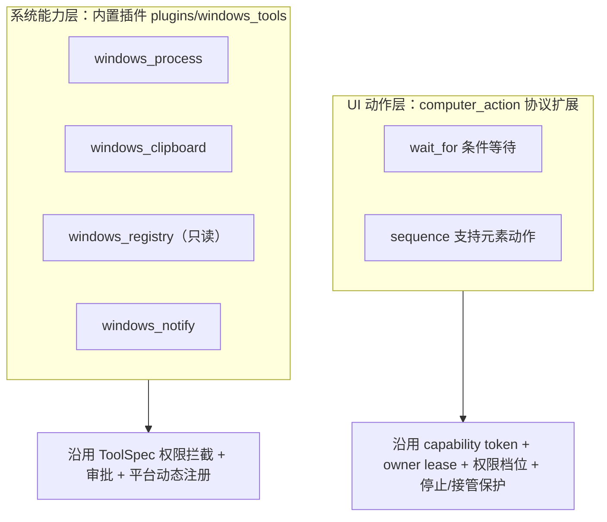

# Windows-MCP 能力对齐设计（零体积增量）

- 日期：2026-11-09
- 状态：待评审
- 关联：`core/computer/`、`plugins/`、`tests/test_prompt_byte_stability.py`

## 1. 背景与目标

用户希望「安装星瑶后即可直接使用电脑操控」，并希望对齐 `CursorTouch/Windows-MCP`
的能力。硬约束是**安装包体积不变**（当前 `dist/ycode` 基线 126.0 MB）。

调研结论：

1. 星瑶的 `core/computer/` 已经用 `comtypes` 直连 `UIAutomationCore`
   （`core/computer/platforms/windows_elements_uia.py:24`），与 Windows-MCP 同一套
   技术底座，已有 21 个动作。
2. Windows-MCP 要求 `requires-python >= 3.14`，依赖 `fastmcp`、`dxcam`、`posthog`、
   `numpy` 等（本机实测均未安装）。整包内嵌需再冻结一份 Python 运行时，
   预估增加 60~120 MB，且会引入第二套重复的工具语义。
3. 因此采用「吸收增量能力」而非「内嵌 MCP 本体」：目标能力全部落在已有依赖
   （`comtypes` / `psutil` / `pywin32`）与标准库（`winreg` / `ctypes`）内，
   **零新增依赖、零体积增量**。

## 2. 非目标

- 不引入 `fastmcp`、`dxcam`、`posthog`、`markdownify` 等新依赖。
- 不改变现有 21 个动作的字段、语义与错误码。
- 不提供注册表写入/删除（安全面过大，v1 只读）。
- 不替代现有 `observe` / `click_element` 体系，只做增量。

## 3. 能力差距

| Windows-MCP 能力 | 星瑶现状 | 本设计处理 |
|---|---|---|
| `WaitFor` 条件轮询 | 只有固定 `wait` 毫秒 | 新增 `wait_for` 动作 |
| `MultiSelect` / `MultiEdit` | `sequence` 不支持元素动作 | `sequence` 白名单加入元素动作 |
| `Process` list/kill | 仅 `execute_command` 间接 | 插件 `windows_process` |
| `Clipboard` 文本 | 仅剪贴板图片 | 插件 `windows_clipboard` |
| `Registry` 读 | 无 | 插件 `windows_registry`（只读） |
| `Notification` Toast | 无 | 插件 `windows_notify` |
| `DisplayInventory` | `list_surfaces` 已含候选几何 | 不新增（现有能力覆盖） |
| `Screenshot` 快速快照 | `observe` 已含截图 | 不新增 |

## 4. 架构分层



分层依据：UI 动作必须与现有 `click` / `type_text` 共享 Turn capability、owner lease
与用户接管状态，否则会绕过「用户已停止」「用户正在操作」的保护，所以扩展
`computer_action` 的 `kind` 白名单；系统能力与视觉模型无关，不应被
`supports_vision` 卡住，因此做成插件并由 `ToolSpec` 继承权限体系。

## 5. 详细设计

### 5.1 `wait_for`（desktop only）

新增 `ComputerActionKind.WAIT_FOR = "wait_for"`。

字段（`_ALLOWED["wait_for"]`）：

| 字段 | 类型 | 约束 | 说明 |
|---|---|---|---|
| `condition` | string | 必填，枚举 | `text_exists` / `element_exists` / `element_enabled` / `window_active` |
| `text` | string | 1~200 字符 | `text_exists` 必填，子串匹配（大小写不敏感） |
| `window_name` | string | 1~200 字符 | `window_active` 必填；其余条件可选作范围限定 |
| `element_ref` | string | 非空 | `element_exists` / `element_enabled` 必填 |
| `timeout_ms` | int | 1000~30000，默认 8000 | 总等待上限 |
| `interval_ms` | int | 100~2000，默认 300 | 轮询间隔 |

**关键实现约束**：`RealUIAHost.collect()` 会整体替换 `self._elements`
（`windows_elements_uia.py:131`），旧 `el-N` 立即过期。因此 `wait_for` 的轮询
**不得复用 `collect()`**，必须新增只读查询方法：

```python
class RealUIAHost:
    def probe(self, hwnd: int, predicate) -> dict | None:
        """在 COM 线程内遍历树并匹配条件，只返回脱敏摘要，不写 self._elements。"""
```

行为：

- 轮询循环每 `interval_ms` 调一次 `probe`，每次迭代检查 `owner.cancel_event`
  与 `stop_notice.is_user_stop_active()`，命中即抛 `computer_cancelled` /
  `computer_user_stopped`，绝不空转到超时。
- 条件满足 → 走与 `observe` 相同的截图与元素收集流程，返回正常
  `ComputerObservation`（模型拿到新画面，可直接继续操作）。
- 超时 → 抛 `ComputerControlError("computer_wait_timeout", ...)`，message 提示
  「条件未在 N ms 内出现，可改 observe 检查当前画面或调整条件」，模型可据此换策略。
- `element_exists` / `element_enabled` 条件从现有 `_elements` 映射按 `element_ref`
  只读查找（只读 `CurrentName` / `CurrentIsEnabled`，不重建映射，不改编号）。
- `probe` 返回的匹配摘要（kind/name/bounds）不携带可用 ref，避免与 ref 生命周期
  耦合；需要点击命中元素时，模型随后调用 `list_elements` 取新 ref。
- 总等待时间计入 controller 的 `wait_ms` 计时字段，不混入输入耗时。

### 5.2 `sequence` 支持元素动作

`_SEQUENCE_STEP_KINDS` 增加 `click_element` 与 `set_value_element`，让模型能把
「点按钮 → 填输入框 → 回车」按元素引用一次打包，减少往返。

约束：

- `list_elements` / `observe` 仍不得进入 sequence（会刷新 ref 或改变观察基线）。
- 子步骤的 `element_ref` 必须在 sequence 开始前有效；任一子步骤抛
  `computer_element_stale` 时整条 sequence 立即失败，不静默跳过。
- `MAX_SEQUENCE_STEPS` 仍为 10。

### 5.3 内置插件 `plugins/windows_tools`

目录结构（与 `plugins/office` 同构）：

```
plugins/windows_tools/
  plugin.json   # {"name":"windows_tools","version":"0.1.0","entry":"plugin.py","enabled":true}
  plugin.py     # def register(registry)
```

**平台动态注册**：`register()` 内先判断 `sys.platform != "win32"` 则直接返回，
不注册任何工具——避免在 macOS/Linux 上白占 tools schema 字节。

四个工具：

| 工具 | 关键参数 | `read_only` | `requires_permission` | `side_effect_scope` |
|---|---|---|---|---|
| `windows_process` | `mode=list/kill`、`filter`、`sort_by`、`limit`、`pid`、`name`、`force` | False | kill=True / list=False | `system` |
| `windows_clipboard` | `mode=get/set`、`text` | False | set=True / get=False | `system` |
| `windows_registry` | `mode=get/list`、`path`、`name`、`view` | True | False | `none` |
| `windows_notify` | `title`、`message` | False | False | `none` |

实现要点：

- `windows_process` 走 `psutil`（已在 `requirements.txt:9`），`kill` 前校验
  PID 存在且不是当前进程/父进程，拒杀 `System Idle Process`、`System`、
  `csrss.exe` 等关键进程，返回稳定错误码 `windows_process_protected`。
- `windows_clipboard` 文本读写走 `ctypes` 调 `user32`/`kernel32`
  （`OpenClipboard` / `GetClipboardData(CF_UNICODETEXT)`），不新增依赖；
  读取失败统一返回「剪贴板暂无文本」而不是抛栈。
- `windows_registry` 只用标准库 `winreg`；路径必须以
  `HKEY_CURRENT_USER\`、`HKEY_LOCAL_MACHINE\` 或 `HKEY_CLASSES_ROOT\` 开头，
  拒绝相对路径、`..` 与空路径；`mode=set/delete` 直接返回「本版本不提供写入」。
- `windows_notify` 用 `win32api` 创建临时托盘图标并发气球通知
  （`Shell_NotifyIconW`）后可立即销毁；失败时降级为返回提示文本，
  不重试、不阻塞回合。
- 所有工具在 `YCODE_TOOL_PROFILE == "cli"` 时不注册（与电脑操控的 CLI 禁用口径
  一致）。

### 5.4 提示词与 schema 同步

- `COMPUTER_ACTION_TOOL_SCHEMA` 的 `kind` 枚举与 description 增补 `wait_for`
  说明，长度控制在新增 200 字以内。
- `system_prompt.md` / `system_prompt_gui.md` 的电脑操控段落补充「条件等待优先
  用 wait_for，不要用 wait 加反复 observe 轮询」。
- `tests/test_prompt_byte_stability.py` 的黄金字节按流程重新固化，并在提交信息
  中注明这是有意的协议扩展，不是为通过测试而改实现。

### 5.5 打包

- `plugins/` 目录已作为 datas 原样拷入安装包（`ycode.spec:66`），新增插件目录
  自动进包，无需改 spec。
- 新插件只依赖标准库与 `psutil`，后者已被 core 使用并已在依赖中，**不新增任何
  `collect_all`**。
- 验收标准：构建前后 `dist/ycode` 总体积差 < 1 MB。

## 6. 安全

- `wait_for` 只读，不改变界面状态。
- `windows_registry` 只读；写入/删除在 v1 直接拒绝并说明原因。
- `windows_process` 的 kill 走审批（`requires_permission=True`），并内置关键进程
  保护；`side_effect_scope="system"`。
- `windows_clipboard` 的 set 会覆盖用户剪贴板，走审批。
- 所有动作沿用现有权限档位（`core/app_context.py` 的线程级绑定）与 owner lease，
  不新增旁路。

## 7. 测试

| 层 | 文件 | 覆盖 |
|---|---|---|
| 解析 | `tests/test_computer_actions_parse.py` | `wait_for` 字段严格校验、未知字段拒绝、超时/间隔边界 |
| 后端 | `tests/test_computer_windows_backend.py` | `wait_for` 命中/超时/取消；`probe` 不写 ref 表 |
| 序列 | 同上 | sequence 含元素动作的成功与 stale 失败 |
| 插件 | `tests/test_plugin_windows_tools.py`（新增） | 平台门控、只读标记、注册表路径白名单、保护进程拒绝 |
| 字节 | `tests/test_prompt_byte_stability.py` | 重新固化的黄金字节 |
| 打包 | `build_release.py` + 体积对比 | `dist/ycode` 增量 < 1 MB |

## 8. 分期

- P0：本设计文档评审通过。
- P1：`wait_for` 协议扩展（actions/models/backend/controller）+ 测试。
- P2：`sequence` 元素动作扩展 + 测试。
- P3：`plugins/windows_tools` 四个工具 + 测试。
- P4：提示词同步、黄金字节固化、构建与体积验收。

P1/P2/P3 之间无文件冲突，可在不同分支或同一分支按序提交；P4 必须最后做。

## 9. 风险与回滚

| 风险 | 缓解 |
|---|---|
| `wait_for` 轮询阻塞回合 | 单次上限 30s，每轮检查 cancel_event；不引入后台线程 |
| UIA 在部分应用（Chromium 自定义控件）匹配不到 | 错误码明确提示改用 observe + 元素列表，不静默成功 |
| 插件工具增加 tools schema 字节 | 仅 Windows 注册；四个工具描述合计控制在约 400 字 |
| 注册表读取泄露敏感配置 | 只读 + 路径白名单 + 结果长度上限 4000 字符 |
| 回滚 | 新增 kind 与插件均为纯增量，删除对应代码/目录即可回到当前行为；黄金字节随版本提交 |

## 10. 验收

1. 在 Windows 本机用视觉模型跑通：`wait_for(text_exists)` 命中后直接
   `click_element`，不出现 ref 失效。
2. `sequence` 一次打包「点搜索框 → 输入 → 回车」成功。
3. 四个插件工具在审批、只读标记、平台门控上行为符合第 5.3 节。
4. `venv\Scripts\python -m pytest tests/test_computer_*.py tests/test_plugin_windows_tools.py tests/test_prompt_byte_stability.py` 全绿。
5. 构建后 `dist/ycode` 体积增量 < 1 MB。