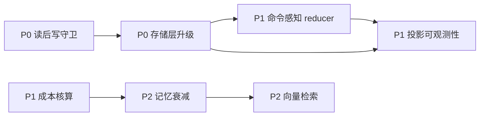

# OpenSquilla 可借鉴方案（面向星瑶 Y-code）

> 调研日期：2026-10-22
> 调研对象：`TokenRhythm/opensquilla` v0.5.6（main 分支 tarball，19.2 MB，不含 LFS 模型资产）
> 对照对象：星瑶 Y-code 1.3.7（当前 dev 分支）

## 0. 精读范围

实际读过的源码（非仅文档）：

| 模块 | 文件 | 关键内容 |
| --- | --- | --- |
| 工具结果存储 | `engine/tool_result_store.py`（792 行） | 内容寻址句柄、gzip、8MB/条上限、256MB 磁盘预算、7 天 TTL、原子写、文件锁 |
| 工具结果投影 | `engine/session_sanitize.py`、`engine/tool_result_query.py`、`engine/tokenjuice_adapter.py` | head/tail 投影、字符页与行查询、reducer 适配与失败降级 |
| 投影规则库 | `plugins/tokenjuice/rules/**`（build/cloud/database/devops/archive 等分类） | 命令感知的结构化 reducer |
| 写保护 | `tools/write_tracking.py`（895 行）、`tools/mutation_receipts.py` | 读后写守卫、sha256 指纹、变更回执 |
| 路由 | `engine/route_plan.py`、`squilla_router/controller.py`、`router_tiers.py` | 不可变 RoutePlan、observe-only、执行腿分离、T0-T3 分层控制 |
| 成本 | `engine/usage_accounting.py`、`engine/pricing.py` | nanos 计价、定价缓存、provider 收据校验 |
| 记忆 | `memory/retrieval.py`、`memory/store.py` | 向量 + 关键词 + 时间衰减 + 来源保护 |
| 沙箱 | `sandbox/run_context.py`、`sandbox/capability_service.py` | 挂载/域名/一次性授权、workspace binding 证明 |

未精读：`engine/agent.py`（17283 行）、`engine/runtime.py`（14800 行）这两个巨型文件只做了函数级定位，未逐段通读。

## 1. 结论

星瑶在**工具结果治理**上的起点比预期高：`core/tool_result_maintenance.py` 已经实现了两级水位线（snip → elide）、决策单调、尾部保护区（8000 token）、marker 幂等、错误结果不改写、可逆折叠（SQLite 归档 + `tool_result_read`）。这套设计和 OpenSquilla 的 tool compression 是同一思路。

所以真正值得抄的不是「有没有」的问题，而是 OpenSquilla 在这套机制上多做了三层：**内容寻址的存储层**、**命令感知的投影规则**、**投影自身的可观测性**。

按投入产出排序，建议做 6 项，不做 4 项（见第 8 节）。

| 优先级 | 方案 | 预计改动量 | 收益 |
| --- | --- | --- | --- |
| P0 | 读后写守卫 | 新增 1 文件 + 2 处接入，约 150 行 | 直接消灭「基于过期内容改文件」这类事故 |
| P0 | 工具结果存储层升级 | 改 `memory.py` schema + 新增 store，约 300 行 | 防 DB 膨胀、句柄可校验、跨会话复用 |
| P1 | 命令感知 reducer | 新增 1 文件 + 约 12 条规则，约 400 行 | 日志类结果再省 30%~60% token |
| P1 | 成本核算 | 新增 1 文件 + 1 张表，约 200 行 | `/usage` 从「多少 token」变成「多少钱」 |
| P1 | 投影可观测性 | 改统计口径，约 80 行 | 能证明治理有效，可回滚坏规则 |
| P2 | 记忆向量检索 + 时间衰减 | 改 `memory.py` 检索路径，约 350 行 | 记不住「换个说法就搜不到」的问题 |

---

## 2. P0：读后写守卫（fresh read guard）

### OpenSquilla 做法

`tools/write_tracking.py` 的 `require_fresh_workspace_file_read()`：

1. 写操作进入前，从 `ToolContext.workspace_file_read_state` 查该文件的读取记录；
2. 没读过 → 抛 `RetryableToolInputError`，提示「先用 read_file 完整读一遍再重试」；
3. 读过 → 对比 `size` 与 `sha256`，与读取时不一致则报「文件已变化，重读」；
4. 命中以下条件时跳过：full host access 模式、无 workspace、scratch 目录内、`file_edit_requires_fresh_read` 关闭、目标文件不存在（新建场景）。

### 星瑶现状

`core/tools.py:608 write_file`、`core/tools.py:2632 edit_file` 都没有这道检查。`edit_file` 靠字符串匹配失败后的相似度兜底，`write_file` 对大文件有行数拒绝，但都不校验「模型看到的内容是否还是最新」。

### 改造方案

新增 `core/fresh_read_guard.py`：

```python
"""写前新鲜度守卫：保证模型修改的是它读过的那一版文件。"""

import hashlib
import threading
from pathlib import Path

_LOCK = threading.Lock()
# (session_id, 绝对路径) -> {"size": int, "sha256": str}
_READ_STATE: dict[tuple[str, str], dict] = {}

MAX_TRACKED = 4096


def _fingerprint(path: Path) -> dict:
    data = path.read_bytes()
    return {"size": len(data), "sha256": hashlib.sha256(data).hexdigest()}


def record_read(session_id: str, path: str, *, full_read: bool) -> None:
    """read_file 成功返回后调用；只有整文件读取（无 offset/limit）才登记。"""
    if not full_read:
        return
    p = Path(path).resolve(strict=False)
    if not p.is_file():
        return
    try:
        fp = _fingerprint(p)
    except OSError:
        return
    with _LOCK:
        if len(_READ_STATE) >= MAX_TRACKED:
            _READ_STATE.clear()
        _READ_STATE[(session_id, str(p))] = fp


class StaleReadError(RuntimeError):
    """可重试的输入错误：模型应先重读文件。"""


def require_fresh_read(session_id: str, path: str, *, tool_name: str, skip: bool) -> None:
    if skip:
        return
    p = Path(path).resolve(strict=False)
    if not p.exists():
        return  # 新建文件不校验
    with _LOCK:
        state = _READ_STATE.get((session_id, str(p)))
    if state is None:
        raise StaleReadError(
            f"{tool_name} 修改已有文件前必须先完整读取：{path}。"
            f"请用 read_file 不带 offset/limit 读一遍后重试。"
        )
    try:
        current = _fingerprint(p)
    except OSError:
        return
    if current["sha256"] != state["sha256"]:
        raise StaleReadError(
            f"{path} 在读取后已发生变化（可能被外部改动）。请重新读取后再修改。"
        )
```

接入点：

- `core/tools.py` 的 `read_file` 返回前调用 `record_read(...)`，`full_read` 判断条件为「未传 offset 且未触发大文件截断」；
- `edit_file` / `write_file` 入口调用 `require_fresh_read(...)`，`skip` 判断条件为「权限模式为 full」或「沙盒已开放且目标在工作目录外」。

错误分类要与星瑶现有约定一致：`StaleReadError` 走「可重试的工具输入错误」通道，让模型看到提示后自行重读，而不是当成致命失败。

### 风险

- 子代理共享主会话时，session_id 必须是父会话 ID，否则子代理读完主代理改不了。
- `read_file` 的大文件截断分支不能登记，否则会误判为「已读全」。

### 验证

在 `tests/` 新增 `test_fresh_read_guard.py`：未读即改、读后外部改、读后正常改、full 模式跳过、新建文件放行，共 5 个用例。

---

## 3. P0：工具结果存储层升级

### OpenSquilla 做法

`engine/tool_result_store.py`，要点：

| 机制 | 实现 |
| --- | --- |
| 句柄 | `tr-` + sha256 前 32 hex（128 bit），内容寻址 |
| 去重 | 同内容同 session 直接复用，仅 touch 访问时间 |
| 落盘 | `content.txt`，超过阈值写 `content.txt.gz` |
| 预算 | 单条 8MB，整库 256MB，超预算按 LRU 淘汰 |
| 保留 | 7 天 TTL，`_remove_expired` 主动清理 |
| 并发 | `_atomic_write_bytes` + 文件锁 + `output.lease` 租约 |
| 流式 | `open_output_spool` 支持命令边跑边落盘，`read_output_preview` 边写边读 |

### 星瑶现状

`core/memory.py:655` 的表：

```sql
CREATE TABLE tool_result_archive (
    handle TEXT PRIMARY KEY,     -- secrets.token_hex(4)，8 位，32 bit
    session_id INTEGER NOT NULL,
    msg_id INTEGER,
    tool_name TEXT,
    bytes INTEGER NOT NULL,
    content TEXT NOT NULL,       -- 全文直存，无压缩
    created_at TEXT
)
```

问题：

1. 句柄 32 bit，同会话内够用，但**无法跨会话去重**，也没有完整性校验字段；
2. 全文以 TEXT 直存，`execute_command` 输出 50MB 会直接写进主库，撑大 DB 并拖慢 VACUUM；
3. 只有手动 `prune_tool_result_archive`，没有自动 TTL 与总量预算；
4. `tool_result_read` 的 `full` 模式一次最多 20 万字符，没有字符偏移分页。

### 改造方案

保留 8 位句柄作为**对外契约**（模型已经习惯 `#ab12cd34` 这个格式，不能改），在内部加一层内容寻址。

#### 3.1 Schema 演进

```sql
-- 新增列（幂等 ALTER，沿用 memory.py 现有加列写法）
ALTER TABLE tool_result_archive ADD COLUMN sha256 TEXT;
ALTER TABLE tool_result_archive ADD COLUMN stored_bytes INTEGER;
ALTER TABLE tool_result_archive ADD COLUMN encoding TEXT DEFAULT 'utf-8';  -- utf-8 | gzip+base64
ALTER TABLE tool_result_archive ADD COLUMN accessed_at TEXT;

CREATE UNIQUE INDEX IF NOT EXISTS idx_tool_result_archive_dedup
ON tool_result_archive(session_id, sha256) WHERE sha256 IS NOT NULL;

CREATE INDEX IF NOT EXISTS idx_tool_result_archive_accessed
ON tool_result_archive(accessed_at);
```

`sha256` 为空的旧记录按「未纳入去重」处理，读路径不受影响。

#### 3.2 写入策略

在 `core/memory.py` 归档写入处（当前 `INSERT OR IGNORE`，约 3965 行）前置一个决策函数：

```python
COMPRESS_THRESHOLD_BYTES = 256 * 1024     # 超过 256KB 压缩
SINGLE_RECORD_LIMIT_BYTES = 8 * 1024 * 1024
ARCHIVE_BUDGET_BYTES = 256 * 1024 * 1024  # 整库预算
ARCHIVE_TTL_DAYS = 7

def encode_payload(raw: bytes) -> tuple[str, str, int]:
    """返回 (落库文本, 编码标记, 存储字节数)。超限时降级为 head+tail 摘要存储。"""
    if len(raw) > SINGLE_RECORD_LIMIT_BYTES:
        head = raw[:SINGLE_RECORD_LIMIT_BYTES // 2]
        tail = raw[-SINGLE_RECORD_LIMIT_BYTES // 2:]
        return (
            head.decode("utf-8", "replace")
            + f"\n\n[... {len(raw)} 字节超过单条上限，中间部分未归档 ...]\n\n"
            + tail.decode("utf-8", "replace"),
            "truncated",
            SINGLE_RECORD_LIMIT_BYTES,
        )
    if len(raw) > COMPRESS_THRESHOLD_BYTES:
        return (base64.b64encode(gzip.compress(raw)).decode("ascii"), "gzip+base64", len(raw))
    return (raw.decode("utf-8", "replace"), "utf-8", len(raw))
```

`get_tool_result_archive` 读取时按 `encoding` 反解，对外仍返回 `content` 字符串，`tools.tool_result_read` 无需改动。

#### 3.3 自动回收

在 `idle_maintenance.py`（星瑶已有空闲维护线程）挂一个任务：

```python
def sweep_tool_result_archive(manager) -> dict:
    removed_expired = manager.prune_tool_result_archive(keep_days=ARCHIVE_TTL_DAYS)
    removed_overflow = _evict_lru_until_budget(manager, ARCHIVE_BUDGET_BYTES)
    return {"expired": removed_expired, "evicted": removed_overflow}
```

LRU 淘汰按 `accessed_at` 升序删除，且**跳过最近 1 小时访问过的记录**，避免删掉正在用的句柄。

#### 3.4 句柄语义

- 对外：继续 8 位，但由 `sha256[:8]` 派生，同内容天然同句柄（会话内）；
- 冲突：8 位截断碰撞时，检测到 `sha256` 不同则回退随机 8 位并记一条 warning；
- 完整性：`tool_result_read` 返回时带 `sha256` 前 12 位，方便排查「取回的是不是原文」。

### 兼容与迁移

- 旧记录 `encoding` 默认 `utf-8`，`sha256` 为 NULL，照常可读；
- 不重建表，只用 `ALTER TABLE ADD COLUMN`，与 `memory.py` 现有迁移风格一致；
- 迁移在 `_ensure_schema` 内完成，失败不阻断启动（星瑶已有静默忽略的加列先例）。

### 验证

- 单条 50MB 输出：写入后 DB 体积增长受控，`tool_result_read` 可 head/tail/grep；
- 同内容重复归档两次：`SELECT COUNT(*)` 仍为 1；
- 预算淘汰：灌入超过 256MB 后，最旧记录被删、最近 1 小时内的保留；
- 旧库升级：构造 v1 表数据，升级后读取正常。

---

## 4. P1：命令感知 reducer

### OpenSquilla 做法

`plugins/tokenjuice/` 是一套规则驱动的工具输出投影：

- `rules/build/*.json`（tsc、vite、webpack、gradle、maven、go-build、cargo…）
- `rules/devops/*.json`（docker-build、docker-compose、kubectl…）
- `rules/database/*.json`（psql、mysql、sqlite3、redis-cli…）
- `rules/cloud/*.json`（aws、gcloud、gh、vercel…）
- `matcher.py` 负责把命令行解析成 argv，判断「这段输出到底属于哪条命令」，并处理 shell 复合命令、`env` 前缀、`bash -c` 重解析等边界；
- `formatters.py` 提供 `strip_ansi` / `trim_empty_edges` / `dedupe_adjacent` / `head_tail` / `count_pattern` 等原子操作；
- 投影失败一律返回 `None`，**绝不让投影失败影响回合**。

### 星瑶现状

`_SNIP_STRATEGIES` 按工具名给固定几何：

```python
"execute_command": (60, 20, 30, 2000, 12000),
"read_file":       (200, 150, 10, 4000, 30000),
```

同一套 head/tail 打在 `pytest` 输出、`npm install` 输出、`docker build` 输出上，重复行（几百行 `PASSED`、几百行 `npm http fetch`）全部保留。

### 改造方案

新增 `core/tool_output_reducer.py`，只做三件事：剥 ANSI、折叠相邻重复行、按规则保留关键行。

```python
"""命令感知的工具输出投影：在 snip 之前先做结构化压缩。"""

import re
from dataclasses import dataclass

_ANSI = re.compile(r"\x1b\[[0-9;?]*[ -/]*[@-~]")

@dataclass(frozen=True)
class ReducerResult:
    text: str
    reducer: str
    original_chars: int


def strip_ansi(text: str) -> str:
    return _ANSI.sub("", text)


def dedupe_adjacent(lines: list[str], *, max_repeat_keep: int = 2) -> list[str]:
    """连续重复行折叠成 '... (xN)'，只保留前 max_repeat_keep 行。"""
    out, i, n = [], 0, len(lines)
    while i < n:
        j = i
        while j + 1 < n and lines[j + 1] == lines[i]:
            j += 1
        run = j - i + 1
        if run > max_repeat_keep:
            out.extend(lines[i:i + max_repeat_keep])
            out.append(f"... (上一行重复 {run - max_repeat_keep} 次)")
        else:
            out.extend(lines[i:j + 1])
        i = j + 1
    return out


# 规则：命令特征 -> (必须保留的正则, 丢弃的正则, head, tail)
_RULES = [
    (
        "pytest",
        (r"^(FAILED|ERROR|E\s|={2,}|-{2,}|PASSED|collected|short test summary)", None, 40, 60),
    ),
    (
        "npm",
        (r"(ERR!|error|added \d+ packages|vulnerabilities|npm (ERR|WARN))", r"^\s*$", 30, 20),
    ),
    (
        "go test",
        (r"^(---|=== RUN|FAIL|ok |PASS|\s+\S+\.go:\d+)", r"^(=== RUN)", 40, 60),
    ),
    (
        "docker",
        (r"(^Step \d+|^#[0-9]+ |ERROR|error:|Successfully|DONE)", r"^[0-9a-f]{12}: (Pull|Waiting|Downloading)", 40, 30),
    ),
    (
        "git diff",
        (r"^(diff --git|@@|\+\+\+|---|index )", None, 200, 40),
    ),
    (
        "git status",
        (r"^(On branch|Changes|Untracked|modified:|deleted:|new file:)", r"^\s*$", 80, 10),
    ),
]


def reduce_tool_output(tool_name: str, command: str, text: str) -> ReducerResult | None:
    """返回 None 表示不适用或未产生收益，调用方回退到原有 snip 几何。"""
    try:
        cleaned = strip_ansi(text)
        lines = cleaned.split("\n")

        matched = None
        for keyword, spec in _RULES:
            if keyword in (command or ""):
                matched = (keyword, spec)
                break

        if matched is None:
            # 无规则命中：只做通用折叠
            folded = dedupe_adjacent(lines)
            if len(folded) >= len(lines) * 0.95:
                return None
            candidate = "\n".join(folded)
            if len(candidate) >= len(text):
                return None
            return ReducerResult(candidate, "dedupe", len(text))

        keyword, (keep_re, drop_re, head, tail) = matched
        keep = re.compile(keep_re, re.IGNORECASE)
        drop = re.compile(drop_re, re.IGNORECASE) if drop_re else None
        kept = [ln for ln in lines if keep.search(ln) or not drop or not drop.search(ln)]

        if len(kept) > 200:
            kept = kept[:head] + [f"... (已省略 {len(kept) - head - tail} 行非关键输出)"] + kept[-tail:]
        kept = dedupe_adjacent(kept)
        candidate = "\n".join(kept)
        if len(candidate) >= len(text) * 0.9:
            return None   # 收益不足 10%，不折腾
        return ReducerResult(candidate, keyword, len(text))
    except Exception:
        return None        # 投影永不抛错
```

接入点在 `core/memory.py` 调用 `snip_tool_result` 之前：

```python
reduced = reduce_tool_output(name, command_from_arguments, text)
if reduced is not None:
    text = reduced.text
    # 继续走原有 snip 几何做二次兜底
```

注意：`execute_command` 的参数里没有单独保存 command 字段的话，需要从消息的 `tool_calls` 里取 `arguments.command`；星瑶的 `_tool_call_is_replayable` 一带已经有解析逻辑，可复用。

### 为什么只抄 6 条规则

OpenSquilla 的规则库有上百个 JSON。星瑶的主力场景是编程助手，`pytest` / `npm` / `go test` / `docker` / `git diff` / `git status` 这六类覆盖绝大多数长输出。规则要能被人读懂、能被人改，上百个 JSON 的维护成本会超过收益。

### 验证

- 用真实 pytest/npm 输出样本做 golden 对比，断言「关键行不丢」：FAILED、ERROR、汇总行必须保留；
- 断言投影失败时原文不丢（降级路径）；
- 度量：同一批样本的字符数下降比例，目标 30%~60%。

---

## 5. P1：成本核算

### OpenSquilla 做法

- `usd_to_nanos()` 用整数纳美元计价，避免浮点累积误差；
- `ModelPrice` / `PricingCache` / `ResolvedModelPrice` / `CostEstimate` 四层结构，支持覆盖价、私有价、折扣反算；
- `_receipt_from_*` 系列校验 provider 返回的计费收据，`has_known_provider_usage_receipt()` 区分「provider 自报」与「本地估算」；
- `UsageExecutionContext` 用 contextvar 绑定一次调用的归属（session / turn / agent / channel）。

### 星瑶现状

`core/memory.py:704` 的 `token_usage` 表已经相当完整：`model`、`api_base`、`cache_scope`、`cache_write_tokens`、`date`、`session_id` 都有索引。缺的只有价格与成本派生。

### 改造方案

新增 `core/usage_pricing.py`：

```python
"""模型价格与成本估算：token 用量 -> 金额。"""

from dataclasses import dataclass

NANOS_PER_USD = 1_000_000_000

@dataclass(frozen=True)
class ModelPrice:
    input_nanos_per_token: int
    output_nanos_per_token: int
    cache_read_nanos_per_token: int = 0
    cache_write_nanos_per_token: int = 0

# 内置价目表（每百万 token 的美元价 -> 纳美元/token）
_BUILTIN: dict[str, ModelPrice] = {
    # 键为模型名归一化后的前缀；具体数值由配置文件覆盖
}

def usd_per_mtok_to_nanos(usd: float) -> int:
    return int(round(usd * NANOS_PER_USD / 1_000_000))

@dataclass(frozen=True)
class CostEstimate:
    input_nanos: int
    output_nanos: int
    cache_read_nanos: int
    cache_write_nanos: int
    total_nanos: int
    source: str        # builtin | config_override | unknown

def estimate_cost(model: str, *, input_tokens: int, output_tokens: int,
                  cache_read_tokens: int = 0, cache_write_tokens: int = 0,
                  price: ModelPrice | None = None) -> CostEstimate:
    if price is None:
        return CostEstimate(0, 0, 0, 0, 0, "unknown")
    ...
```

落点：

1. `config.json` 增加可选 `model_prices` 段，未配置时用内置表；
2. `/usage` 增加 `cost` 子命令，按 `token_usage` 聚合后乘价；
3. GUI 用量页增加金额列，未知价格的模型显示 `--` 而不是 0（避免误导）。

### 注意

价格会变，内置表必须带 `version` 和时间戳，并且**允许用户完全覆盖**。绝不把估算值当账单展示，字段名用 `estimated_cost`。

### 验证

- 已知价格 + 已知 token 数，断言纳美元金额精确匹配；
- 未知模型返回 `source="unknown"`、金额 0；
- 缓存读写 token 分别计价，不与输入输出混算。

---

## 6. P1：投影可观测性

### OpenSquilla 做法

`TokenjuiceReduction` 带 `raw_chars` / `reduced_chars` / `ratio` / `reducer`；诊断模式下输出估算节省的 token；`diagnostics on` 后可在诊断面板看到每次投影的命中规则。

### 星瑶现状

`is_snipped` / `is_elided` 只判断状态，没有「省了多少」的度量。

### 改造方案

在 `tool_result_archive` 旁边加一张轻表，或直接在 `messages` 的元数据里记：

```sql
CREATE TABLE IF NOT EXISTS tool_result_governance_stats (
    id INTEGER PRIMARY KEY AUTOINCREMENT,
    date TEXT NOT NULL,
    tool_name TEXT,
    stage TEXT,              -- snip | elide | reduce
    reducer TEXT,            -- 命中的规则名，如 pytest / dedupe
    raw_chars INTEGER,
    final_chars INTEGER,
    saved_tokens INTEGER     -- (raw_chars - final_chars) // 4
)
```

写入点就在现有 snip/elide 事务里（同事务提交，保证统计与改写一致）。`/usage` 增加一行汇总：

```
工具结果治理：本月折叠 1,284 次，估算节省 3.2M tokens（其中命令输出 61%）
```

这条统计的价值在于：**没有它就无法判断某条 reducer 规则是不是在帮倒忙**。

---

## 7. P2：记忆向量检索 + 时间衰减

### OpenSquilla 做法

`memory/retrieval.py`：

- 向量 + 关键词 + 时间范围三路融合；
- `_temporal_decay()`：30 天半衰期，`MEMORY.md` 和 `memory/` 下非日期文件视为 evergreen，不衰减；
- `_is_legacy_memory_capture()`、`is_searchable_source_path()` 做来源保护，避免把历史会话正文当长期记忆；
- `memory/redaction.py` 负责脱敏。

### 星瑶现状

`core/memory.py` 用 FTS5 关键词检索（`_fts_normalize` / `_fts_match_expression` / `_fts_snippet`），没有向量路径，也没有时间衰减。全仓搜索 `embedding|vector|cosine` 无命中。

### 改造方案

分两步，第二步可选：

**第一步（低风险，先做）**：加时间衰减与 evergreen 判定，纯排序逻辑，不动存储。

```python
EVERGREEN_NAMES = {"MEMORY.md"}
HALF_LIFE_DAYS = 30.0

def _decay(score: float, path: str, mtime: float, now: float) -> float:
    if Path(path).name in EVERGREEN_NAMES or "/memory/" in path.replace("\\", "/"):
        return score
    age_days = max(0.0, (now - mtime) / 86400.0)
    return score * (0.5 ** (age_days / HALF_LIFE_DAYS))
```

**第二步（可选）**：接 `sqlite-vec` 或用纯 Python 余弦（记忆条目量级通常 < 1 万，纯 Python 足够）。

- 新增 `memory_embeddings` 表：`path`、`chunk_index`、`vector BLOB`、`model`、`dims`、`updated_at`；
- 嵌入用配置里的 embedding 提供商，副模型机制可以复用；
- 检索时 hybrid：关键词命中给基础分，向量相似度给加权分，最后过时间衰减。

不建议一上来就引 `sqlite-vec` 扩展：星瑶要打包成 Windows 安装包，引入 native 扩展会带来跨平台分发问题。纯 Python 余弦 + 现有 SQLite 更稳。

---

## 8. 不建议照搬的部分

| 项目 | 原因 |
| --- | --- |
| Gateway 常驻服务形态 | 星瑶是进程内助手，改成常驻服务等于换产品，且会引入多用户隔离、鉴权、连接管理一大摊子 |
| contracts 代码生成体系 | `src/opensquilla/contracts` 467 个文件 + datamodel-code-generator + syrupy 快照，是给「多入口共享同一套协议」准备的；星瑶只有一个入口，byte-golden 已够 |
| 全量 tokenjuice 规则库 | 上百个 JSON 规则，维护成本超过收益，抄关键 6 条即可 |
| SquillaRouter 的 ONNX 模型 | 需要训练数据、模型资产、ONNX/LightGBM 运行时，且模型是对方的学术资产，抄不来；但**observe-only 的评估思路**可以抄 |
| Electron 桌面壳 | 星瑶现有 NSIS 向导体积更小、启动更快，换成 Electron 是负优化 |
| 分层 sandbox（Bubblewrap/Seatbelt） | 星瑶跑在 Windows 为主，这套是 Linux/macOS 原生能力，Windows 侧没有等价实现 |

## 9. 实施顺序与验收



建议节奏：

1. 第 1 周：读后写守卫 + 存储层升级（纯后端，风险低，可独立发布）；
2. 第 2 周：命令感知 reducer + 投影可观测性（有统计才能证明收益）；
3. 第 3 周：成本核算（依赖已有 `token_usage` 表，改动小）；
4. 第 4 周起：记忆衰减，向量检索另行评估。

每项完成后的验收底线：

- `python -m pytest tests/ -q` 全绿（星瑶当前 313 个测试文件，新增用例不得破坏现有基线）；
- 新增代码必须有对应的失败路径测试，尤其是「投影失败不影响回合」这条不变量；
- 涉及 schema 变更的，必须验证「旧库升级后读取正常」。

## 10. 一句话总结

星瑶的工具结果治理骨架已经对了，缺的是**存储层的工程化**（内容寻址、体积治理、原子性）、**投影的语义化**（按命令而非按工具）、**决策的可度量**（省了多少、命中什么规则）。这三层补上之后，OpenSquilla 在这块就没有明显领先的地方了。

---

## 附录 A：P0 任务分解（可直接开工）

### A.1 读后写守卫

- [ ] 新建 `tests/test_fresh_read_guard.py`，写 5 个失败用例：未读即改、读后外部改、读后正常改、full 模式跳过、新建文件放行
- [ ] 运行 `python -m pytest tests/test_fresh_read_guard.py -q`，确认全部失败
- [ ] 新建 `core/fresh_read_guard.py`，实现 `record_read` / `require_fresh_read` / `StaleReadError`
- [ ] 运行测试，确认 5 个用例通过
- [ ] 在 `core/tools.py` 的 `read_file` 成功分支接入 `record_read`（仅 full read 登记）
- [ ] 在 `core/tools.py:608 write_file` 与 `core/tools.py:2632 edit_file` 入口接入 `require_fresh_read`
- [ ] 手工验证：新建会话里直接让模型改一个未读过的文件，确认报错信息引导它先读
- [ ] 运行 `python -m pytest tests/ -q`，确认无回归
- [ ] 提交

### A.2 工具结果存储层升级

- [ ] 在 `tests/test_tool_result_archive_store.py` 写失败用例：超大结果压缩、同内容去重、LRU 淘汰、旧库升级后读取
- [ ] 运行测试，确认失败
- [ ] 在 `core/memory.py` 的 schema 初始化处追加 4 个 `ALTER TABLE ADD COLUMN` 与 2 个索引（幂等，失败静默，沿用现有先例）
- [ ] 实现 `encode_payload` / `decode_payload`，接在归档写入与 `get_tool_result_archive` 两侧
- [ ] 把句柄生成改为 `sha256[:8]` 派生，冲突时回退随机值并记 warning
- [ ] 在 `core/idle_maintenance.py` 注册 TTL + 预算淘汰任务
- [ ] 运行测试，确认通过
- [ ] 用真实大输出样本（>8MB 命令行日志）手工验证读写与 DB 体积
- [ ] 运行 `python -m pytest tests/ -q`
- [ ] 提交
