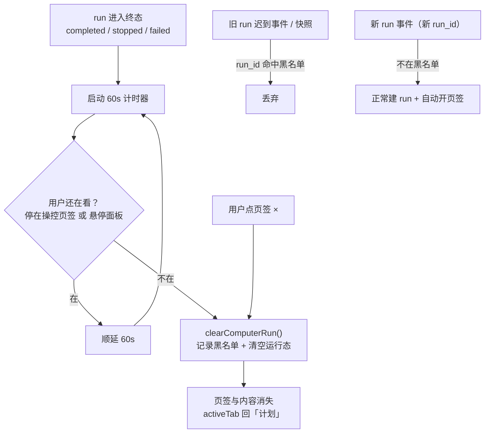

# 电脑操控面板主动关闭 设计文档

**日期：** 2026-09-10
**状态：** 已确认，待实施
**背景：** 用户反馈 Y-code GUI 中电脑操控结束后，右侧「操控」页签与面板内容一直存在、没有任何关闭入口，只能关闭整个右面板或在应用退出后消失。

## 问题与根因

现有实现在 `docs/superpowers/specs/2026-09-02-computer-control-design.md` §16.2 中只定义了「run 结束后保留本次轨迹到下一个 run」，**没有定义「保留何时结束」与「用户如何主动结束保留」**，属于设计缺口而非实现缺陷。

具体链路：

1. `RightPanel.vue` 的 `tabs` 计算属性：只要 `store.computerRun.run_id` 非空，「操控」页签就存在。
2. `appStore.reduceComputerEvent` / `_applyComputerSnapshot` 只在「出现新 run」或「快照切换到不同 run_id」时重置 `computerRun`，**不存在任何清空路径**。
3. 结果：run 的 `run_id` 会一直留在 Store 里，页签与终态内容常驻到应用退出。

附带瑕疵：`ComputerControlPane.vue` 的「立即停止」按钮判据是 `store.computerRun.run_id`，run 已 completed 时仍渲染，点击必然是「当前没有进行中的操控会话」的无效操作。

## 目标

- run 进入终态后 **60 秒自动关闭**（清空运行态 → 页签与内容消失）。
- 页签提供 **× 手动关闭**入口，随时可关。
- 关闭后旧 run 的迟到事件与状态快照 **不得复活页签**。
- 新 run 到达时行为与现状 **完全一致**（自动切到操控页签）。

## 非目标

- 不改后端：Bridge API、事件契约、快照语义、预览服务全部不动。
- 不改顶部安全控制条的可见性规则（终态已自动隐藏）。
- 不引入长期截图或轨迹历史。
- 不改 run 期间的暂停 / 恢复 / 停止逻辑。

## 关键前提（已验证）

1. 页签可见性判据唯一：`store.computerRun.run_id`（`RightPanel.vue:209`）。
2. `appStore.ts` 的 reducer 存在「Store 尚无 run 时首个事件直接认领」分支（`appStore.ts:1888-1892`，用于支持无 `starting` 前导的 action 事件流）。**清空后该分支会把迟到事件当成新 run**，因此必须额外加黑名单门闩。
3. `refreshComputerRun()` 的两个调用点（`App.vue:301` 窗口聚焦、`RightPanel.vue:383` 切到操控页签）都要求 `computerRun.run_id` 非空，清空后不会被自动拉起；但 `_applyComputerSnapshot` 仍需门闩做防御。
4. 前端既有测试：`ComputerControlBar.test.ts`（含 Store reducer 用例）、`ComputerControlPane.test.ts`、`RightPanel.test.ts`。
5. `rightPanelCollapsed` 由顶栏「切换面板」按钮控制（`Topbar.vue:40`），本次不新增面板级开合入口。

## 设计

### 1. Store：可关闭的运行态（`appStore.ts`）

新增记账字段（不参与渲染）：

```ts
_computerClosedRunId: '' as string,
```

新增 action：

```ts
// 用户主动关闭 / 终态自动关闭：记录 run_id 黑名单后清空运行态
clearComputerRun() {
  const runId = this.computerRun.run_id;
  if (!runId) return;
  this._computerClosedRunId = runId;
  this.computerRun = emptyComputerRun();
  this.computerTrace = [];
  this._computerActionStartMs = {};
  this._computerEventSeq = 0;
}
```

门闩：`reduceComputerEvent` 与 `_applyComputerSnapshot` 在解析出 `runId` 之后、任何分支之前插入

```ts
if (runId && runId === this._computerClosedRunId) return;
```

**为什么是单值而不是集合**：终态 run 的事件源在关闭时已经停止，迟到事件窗口极短，只有「最近一次被关闭的 run」需要防复活；用集合属于过度设计（YAGNI）。

`computerLastAutoOpenedRunId` **保持不变**：新 run 的 `run_id` 与旧值不同，自动开页签逻辑无需改动。

### 2. 终态常量（`appStore.ts`）

与 `COMPUTER_BAR_STATUSES` 并列新增：

```ts
const COMPUTER_TERMINAL_STATUSES = ['completed', 'stopped', 'failed'];
```

供页签关闭按钮与自动关闭计时共用，避免两处各写一份状态列表。`idle` 不纳入：`idle` 表示从未有过 run，此时 `run_id` 本就为空。

### 3. 页签 ×（`RightPanel.vue`）

- `tabs` 计算属性的 computer 项携带 `closable: true` 标记，其余页签不带。
- 页签渲染在 `closable` 且状态 ∈ 终态时追加关闭元素：

```html
<span class="rtab-close" data-test="computer-tab-close"
      title="关闭操控面板" @click.stop="closeComputerTab">×</span>
```

- **运行中不渲染 ×**：run 处于活动期时唯一下场手段是「立即停止」，避免误关正在执行的 run。
- 手动关闭与自动关闭共用同一个内部函数 `dismissComputerPane()`，它做三件事：清除自动关闭计时器 → 调用 `store.clearComputerRun()` → 若 `activeTab === 'computer'` 切回 `'plan'`。
  「切回 `'plan'`」两条路径都必要：面板折叠时 `activeTab` 仍可能停在 `'computer'`，页签消失后会让内容区指向不存在的页签。
- 关闭入口只放页签一处，面板头部不重复提供，避免两个入口语义打架。

### 4. 终态 60 秒自动关闭（`RightPanel.vue`）

- 常量 `COMPUTER_AUTO_DISMISS_MS = 60000`。
- `watch([() => store.computerRun.run_id, () => store.computerRun.status])`：进入终态时启动计时器；`run_id` 变化或清空时取消计时器。
- 计时到点做一次判定：**任一条件满足则重置计时器再等 60 秒**，否则调用 `dismissComputerPane()` 关闭。
  1. 用户正停留在操控页签且右面板未折叠（`activeTab === 'computer' && !store.rightPanelCollapsed`）。
  2. 鼠标正悬停在右面板内（`#rightbar` 的 `mouseenter` / `mouseleave` 维护 `panelHovered` ref）。
- `onUnmounted` 清除计时器，避免组件卸载后泄漏。

语义一句话：**关不关，取决于用户还在不在看。** 不在看就收拾干净，在看就一直留着。

### 5. 终态隐藏「立即停止」（`ComputerControlPane.vue`）

按钮判据由 `store.computerRun.run_id` 改为 `store.computerRun.run_id && !isTerminal`（`isTerminal` 由终态常量派生），消除必然失败的无效点击。

## 数据流



## 测试

**`ComputerControlBar.test.ts`（Store reducer 用例，已有该文件承载 Store 测试）**

1. `clearComputerRun()` 后 `run_id` 为空、轨迹清空。
2. 关闭后旧 run 的迟到事件（`event_seq` 更大）不复活运行态。
3. 关闭后 `_applyComputerSnapshot(旧 run)` 不复活运行态。
4. 关闭后新 run 事件正常建 run，且轨迹从空开始。

**`RightPanel.test.ts`（`vi.useFakeTimers()`）**

5. 终态 60s 后自动关闭：页签消失、内容清空。
6. 60s 内到达新 run → 不关闭，页签保持。
7. 停留在操控页签时到点顺延，不被关闭。
8. 点击 × 立即关闭，且 `activeTab` 回到「计划」。
9. 运行中不渲染 ×（仅终态渲染）。

**`ComputerControlPane.test.ts`**

10. 终态不渲染「立即停止」；活动期仍渲染。

## 验收标准

1. run 终态 60 秒后，若用户不在操控页签且未悬停面板，页签与内容自动消失。
2. 用户停留在操控页签或鼠标悬停面板时，自动关闭不会发生（顺延）。
3. 终态下点击页签 × 可立即关闭，且不残留空页签。
4. 关闭后旧 run 的迟到事件与快照不能复活页签；新 run 自动重新开页签。
5. 运行中无关闭入口，「立即停止」仍是活动期唯一下场手段。
6. 前端全部测试与类型检查通过。

## 风险

1. **假定时器与 Vue 刷新的交互**：测试需 `vi.useFakeTimers()` 配合 `await nextTick()` / `vi.advanceTimersByTime()`，并确保卸载时清除计时器。
2. **自动关闭误伤**：由「在看就不关」规则 + 到点顺延机制覆盖；若用户长时间停留在操控页签，页签会一直保留（这符合预期）。
3. **迟到事件复活**：已由黑名单门闩覆盖；单值黑名单的边界（连续两次 run 均被关闭）在真实场景中不构成问题，因为上一轮 run 的事件源早已停止。
