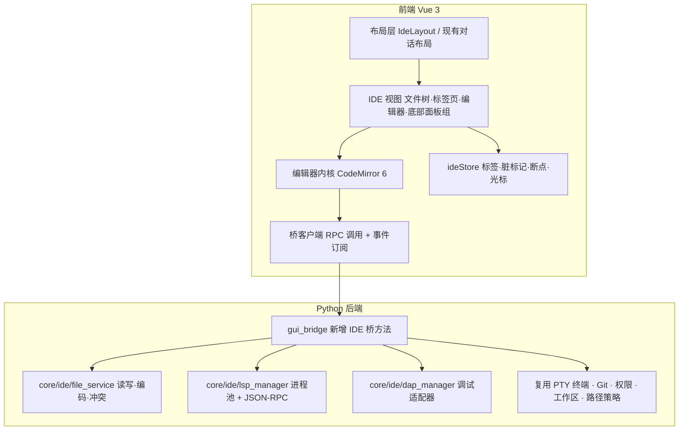
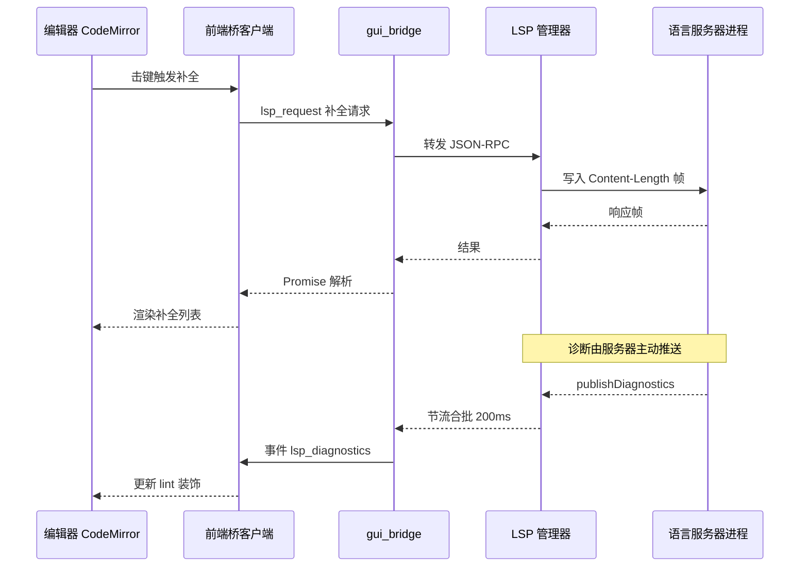

# 星瑶 IDE 模式 · 总体设计规格

- 日期：2026-10-06
- 分支：`ide`（长期特性分支，定期从 `dev` 合入）
- 状态：设计已评审，待实施计划
- 适用范围：S1 IDE 骨架 / S2 语言智能 / S3 运行与调试（一个批次排期，分三份规格，本文档为总体架构与 S1 详细设计）

---

## 1. 背景与目标

星瑶当前是「GUI 优先的 Agent 工作台」：文件查看、文件编辑、命令执行全部由 Agent 通过工具调用（`read_file` / `edit_file` / `execute_command`）完成，UI 只做只读回显。这一取向在 `docs/superpowers/specs/2026-08-26-lan-remote-control-design.md:31` 有明确记录（"桌面 GUI 也没有文件编辑器或终端"）。

本规格要做的是**产品定位的一次扩展**：在保留「对话模式」的前提下，新增「IDE 模式」，让用户可以直接手写代码、看诊断、跑起来、断点调试，同时星瑶仍是同一套内核、同一个会话、同一个工作区。

目标：

1. 顶部一键切换「对话模式 / IDE 模式」，共用同一套内核、工作区与会话状态，切换不重建会话、不丢流式内容。
2. IDE 模式下支持多语言编辑、语言智能（补全 / 跳转 / 悬停 / 诊断 / 格式化 / 重命名）、运行与调试。
3. 不破坏既有体系：不触碰提示词字节稳定红线、不改动 `core/lsp.py` 现有工具行为、不改变现有权限与撤销语义。

非目标（YAGNI，明确不做）：

- 插件市场 / 扩展体系
- 多根工作区、远程开发（SSH / WSL / 容器）
- 编辑器内容注入 Agent 上下文（见 7.3，会撞字节稳定与缓存前缀红线）
- 用户手改内容纳入「按回合撤销」（已决策：各管各的）
- 移动端（`frontend-mobile`）的 IDE 模式

---

## 2. 现状盘点

### 2.1 已有资产（可直接复用，不重写）

| 能力 | 位置 | 现状 |
|---|---|---|
| 文件树（懒加载 + 展开状态恢复） | `frontend/src/components/FileTreeNode.vue`；`gui_bridge.py:2809` `get_file_tree`、`:2823` `get_dir_children` | 只读浏览 |
| 代码预览 + 语法高亮 | `RightPanel.vue:495-539`（highlight.js 懒加载）、`gui_bridge.py:7393` `read_file_preview` | 只读 `<pre>`，支持 UTF-8/GBK、图片 base64、二进制拒绝 |
| 交互式终端 | `TerminalPane.vue`（xterm + FitAddon）、`utils/ptyBus.ts`、`gui_bridge.py:7816` `pty_terminal_ensure` | 真实 ConPTY，可交互 |
| Git 面板 / Diff 渲染 | `GitPanel.vue`、`GitDiffView.vue`、`utils/diffView.ts` | 只读 |
| 可拖拽分栏 | `composables/usePanelResize.ts` | 通用实现，支持视口比例与双击复位 |
| 多页签容器范式 | `RightPanel.vue:29-89`、`appStore.ts:130-133`、`:1144-1159` | 就地实现，未抽象成通用组件 |
| 布局偏好后端持久化 | `core/ui_layout.py` | 原子写 + 备份 |
| 内嵌浏览器 / 电脑操控 | `BrowserPane.vue`、`core/embedded_browser.py` | 可用 |

### 2.2 缺口

- 无编辑器内核（全仓库无 monaco / codemirror）
- 无「用户手动改文件并保存」链路（无写盘、无脏标记、无冲突检测）
- 无真语言服务（`core/lsp.py` 是正则 + ripgrep 的 LSP-lite，仅供 `find_definition` 工具使用）
- 无调试能力

### 2.3 必须遵守的既有约束

| 约束 | 出处 |
|---|---|
| `evaluate_js` 只允许在 `gui_bridge.py` 的 `gui-js-dispatcher` 单消费者线程调用，事件源线程只 `_js_queue.put_nowait` | `AGENTS.md` 并发与线程安全条款；`gui_bridge.py:630`、`:2100-2101`、`:2113-2114` |
| 不得改变 `build_stable_prompt` 字节输出；不得为过测试改 `tests/test_prompt_byte_stability.py` | `AGENTS.md` 指针/字节稳定红线 |
| Harness Journal 只落状态 / ID / 序号 / 时间 / 耗时 / 哈希，严禁写正文与凭据 | `AGENTS.md` |
| 不引入第三方依赖（Python 侧） | `AGENTS.md`、多个工作包声明 |
| 版本号只改 `core/version.py`；`dist/`、`frontend/dist` 永不提交 | `CLAUDE.md` |
| 前端 CSP 为 `default-src 'self'`，仅放行 `127.0.0.1:*` 的 img/media/connect | `frontend/index.html:7-11` |
| 文本数据注意编码一致性，避免 GBK / UTF-8 混淆 | 项目编码规范第 9 条 |

---

## 3. 关键决策记录

| # | 决策 | 结论 | 理由 |
|---|---|---|---|
| D1 | 产品形态 | 双模式并存，顶部一键切换，共用内核与会话 | 一套内核两套布局，复用成本最低 |
| D2 | 能力档位 | C 档：高亮 + 补全 + 跳转 + 悬停 + 诊断 + 格式化 + 重命名 | 用户明确要求"接近 VSCode" |
| D3 | 编辑器内核 | CodeMirror 6 | 与严格 CSP 兼容（无需放宽 `worker-src blob:`）、体积比 Monaco 小一个数量级、主题天然映射 CSS 变量、按需动态 import 与现有 hljs 懒加载同套路 |
| D4 | 语言服务器供给 | 内置 `jedi-language-server`（纯 Python，无 Node 依赖）保证开箱即用；设置页允许探测并切换到 Pyright（用户机器有 Node 时享受最强类型检查） | 避免安装包背 Node 运行时，同时不牺牲上限 |
| D5 | 手改与 Agent 写盘 | 各管各的：Ctrl+S 直接写盘，不进回合撤销；星瑶改过的文件自动刷新并标注；冲突以磁盘为准 + 一键 diff | 改造现有 `undo_turn` / 检查点体系风险过高，收益不足 |
| D6 | 运行与调试 | 运行与调试都要做，DAP 后端托管 | 用户明确要求 |
| D7 | LSP / DAP 进程归属 | 全部由 Python 后端托管，前端只做 UI 与 JSON-RPC 消费 | WebView 无法 spawn 进程；后端已有进程管理与权限体系 |
| D8 | 范围批次 | 三份规格一个批次排期，实现按 S1 → S2 / S3 依赖推进 | 三个子系统无法在一份规格里评审 |

---

## 4. 总体架构



新增后端包 `core/ide/`，**不改动 `core/lsp.py`**（那是 `find_definition` 工具的实现，改动会影响现有工具行为与测试）：

```
core/ide/
  __init__.py
  file_service.py        # 文件读写、编码保持、冲突检测、外部改动扫描
  language_registry.py   # 扩展名 -> 语言 id -> 语言服务器配置 的映射
  server_provision.py    # 内置服务器定位、PATH 探测、手动路径覆盖
  lsp_manager.py         # LSP 进程生命周期 + JSON-RPC 帧编解码 + 请求转发
  dap_manager.py         # DAP 进程生命周期 + 帧编解码（S3）
```

---

## 5. S1 IDE 骨架详细设计

### 5.1 模式与布局

新增 `frontend/src/components/IdeLayout.vue`，最大化复用现有组件：

| 区域 | 实现 |
|---|---|
| 左侧活动栏 | 新建（图标切换：文件树 / Git / 调试；搜索面板列为后续可选，不在本次范围） |
| 左侧面板 | 文件树复用 `FileTreeNode.vue` + `store.fileTree`；Git 复用 `GitPanel.vue` |
| 中间编辑区 | 新建 `EditorTabs.vue` + `EditorPane.vue` |
| 底部面板组 | 终端复用 `TerminalPane.vue`；新增「问题」「输出」「调试控制台」页签（S2/S3 填充内容，S1 先占位） |
| 右侧对话区 | 复用现有消息渲染组件，收成可折叠侧边栏 |
| 分栏拖拽 | 复用 `composables/usePanelResize.ts` |

模式状态：

- `appStore.ideMode: boolean`，**按会话隔离**（与 `rightPanelTabs` 同范式，见 `appStore.ts:1144-1159`）
- 切换入口：`Topbar.vue` 加切换按钮 + 快捷键。S1 的首个任务必须先盘点现有快捷键绑定（`App.vue`、`InputArea.vue` 及各面板）形成占用清单，再定新增绑定，避免冲突
- 切换语义：不重建会话、不重置 `sessionRuntime`、不中断进行中的回合；流式输出在两种布局下都持续可见

### 5.2 状态管理

新增 `frontend/src/stores/ideStore.ts`，按 **会话 + 工作区** 双键隔离：

| 状态 | 说明 |
|---|---|
| `openTabs: {path, encoding, eol, dirty, viewState}[]` | 打开的标签页与编辑器视图状态（光标、滚动） |
| `activeTab` | 当前标签 |
| `externalChanges: {path, kind}[]` | 被外部（星瑶 / 其他程序）修改的文件 |
| `diagnostics: Map<path, Diagnostic[]>` | S2 填充 |
| `breakpoints: Set<{path, line}>` | S3 填充 |

**持久化走两条路**：即时缓存用 localStorage（首屏不闪），权威副本走 `core/ui_layout.py` 同款的原子写后端接口（`ide_save_layout` / `ide_get_layout`）。理由见 `core/ui_layout.py` 文件头注释：WebView2 的 localStorage 异步落盘，用户在状态变更后立刻关窗会因 checksum mismatch 丢数据。断点、打开的标签这类"丢了很烦"的状态必须走后端。

### 5.3 编辑器内核与能力映射

CodeMirror 6 扩展映射：

| 能力 | 扩展 |
|---|---|
| 基础 | `@codemirror/view`、`@codemirror/state`（行号、括号匹配、自动缩进、折叠、多光标、矩形选择、缩进参考线、当前行高亮、选中匹配高亮） |
| 编辑命令 | `@codemirror/commands`（注释切换、上下移动行、复制行、编辑器内独立撤销栈） |
| 查找替换 | `@codemirror/search`（正则、大小写、全文件替换） |
| 高亮 | 各 `@codemirror/lang-*`（python / javascript / html / css / json / markdown / rust / go / java / cpp / sql / xml / yaml），冷门语言走 `@codemirror/legacy-modes` |
| 主题 | CM6 主题对象从现有 CSS 变量取值（`body.light` 深浅两套），与 `core/gui_theme.py` 主题切换联动 |
| 补全 / 诊断 / 悬停 / 跳转 / 格式化 / 重命名 | 前端用 `@codemirror/autocomplete`、`@codemirror/lint` 承载 UI，数据走 LSP（S2） |

加载策略：所有语言包与重扩展**动态 import**，与 `RightPanel.vue:495-511` 现有的 hljs 懒加载同套路，不进首屏包。

撤销语义：编辑器撤销栈与星瑶的回合撤销**完全独立**，两者互不感知（对应 D5）。

### 5.4 文件服务

新增 `core/ide/file_service.py`，桥方法 `ide_read_file` / `ide_write_file` / `ide_stat_files`。

**读取**（与只读预览的区别：预览允许截断，编辑器不允许）：

- 完整读取，不截断；超过 `IDE_EDIT_MAX_BYTES`（建议 2 MB）或二进制（含 `\x00`）直接拒绝并提示"请用只读预览或在系统中打开"
- 编码探测顺序 UTF-8 → GBK（与 `read_file_preview` 一致），**记录实际编码并随文件返回**
- 检测并记录 BOM 有无、换行风格（LF / CRLF / CR）与是否混合

**写入**：

- 按读取时记录的编码原样写回（GBK 文件写回 GBK），BOM 与换行风格同样保持原样
- 原子写：临时文件 + 替换，避免中断产生半截文件
- 写前校验 `expected_hash`（读取时返回的内容哈希），不一致则返回 `conflict`，由前端三选：以磁盘为准重载 / 覆盖 / 看 diff（复用 `utils/diffView.ts`）
- 写盘后不触发任何 Agent 侧副作用（不进回合撤销、不写 Journal 正文，仅记录路径与哈希）

**路径策略**：复用 `core/gui_path_policy.gui_path_access_allowed`，`action` 取 `"edit"`（需在该模块新增分支，语义与 `preview` / `open` 一致：凭据文件永远拒绝；GLOBAL 放行；工作区内放行；工作区外跟随沙盒开关）。所有路径先过 `_resolve_real_path` 归一化，防 `..` 与软链穿越。

**外部改动感知**：

- 后端只轮询"当前已打开文件"的 `(mtime, size)`，不扫描全仓，间隔建议 1 s（复用 `gui_main.py:218-220`、`:293-295` dist watchdog 的实现范式）
- 变更推事件 `ide_file_changed`：文件在编辑器内干净则自动重载并提示；脏则只标注「已被星瑶修改」+ 提供一键 diff，**绝不静默覆盖用户未保存的内容**

### 5.5 接口契约（S1）

桥方法（`gui_bridge.py` 新增）：

| 方法 | 入参 | 返回 |
|---|---|---|
| `ide_read_file(path)` | 路径 | `{ok, content, encoding, eol, bom, hash, truncated:false, msg?}` |
| `ide_write_file(path, content, expected_hash)` | 路径、内容、期望哈希 | `{ok, hash, msg?, conflict?:{disk_hash}}` |
| `ide_stat_files(paths)` | 路径数组 | `{ok, stats:[{path, mtime, size, hash}]}` |
| `ide_get_layout(session)` | 会话名 | `{ok, layout}` |
| `ide_save_layout(session, layout)` | 会话名、布局快照 | `{ok, layout}` |

事件（经 `emit_event` → `_js_queue` → `gui-js-dispatcher`）：

| 事件 | 载荷 | 时机 |
|---|---|---|
| `ide_file_changed` | `{path, mtime, size}` | 已打开文件被外部修改 |
| `lsp_diagnostics` | `{path, diagnostics[]}` | 服务器推送诊断，节流合批（S2） |
| `lsp_status` | `{server, state, msg?}` | 语言服务器启停与异常（S2） |
| `dap_stopped` / `dap_output` | 见 S3 规格 | 调试事件（S3） |

---

## 6. S2 / S3 设计要点（详细规格另行出具）

### 6.1 S2 语言智能

- 每语言服务器一个子进程，stdio + `Content-Length` 帧（LSP 标准帧），生命周期绑定工作区：打开工作区按需启动，关闭或切工作区时优雅 `shutdown` + `exit`，超时强杀
- 前端发起的请求走桥的 request/response；服务器主动推送（`publishDiagnostics`、`window/logMessage`）走事件管线
- **性能红线**：`evaluate_js` 只能在 `gui-js-dispatcher` 单线程调用，诊断必须节流合批（建议 200 ms），补全请求前端防抖 + `$/cancelRequest`
- 供给：内置 `jedi-language-server` 覆盖 Python；TypeScript / JavaScript 探测 `typescript-language-server`；其余语言探测 `gopls` / `rust-analyzer` / `clangd` / `jdtls` 等。设置页新增「编辑器与语言服务」分区，承载各语言服务器状态展示、探测结果与手动指定可执行文件路径
- 语言服务器是用户级进程，不经过模型工具，因此不触发 `permission_broker`；但必须遵守"进程只能由后端管"与"路径限定工作区"



### 6.2 S3 运行与调试

- 运行：按语言猜命令（`python xxx.py` / `node xxx.js` …）或读取项目配置，一键在现有终端面板执行，复用 `pty_*` 桥方法
- 调试：`core/ide/dap_manager.py` 托管适配器进程（Python 用 `debugpy`，Go 用 `dlv`，C/C++/Rust 用 `lldb-dap`），DAP 帧格式与 LSP 同为 `Content-Length`，载荷字段不同
- 前端：`DebugPane.vue`（调用栈 / 变量 / 监视 / 调试控制台）、编辑器侧断点 gutter、当前执行行高亮、调试工具条（继续 / 单步 / 跳出 / 重启 / 停止）
- S1 的底部面板组必须预留调试控制台位置

---

## 7. 与现有体系的接缝

### 7.1 打包与体积

- 新前端依赖进 `frontend/package.json` 的 `dependencies`（影响 dist 体积）
- `build_release.py:188-235` 的前端构建步骤需增加产物体积校验，防止首屏包被编辑器内核撑爆
- 语言服务器二进制：内置件随安装包分发，需在 `build_release.py` 的打包清单中登记；体积超阈值时改为首次启动解压到用户目录（此项在 S2 规格中定量决策）

### 7.2 线程与事件模型

严格遵守：所有前端可见事件必须经 `_js_queue` 与 `gui-js-dispatcher` 单消费者线程派发（`gui_bridge.py:630`、`:2100-2101`、`:2113-2114`）。LSP / DAP 的读线程只允许 `put_nowait`，**不得直接 `evaluate_js`**。

### 7.3 字节稳定与缓存红线

**明确不做**：把编辑器内容、打开的文件列表注入 Agent 上下文。理由：会改变 `build_stable_prompt` 的字节输出，破坏跨轮缓存前缀，且违反 `AGENTS.md` 的指针/字节稳定红线。IDE 功能对模型请求路径**零影响**。

### 7.4 撤销与权限

- 编辑器撤销栈独立于回合撤销（D5）
- 文件写盘不产生 Journal 正文记录，仅记录路径与哈希（符合 Journal 只落元数据铁律）
- 调试 / 运行进程由用户显式触发，不进入 `permission_broker` 流程

---

## 8. 错误处理

| 场景 | 处理 |
|---|---|
| 文件过大 / 二进制 | 拒绝进入编辑器，提示改用只读预览或系统打开 |
| 编码无法识别 | 只读打开并提示，禁止保存 |
| 保存冲突 | 返回 `conflict`，前端三选（重载 / 覆盖 / diff），不静默覆盖 |
| 语言服务器启动失败 | 推 `lsp_status` 异常事件，编辑器降级为纯高亮，不影响编辑与保存 |
| 语言服务器崩溃 | 管理器检测退出，限次自动重启（建议 3 次），超限后标记不可用并提示 |
| 工作区切换 | 优雅关闭全部 LSP / DAP 进程，超时强杀，清理 ideStore 的按会话状态 |
| 桥不可用 | 复用现有 `bridgeReady` 握手语义（`App.vue:836-844` 两步注入），未就绪不发请求 |

---

## 9. 测试策略

**后端（pytest）**

- `file_service`：路径穿越（`..`、软链、8.3 短名、大小写）拒绝；GBK 文件往返不损坏；BOM 与 CRLF 保持；冲突检测；大文件拒绝；原子写
- `lsp_manager`：帧编解码（分片到达、粘包）；进程生命周期（启动 / 优雅退出 / 超时强杀 / 崩溃重启限次）；请求取消
- `dap_manager`：帧编解码；断点与停止事件流转
- 路径策略新增 `action="edit"` 分支的放行矩阵

**前端（vitest）**

- `ideStore`：按会话隔离、脏标记、外部改动标注、布局快照存取
- 标签页：打开 / 关闭 / 激活 / 外部改动提示
- 模式切换：不重建会话、不丢流式内容

**回归红线**

- `tests/test_prompt_byte_stability.py` 与 Provider payload golden 必须保持通过（IDE 对请求路径零影响，本应天然通过，作为守卫）
- `smoke_release_chain.py` 打包冒烟

---

## 10. 验收标准

**S1**

1. 顶部可切换「对话模式 / IDE 模式」，切换后会话、消息、进行中的回合与流式输出均不受影响
2. 文件树可打开文件到标签页，支持多标签、切换、关闭；编辑器有行号、高亮、括号匹配、查找替换
3. 编辑后标签显示脏标记，Ctrl+S 保存成功；保存 GBK 文件后编码与换行风格与原文一致
4. 星瑶通过 `edit_file` 修改已打开文件后，编辑器在 2 s 内感知：文件干净自动重载并提示，文件脏则标注且不覆盖用户内容
5. 保存冲突时弹出三选，选择"看 diff"能正确展示磁盘版本与编辑器版本的差异
6. 工作区外文件可只读打开，但保存被拒绝并给出明确提示；凭据配置文件（`~/.ycode/config.json` 等）读写均拒绝
7. 打开超过 2 MB 的文件被拒绝进入编辑器并给出提示，软件不卡顿
8. 关闭并重开软件后，上次打开的标签、光标位置与布局恢复
9. 现有 GUI 功能无回归（对话、终端、Git、内嵌浏览器、电脑操控）

**S2**

1. 打开 Python 文件触发内置 `jedi-language-server` 启动，补全、跳转定义、悬停、诊断、格式化、重命名均可用
2. 连续快速输入时不出现 UI 卡顿，诊断推送节流合批生效
3. 切换工作区后语言服务器被正确关闭，无残留进程
4. 未安装的语言服务器在设置页给出明确状态与手动指定入口，不影响编辑器基本编辑

**S3**

1. 一键运行当前文件，输出落在底部终端面板
2. 可设置断点、启动调试、单步、查看调用栈与变量、在调试控制台求值
3. 调试结束后适配器进程被正确回收

---

## 11. 风险与未决项

| 风险 | 说明 | 缓解 |
|---|---|---|
| CodeMirror 6 功能拼装量被低估 | C 档要求的补全 / 诊断 / 悬停 / 跳转 UI 都要自己接线 | S2 规格中先做一条语言（Python）端到端打通，再横向铺语言 |
| 语言服务器体积 | 内置件可能显著增加安装包 | 超阈值时改为首次启动解压到用户目录 |
| `ideStore` 与巨型 `appStore`（5824 行）的边界 | `appStore.ts` 已经是超大文件，新状态若继续塞进去会加剧 | 强制独立 `ideStore.ts`，只在必要时通过 `appStore` 暴露的接口交互 |
| 前端包体积 | CM6 + 语言包 + LSP 客户端 | 全部动态 import；`build_release.py` 加体积门禁 |
| WebView2 localStorage 丢数据 | 已确认的历史问题（`core/ui_layout.py` 文件头） | 关键状态走后端原子写 |
| 快捷键冲突 | 现有 GUI 已占用部分快捷键 | 实现前先盘点现有绑定，新增绑定写进规格 |
