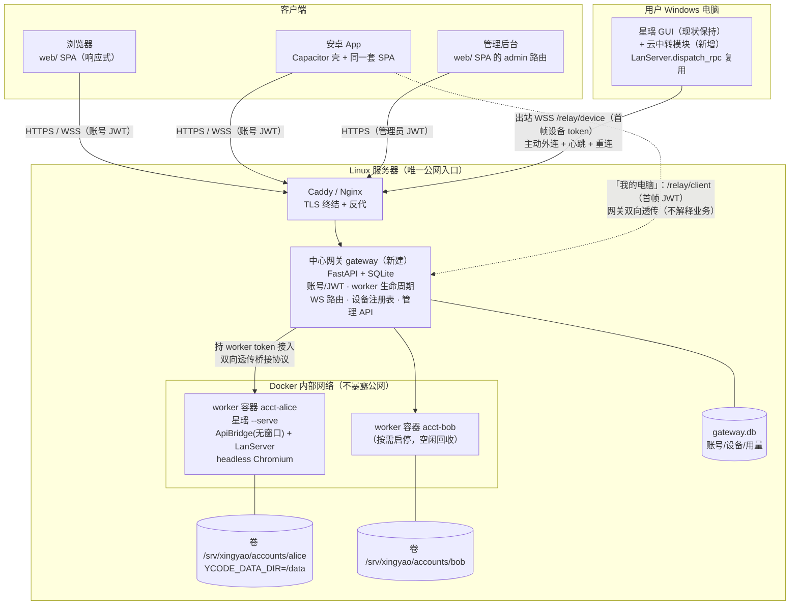
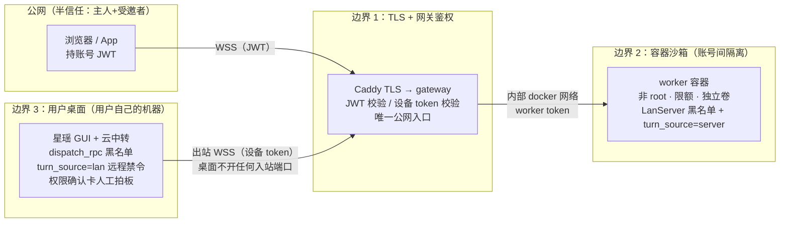

# 星瑶 Personal Agent 平台架构设计

> 修订 r2（2026-11-13）：按 `audit/design-review-r2.md` 的 M01-M20 修订。闭合 worker/relay epoch 与有限补发协议、三类 token 失效规则、Linux 浏览器完整调用链、截图 HTTP 鉴权、账号全通道隔离及 metrics 数据契约；重排 P1-P4 高风险门禁。本文是设计修订，不表示任何实现或运行验收已经完成。

日期：2026-11-13
状态：r2 设计待复审；实施与实测未开始
取代：`2026-11-13-server-multi-tenant-design.md`（对外 SaaS 多租户方向已废弃，仅作素材归档）
输入：`audit/core-service.md`、`audit/remote-mobile.md`、`audit/platform-deploy.md`（三份只读审计，本文所有 file:line 均引自审计并经本轮抽样复核）

---

## 1. 背景与需求

### 1.1 产品定位

星瑶从「Windows 桌面单机应用」演进为 **Personal Agent 平台**（对标 Today / Muse 的个人助理形态）：产品主人自己在 Linux 服务器上常驻一个 Agent，通过浏览器或安卓 App 随时对话、围观它操作浏览器、远程审批权限；同时保留「我的电脑」入口，从手机反向触达自己 Windows 电脑上正在运行的星瑶 GUI。**这不是对外 SaaS**：账号只给产品主人自己和极少数受邀者使用。

### 1.2 七项需求

| # | 需求 | 一句话定义 |
|---|---|---|
| R1 | Windows 桌面 GUI 零回归 | 现有 GUI 全部行为不变，改造只允许平台守卫 / 新增档位 / 新增入口 |
| R2 | Windows CLI 零回归 | `--cli` / `run_headless` 路径行为不变 |
| R3 | Linux 服务器 Personal Agent + 专属极简 Web 前端 | `--serve` 无窗口常驻 + 新响应式 SPA，Docker + Caddy 部署 |
| R4 | 安卓 App（Muse/Today 风格） | Capacitor 包装同一套 SPA，直连服务器 |
| R5 | App 内「我的电脑」 | 手机 → 服务器 → 用户 Windows 上运行中的星瑶 GUI；桌面持设备 token 主动外连注册，服务器纯转发 |
| R6 | 账号登录 + 对话隔离 | 每账号独立数据 / 会话 / 记忆 / Key，一账号一容器 |
| R7 | 后台管理系统 | 账号管理、设备管理、worker 状态、用量查看 |

### 1.3 信任模型假设（全设计的前提）

- **账号 = 产品主人自己 / 极少数受邀者**，不是不可信公网用户。账号持有者被信任「不会主动攻击平台」，但仍按「一账号一 Docker 容器」隔离（复用 core-service.md 第三节「同进程多账号必然串号，必须一账号一进程」的审计结论），容器加固做基线：非 root、CPU / 内存 / PID 限额、数据卷隔离、drop capabilities、no-new-privileges。
- **不做**对外 SaaS 级渗透防护（egress 白名单代理、注册风控、计费防刷、容器逃逸对抗性加固等）。理由：威胁模型里没有「恶意注册用户」，这些投入对个人产品是纯成本。
- **将来若转为对外服务，必须补**：① 模型 API egress 白名单代理（否则 execute_command 可外联任意地址，见 remote-mobile.md 3.4「远程回合仍可执行命令与读写文件」）；② 注册风控（邀请码 / 验证码）与配额防刷；③ 容器逃逸对抗加固（gVisor / Kata、seccomp 精细策略、只读根文件系统全面化）；④ 渗透测试与审计日志合规；⑤ 网关自身的高可用与限流。旧文档第 3 节「阶段三：对外运营加固」清单可整体回收复用。
- 网关是唯一公网入口，TLS 由 Caddy / Nginx 反代终结；worker 容器与桌面 GUI 都不直接暴露公网。

---

## 2. 现状审计结论摘要

三份报告全文见 `audit/` 目录，此处只摘取支撑本设计的关键结论（file:line 以当前工作区为准，本轮已抽样复核 frameless.py:101、gui_bridge.py:3809-3831、credentials.py:9、lan_server.py:1150、capability.py:87-103、browser_backend.py:46/1209-1215、tool_registry.py:182、config.py:430-458、linux.py 全文、settings.py:26/37-41、controller.py:517-528、browser_worker.py:37，全部吻合）。

### 2.1 核心服务化（audit/core-service.md）

- 核心对话链无界面依赖，可复用：agent_service（headless 约束，agent_service.py:4-12）、MemoryManager 按路径实例化 + WAL（memory.py:501-510）、LanServer 构造仅需 bridge+port（lan_server.py:379-406）。
- **四处必改**：① frameless 模块级 `ctypes.windll` Linux import 即崩（frameless.py:101-110，gui_bridge 顶层 import 连带）；② `_emit_raw` 无窗口先 return，LAN/飞书广播被掐断（gui_bridge.py:3809-3831）；③ 权限确认单槽队列 + gui flavor 跳过终端回退 → 无窗口无人应答时无限挂起（permission_terminal.py:524-539、gui_bridge.py:7934-7939）；④ 进程级全局单例决定**一账号一进程**（app_context.py:16-24、permission_broker.py:263、llm.py:361-365 等）。
- LAN/MCP/飞书服务靠前端首屏触发（gui_bridge.py:4382-4398），serve 必须显式启动（gui_bridge.py:8106-8220）。
- 数据隔离 ≈95% 完整，`YCODE_DATA_DIR` 主干可用（config.py:430-443），**5 处残留**需修（tokenrhythm_auth.py:64-68、workflows/store.py:44-45、hooks/zcode_import.py:385、harness/tool_adapters.py:154、skills.py:650-661）。
- 凭据加密 Linux 走 keyring 分支（credentials.py:51-56），headless 容器需 file 后端（部署项）。

### 2.2 远程链路与移动端（audit/remote-mobile.md）

- **桥接协议可复用但需加 epoch**：单端口 HTTP+WS、RPC 帧、20 种白名单事件与 128 条环形缓冲可复用；现有重连只在同一进程且未发生缓冲/队列溢出时保证窗口内补发。r2 增加 boot_id/hello/seq_reset/resync_required，不能沿用无条件“不重不漏”表述。首帧 token 鉴权、失败 close 4401 保留。
- **安全边界收敛在 `dispatch_rpc` 一个函数**（lan_server.py:821-859）：54 项 FORBIDDEN_METHODS（:224-364）、`_` 前缀拒绝、`set_permission_mode` 必须带会话名、`send_user_message` 强制 `turn_source="lan"` 且参数白名单化（:369-377、877-922）。与传输解耦，可直接搬到中转链路。
- **远程回合限制（turn_source != "local"）**：禁电脑/浏览器操控（capability.py:96-99）、禁跨会话引用（agent_service.py:1480-1484）、禁副模型路由（turn_model_override.py:163-164）、不抢占桌面当前会话（gui_bridge.py:9444）。**注意**：命令执行与文件读写工具不受 turn_source 限制，约束来自权限模式与沙盒（remote-mobile.md 3.4）。
- **桌面主动外连有完整参考**：飞书通道「凭据换接入点 → WS 长连接 → 心跳/重连/优雅停止 → 服务状态机 → 事件去重」五件套（core/feishu/_lark_ws/client.py:465-520、404-414、593-621、313-345；service.py:27-32、74-152）。但**全库无任何 relay/tunnel 实现**（remote-mobile.md 4.3），桌面侧 WS dial 客户端需新写。
- frontend-mobile 是 Vue3+Vant 的 PWA（package.json:12-31、router.ts:6-14），四页应用 + 917 行 store 可作新前端参照；mobile-shim 200 行行为（token 存储/重连/水位/4401）是传输层规格。
- GUI 关闭 ⇒ LAN 必停（gui_bridge.py:2508-2524），无独立常驻形态——「我的电脑」接受「GUI 在跑才可连」的产品语义。

### 2.3 Linux 与浏览器跨平台（audit/platform-deploy.md）

- Linux 电脑操控整体不可用的根因：`LinuxPlatformAdapter(UnavailablePlatformAdapter)`（linux.py:6-8）；平台支持是「全有全无」单开关（controller.py:517-527）。
- 浏览器链路平台中立度高：worker 子进程 JSON 行协议、`sys.executable -m` transport Linux 可用（browser_backend.py:894-928）；**11 项最小改造清单**见该报告第二节（本文 4.3 展开）。
- **最高风险**：credentials.py:9 顶层 `from ctypes import wintypes`，Linux import 期 ValueError（推断，CPython 已知行为），连带 mcp_client.py:15 / doctor.py:22——P1 首先实测。
- 工具档位机制现成：`VALID_TOOL_PROFILES=("full","cli")`（tool_registry.py:182）、CLI_EXCLUDED_TOOLS（:133-180）、插件加载后统一 unregister（:1446-1455）；`YCODE_TOOL_PROFILE=cli` 会硬禁电脑操控（capability.py:87-93），server 档位必须绕开此交互。
- 依赖：requirements.lock 是 Windows venv 快照不可用于 Linux；playwright 组件 zip 必检 node.exe（components.py:89,190）Linux 必须走 pip；镜像建议 `mcr.microsoft.com/playwright/python:v1.62.0-jammy`（与 lock 的 playwright==1.62.0 对齐）；必须设 `LANG=C.UTF-8`（子进程编码依赖 locale，process_io.py:35-44）。
- 观察截图流现成：`computer_observation` 事件（controller.py:1028）携带 `preview_url`，指向进程内 127.0.0.1 预览服务（preview_server.py:3-5，每进程随机 token、只服务当前 run 最近 3 张 PNG）——Web 围观面板复用此流。

---

## 3. 总体架构



关键数据流：

1. **Personal Agent 对话（R3/R4/R6）**：App/浏览器登录换 JWT → WSS `/ws/agent` 首帧 `{"jwt","last_seq"?,"last_boot_id"?}` → 网关校验 JWT、按需拉起该账号容器 → 网关持 worker token 连容器内 LanServer → 按 hello/seq_reset/replay/live 顺序双向透传桥接协议帧。网关不理解 RPC 内容。
2. **我的电脑（R5）**：桌面云中转模块出站 WSS `/relay/device`，首帧提交设备 token、device_id 与 boot_id → 网关标记设备在线并推送给 App → App 连 `/relay/client`，首帧提交 JWT、device_id 与水位 → 网关校验归属后双向透传；桌面侧 RPC 交带连接级来源参数的 `dispatch_rpc`（全部现有安全边界生效），事件从 `_emit_raw` 分流到 relay 连接。
3. **管理（R7）**：admin 角色 JWT → `/api/admin/*` REST + `/ws/admin` 状态推送；worker 用量经容器内 `/metrics`（worker token 鉴权）拉取聚合。

---

## 4. 组件详细设计

### 4.1 中心网关 gateway（新建，R3/R5/R6/R7 的枢纽）

**职责**：账号/JWT；worker 生命周期（Docker API 按需启停 + 空闲回收）；WS 路由（纯转发）；设备注册表与 relay 配对；管理 API。技术栈 FastAPI + SQLite（WAL）起步，单机单进程，规模到了再换 Postgres。

**接口定义**：

| 端点 | 方法/协议 | 鉴权 | 语义 |
|---|---|---|---|
| `/api/auth/login` | POST | 用户名+密码 | 返回 `{access_token(30min), refresh_token(30d), role}` |
| `/api/auth/refresh` | POST | refresh_token | 轮换 refresh，返回新 access |
| `/api/auth/logout` | POST | JWT | 吊销 refresh |
| `/ws/agent` | WS | 首帧 `{"jwt"[,"last_seq","last_boot_id"]}` | 该账号 worker 的桥接协议透传；每前端连接独占一条上游 worker 连接，RPC id 天然不冲突 |
| `/api/devices` | GET | JWT | 本账号设备列表 + 在线状态（App「我的电脑」入口渲染） |
| `/ws/devices` | WS | 首帧 `{"jwt"}` | 设备在线状态变更推送 `{"type":"device_status","data":{device_id,online}}` |
| `/relay/device` | WS | 首帧 `{"type":"relay_register","token","device_id","boot_id"}` | 桌面注册；15s ping/pong，45s 无心跳离线；单连接 generation |
| `/relay/client` | WS | 首帧 `{"jwt","device_id"[,"last_seq","last_boot_id"]}` | App 连指定设备；校验账号归属；长期凭据不进入 URL |
| `/api/admin/accounts` | GET/POST/PATCH | admin JWT | 账号 CRUD（创建/禁用/重置密码/配额） |
| `/api/admin/devices` | GET/POST/DELETE | admin JWT | 设备列表；生成设备 token（明文只显示一次）；吊销/轮换 |
| `/api/admin/workers` | GET/POST | admin JWT | worker 列表与状态；手动 start/stop/restart |
| `/api/admin/usage` | GET | admin JWT | 按账号/日的 token 用量与回合数 |
| `/ws/admin` | WS | 首帧 `{"jwt"}`（admin） | worker 状态变更、设备上下线实时推送 |
| `/health` | GET | 无 | 存活探针 |

**WS 路由语义（/ws/agent）**：
- 首帧 10 秒超时；JWT 无效/过期 close **4401**，前端先 refresh 再重连，refresh 失效才回登录页。每个 REST/WS 请求还必须在统一 auth dependency 中读取账号当前 `disabled/role`；改密、禁用、降权时递增 `accounts.auth_epoch`，JWT 同时携带 epoch，不能只验签名与 exp。
- 网关为每条前端连接单独 dial 一条 worker LanServer 连接，上游首帧统一为 `{"token":worker_token,"last_seq":<number|null>,"last_boot_id":<string|null>}`；全新连接两项均为 null。worker 的每客户端有界队列承担背压，补发缓冲在 worker 侧。
- **worker epoch 的精确顺序**：LanServer 启动生成 `boot_id=secrets.token_hex(4)`。认证成功后首先发送 `{"type":"hello","data":{"boot_id":...}}`；若客户端 `last_boot_id` 与当前不同，随后发送 `{"type":"seq_reset","data":{"boot_id":...,"from_seq":0,"resync_required":true}}`，忽略旧 last_seq；然后按 seq 升序补发当前 128 帧窗口，最后进入实时帧。hello/seq_reset 均不得带 `id`，避免 shim 当作 RPC 应答。boot_id 相同才按 last_seq 过滤；旧服务端无 hello 时旧 shim 保持现行为，新 shim 对旧服务端进入 legacy 模式并强制初始快照；新服务端收到无 last_boot_id 的旧客户端按全新连接处理。
- **shim 合并规则**：hello/seq_reset 在通用 `onBridgeEvent` 扇出前拦截。seq_reset/resync_required 时先暂停把 replay/live 交给 store，调用 `get_initial_state` 并以返回的权威快照替换对应会话状态，记录 `snapshot_epoch=boot_id` 与该连接当时已收到的 `snapshot_seq`；随后只处理同一 boot_id 且 seq 大于 snapshot_seq 的增量，其它旧帧丢弃。每连接按 boot_id 重置去重集合，不能以“事件类型”去重 token_delta 等合法重复事件。若事件发生在快照生成之后但乱序到达，以会话 revision/回合终态优先，终态后忽略迟到 delta；无法判定顺序时重新取快照，不猜测合并。Web 在 localStorage 按 `服务器 + account_id + profile` 持久化 `(boot_id,last_seq)`；Android 杀进程后清空水位并以全新快照自愈。退出换号、切服务器或 profile 时清空对应内存事件、设备列表、会话缓存与水位命名空间。
- worker 未运行：先 `docker start`，推 `{"type":"worker_starting","data":{"boot_id":null}}`；健康检查通过后才以 worker hello 为新 epoch。worker 崩溃时推 `worker_lost`，其 boot_id 取网关缓存的最后一次健康快照；缓存为空则 null。worker `/health` 改为 `{"ok":true,"boot_id":...}` JSON，网关缓存该值，不能要求启动前或崩溃后实时读取。
- 本协议同时修改 `frontend/mobile-shim.js` 与 `core/lan_server.py` 内嵌兜底副本，Windows LAN 直连同步受益；新 `gateway-shim.ts` 复用同一状态机。修改现有 shim 属于 R1 的必要兼容改造，不是“完全不改 frontend”。

**worker 生命周期**：
- 按需启动：账号首次 WS 活动时拉起；容器命名 `xingyao-worker-<account_id>`，标签 `xingyao.account=<id>`，网关重启后按标签枚举重建映射。
- 空闲回收：每 30s 轮询 worker `/metrics`（见 4.2）取 `last_activity_ts` 与 `active_turn`；空闲超 30 分钟且无进行中回合 → `docker stop`。
- 容器加固基线（compose 片段语义）：非 root（uid 10001）、`cap_drop: ALL`、`security_opt: no-new-privileges`、`mem_limit: 2g`、`cpus: 2`、`pids_limit: 512`、`shm_size: 1g`、只挂本账号卷、接入内部 docker network、**不 publish 任何端口**。个人产品不做 egress 白名单（信任模型 1.3）。

**改造点**：gateway 全部新建；Q1 同时修改 worker `core/lan_server.py`、`frontend/mobile-shim.js` 与内嵌 shim 兜底，Q2 复用并抽取 dispatch/replay，不再声称“无现有代码改动”。

**新建文件清单**：
```
gateway/
  app.py            # FastAPI 装配、路由注册、启动恢复（按标签枚举容器）
  auth.py           # 密码 argon2、JWT 签发/校验/刷新轮换
  db.py             # SQLite schema 与迁移（见第 5 节）
  workers.py        # Docker SDK 生命周期：start/stop/health/metrics 轮询/空闲回收
  ws_agent.py       # /ws/agent 透传管道（每连接独占上游）
  relay.py          # /relay/device + /relay/client + 设备注册表 + 在线状态推送
  admin.py          # /api/admin/* + /ws/admin
  config.py         # 网关配置（数据根、Docker 网络、镜像名、JWT 密钥、空闲阈值）
  requirements.txt  # fastapi uvicorn websockets docker argon2-cffi pyjwt
  Dockerfile        # 或宿主机 systemd 单元（首版建议宿主机直跑，需访问 docker.sock）
deploy/
  Caddyfile         # TLS + 反代 gateway
  docker-compose.yml# gateway 网络 + worker 镜像模板（worker 由网关动态创建）
  gateway.service   # systemd 单元（宿主机形态）
```

### 4.2 worker：星瑶 `--serve` 常驻模式（R3/R6，R1/R2 零回归）

**职责**：容器内无窗口常驻，复用 ApiBridge + LanServer 全部现有能力；对网关暴露桥接协议与运维探针。

**接口定义**：
- 桥接协议：LanServer 现有 WS 协议原样（RPC/事件/seq 补发/4401，见 2.2），不新增业务帧。
- `GET /health`：返回 `{"ok":true,"boot_id":...}` JSON，供网关缓存当前/最后健康 epoch。
- `GET /metrics`（**新增**，serve 模式才注册路由；`Authorization: Bearer <worker_token>`，常量时间比较）：返回 `{"version","boot_id","uptime_s","last_activity_ts","active_turn":bool,"token_usage":[{model,prompt_tokens,completion_tokens,total_tokens}],"sessions":n,"turns_total":n}`。`token_usage` 是 DB 全表按 model 合并后的全量累计；`turns_total` 是持久化的已完成用户回合计数，不能用 LLM 请求行数冒充；`sessions` 仅是当前快照，不用于按日历史。
- **用量入账契约**：网关新增 `usage_watermarks(account_id,model,prompt_tokens,completion_tokens,total_tokens,turns_total,updated_at)`。每轮在单个 SQLite 事务中读取水位→按字段计算 `max(0,current-watermark)`→写 `usage_daily`→更新水位；current 任一字段回退时，该模型整组按重置处理并记录审计事件。`usage_daily.day` 明确定义为**网关入账日（服务器时区）**，不是实际消耗日；换卷/清库、轮询后提交前崩溃、跨午夜都须有 fixtures。首版用量页展示 token 与 turns；按日 sessions 没有持久数据源，首版不展示该字段。统计只覆盖成功落库的有效 usage，不承诺与厂商账单绝对一致。
- 进程接口：`python gui_main.py --serve`（或薄入口 `serve.py`）；env：`YCODE_DATA_DIR=/data`、`YCODE_TOOL_PROFILE=server`、`LANG=C.UTF-8`；SIGTERM/SIGINT → 优雅停机。

**启动序列**（照 core-service.md 1.3 表展开）：
1. 入口在 import GUI 重模块之前识别 `--serve`（仿 `--cli` 分发范式，gui_main.py:148-174），设 `YCODE_TOOL_PROFILE=server`（先于任何 core.llm import，同 main.py:10-11 模式）。
2. 复制：滚动日志（gui_main.py:326-372）、配置自检（:894-920，弹窗改日志+退出码）、mcp 单例（:954-957）、`set_trust_prompt(lambda: False)`（:958-969，防无终端 input 挂死）、`ApiBridge(mcp_manager=…)`（:970）、LLM 预热（可选，:662-696）。
3. 跳过：WebView2/窗口/托盘/热键/内嵌浏览器全部步骤（gui_main.py:931-938、975-1013、1020-1166、858-875）。
4. **显式启动服务**：`_ensure_lan_server()`；不依赖前端首屏触发。serve 默认禁用独立 MCP 监听，确需开启时只能绑定账号内部网络并列明端口；飞书按账号配置可选。
5. **显式启动电脑运行时**：调用 `start_computer_runtime()` 与 `attach_preview_publisher()`（gui_main.py:858-875 的 GUI 调用点抽成共享函数），但不注册 Windows 全局热键；serve 使用 server 专用 browser preflight。没有 publisher 时不得声称围观已接线。
6. per-account 锁：`YCODE_DIR/serve.lock` fcntl.flock + pid 文件；SIGTERM/SIGINT → `api.shutdown()` + `shutdown_process_computer_runtime("serve_exit")` + `lan.stop()`，确保 preview 与 Chromium 一并清理。

**改造点清单**（对应 core-service.md 第二节 R1-R12）：

| # | 改造点 | 证据 file:line | 改法（零回归约束） |
|---|---|---|---|
| S1 | frameless Linux import 即崩 | core/frameless.py:34、75-99、101-117、204/217；gui_bridge.py 顶层 `_MONITORINFO` import | Windows 原生绑定区整体守卫化/惰性化。**`_MONITORINFO/_MINMAXINFO` 不是纯平台无关 Structure**，其字段依赖 wintypes：选择为 Linux 定义等价 DWORD/RECT/POINT 等中立 ctypes 类型并保留结构，或把结构及 gui_bridge 顶层 import 一并平台隔离；不得只跳过 wintypes import。Windows 原生路径与 DWM 行为不变 |
| S2 | `_emit_raw` 无窗口掐断广播 | gui_bridge.py:3809-3831（早退 :3810-3811，LAN 广播 :3824-3826，飞书 :3829-3831） | **保留 `_shutting_down` 早退不变（审查 Q4 必改）**，仅移除 `not self._window` 条件：窗口存在才 `_queue_js_payload`；非关闭期 LAN/飞书（及 P4 云中转）广播无条件执行。有窗口时与关闭期的执行顺序均与现状完全一致 |
| S3 | serve 入口与初始化序列 | gui_main.py:148-174、923-970；gui_bridge.py:4382-4398、8106-8220 | 新增 `--serve` 分支 + `serve_main()`（上文序列）；不动 `--cli` 与 GUI 分支 |
| S4 | 权限无人应答挂死 | permission_terminal.py:524-539、551-564；gui_bridge.py:1951-1954、7915-7939 | ApiBridge 构造后 serve 必须显式替换 broker handler。默认有在线客户端时等待、10 分钟超时拒绝；**无在线客户端立即拒绝**，不创建无限等待请求；可配全自动拒绝。超时/人工应答/取消/断线/shutdown 以原子结算保证只完成一次，后到的应答返回已失效。GUI/CLI 原 handler 与无限等待语义不动 |
| S5 | 凭据后端 | credentials.py:51-56、23-44 | 固定 `keyrings.alt.backends.file.EncryptedKeyring`（不得用明文 PlaintextKeyring），keyring 文件仅落 `/data/keyring/`；主秘密经 Docker secret/受控 env 注入，禁止写入 config.json、镜像或日志。写明重启解锁、轮换与备份恢复；验收直接检查卷内无 Key 明文。`_DataBlob`/wintypes 随 #9 平台隔离 |
| S6 | 单实例锁 | gui_main.py:699-831（:721-722 非 win32 返回 False） | serve 用 flock + pid 文件；一账号一容器由网关保证 |
| S7 | LanServer bind/对外地址 | lan_server.py:412-453、1123-1154 | 构造加 `bind` 并贯穿 `_serve` 与 start 返回（**默认 `0.0.0.0` 不变**）；`remote_public_url` 仅覆盖 bind_url 对外 HTTPS 前缀，不改变实际监听。容器不 publish 端口；serve 默认禁用 MCP，验收实际检查 Docker publish 与网络，而非只看 Caddyfile |
| S8 | 数据目录 5 处残留 | tokenrhythm_auth.py:64-68；workflows/store.py:44-45（另 skill_sync.py:17-18）；hooks/zcode_import.py:385；harness/tool_adapters.py:154；skills.py:650-661 | 统一改走 `config.YCODE_DIR` 或显式读 env（照 hooks/registry.py:36-45 范式）；`~/.agents/skills` 兼容扫描在 server 档关闭。Windows 默认路径值不变（YCODE_DIR 缺省即 ~/.ycode） |
| S9 | Windows 专属功能面 | gui_browser_mixin.py:6-7,48；gui_snip_mixin.py:365；gui_terminal.py:140；gui_main.py:858-875 | serve 不加载窗口步骤；桥方法保留 `unsupported_platform` 降级；工具表由 server 档裁剪（4.3 #10） |
| S10 | 调试残留 | llm.py:379-397 | 改为默认关闭的 env 开关；优先保留原 Windows 路径开关的兼容行为，不得仅凭 Linux no-op 就声称删除对 Windows 无风险 |
| S11 | 服务不依赖前端首屏 | gui_bridge.py:4377-4398 | S3 已覆盖：启动序列显式触发，`get_initial_state` 幂等保留 |
| S12 | 退出收尾 | gui_main.py:1173-1181；gui_bridge.py:2419-2430；lan_server.py:1188-1198 | 信号 → shutdown 链；`shutdown` 已在远程黑名单（lan_server.py:316） |
| S13 | `/metrics` 运维探针（新增） | lan_server.py:950-971（路由表）、memory.py:962（token_usage 表） | serve 模式注册 `/metrics` 路由，worker token 鉴权；GUI 模式不注册 |

**worker token 供给**：网关在账号开通时生成 `secrets.token_urlsafe(24)`，预写账号卷 config.json 的 `remote_pair_token` / `remote_pair_token_expires_at`（config.py:450-451）+ `remote_token_ttl=0`（永久，lan_server.py:498-505）；worker 启动自动恢复（lan_server.py:630-639、1126）。轮换 = 网关重写 config + 重启容器（旧连接随进程消亡）。正式网关形态下浏览器/App 不持有 worker token；P1 无网关时，WS 配对 token 是明确的独立过渡例外，预览 HTTP 仍只由 Caddy 验权后向上游注入，P2 全部收回。

**新建文件清单**：
```
serve_main.py                 # 薄入口：设 env → 日志/自检/锁 → ApiBridge → 显式起服务 → 信号常驻
core/serve/__init__.py
core/serve/permission_policy.py  # S4 策略 handler（无客户端立即拒绝 / 在线等待+超时拒绝 / 全拒绝）
core/serve/lock.py            # flock + pid
core/serve/metrics.py         # /metrics 数据组装（读 token_usage 等）
tests/test_serve_bootstrap.py # 无窗口构造、广播不掐断、黑名单、bind 参数、权限策略
requirements-server.txt       # Linux 专用依赖（剔 pywebview/pystray，加 keyrings.alt）
requirements-server.lock      # Linux 容器内 pip freeze 生成
deploy/worker.Dockerfile      # 基于 playwright/python:v1.62.0-jammy，非 root，CJK 字体
```

### 4.3 浏览器操控 Linux 化（R3，R1 零回归）

**职责**：让 server 档 worker 在容器内用 headless Chromium 执行浏览器自动化；desktop target 保持 Windows-only；Windows GUI 的 edge/chrome/embedded 路径行为不变。

**接口定义**：不新增对外接口。`computer_action` 工具经现有 capability 判定注入（llm.py:2059-2079）；观察截图经现有 `computer_observation` 事件 + preview_server 流出（controller.py:1028、preview_server.py:3-5）。

**turn_source 决策**：新增受控来源值 **`"server"`**。共享 dispatch 签名改为 `dispatch_rpc(method,args,turn_source="lan")`，来源由服务端按连接传入且 `_force_lan_turn_source` 改为按该参数注入；Windows LAN/relay 保持 lan，serve 连接才传 server。capability 对 server **只允许 browser、恒拒 desktop**；其余远程限制与 lan 相同。同步 `gui_bridge.TURN_SOURCES`、`llm.COMPUTER_TURN_SOURCES` 与一致性测试。

**11 项最小改造清单**（对应 platform-deploy.md 第二节，逐项展开）：

| # | 文件:行 | 改法 |
|---|---|---|
| 1 | core/computer/platforms/linux.py:6-8 | 真实现替换 UnavailablePlatformAdapter：`browser_supported=True`、`desktop_supported=False`（per-target 标志，见 #8）；`find_browser_executable` 返回 `shutil.which("chromium"/"google-chrome")` 或 Playwright 自带 chromium；desktop/hotkey/surfaces 方法保持抛 `computer_unsupported_os`；`browser_window_hints` 返回 `()`（headless 无窗口，走 DOM 裁决）。顶层保持零重依赖（command_shell.py:12 连带 import） |
| 2 | core/computer/settings.py:26、37-41 | `_BROWSER_DEFINITIONS` 增加 `"chromium"`；`DEFAULT_COMPUTER_BROWSER="edge"` 按平台回落（Linux 默认 chromium，Windows 不变）；:137 embedded 判定保持 win32-only |
| 3 | core/computer/browser_backend.py:46 | `_CHANNELS` 增加 `"chromium": "chromium"`；用 Playwright 自带浏览器时 channel 传 None（:1211 条件化） |
| 4 | core/computer/browser_backend.py:1212 | `headless=False` → 按平台：Linux 恒 True，**Windows 恒 False 不变**；Linux 补 `args=["--no-sandbox","--disable-dev-shm-usage"]`（当前 launch 无 args 参数，:1209-1215） |
| 5 | core/computer/browser_backend.py:1244-1245、1257 | `_resolve_browser_pid` exe 名与 `replace("/","\\")` 按平台分支（Linux：chrome/chromium/headless_shell + `os.path.normcase`）；不改不炸但多标签裁决 fail-closed |
| 6 | core/computer/browser_worker.py:37 | `choices=("edge","chrome")` 增加 `"chromium"` |
| 7 | core/computer/capability.py:87-93 | cli 硬禁用判定保留；server 档不走 `computer_cli_disabled`，改为「允许 browser、剔除 desktop」（:105-111 targets 组装处按平台/档位过滤）；:96-99 远程禁令扩为 `turn_source not in ("local","server")`，server 来源再按 #8 过滤 desktop；:100-103 文案随平台更新 |
| 8 | core/computer/controller.py:180-231、499-527、532-598；gui_bridge.py:7126-7160 | per-target 判定同时覆盖 capability、generation 复核和 `_default_backend_factory`，工厂不得再被全局 `adapter.supported` 一刀切；controller 浏览器白名单与 settings 共享定义并纳入 chromium。**serve 空配置默认启用 browser-only 能力、desktop 恒关**；远程不开放 `set_browser_control_enabled` 扩权。server preflight 只检查 Chromium 可用性，不要求 `probe_hotkey()`；Web 紧急停止保留，Windows GUI preflight 不变 |
| 9 | core/credentials.py:9 | `from ctypes import wintypes` 移入 win32 分支（`_DataBlob` :23-24 一并惰性化）；连带解除 mcp_client.py:15 / doctor.py:22 的 Linux import 崩溃风险。**P1 第一件事在 Linux 实测此处与 frameless** |
| 10 | main.py:10-11 + core/tool_registry.py:182、133-180、1446-1455 | 新增 `YCODE_TOOL_PROFILE=server` 档：`VALID_TOOL_PROFILES=("full","cli","server")`；`SERVER_EXCLUDED_TOOLS = CLI_EXCLUDED_TOOLS | {…}` 再剔 skill/plugin/hook 管理等（保留 browser_set_viewport 与 computer_control 停止面板）；:1446 判定改 `profile in ("cli","server")` 按档位选集合；plugins/windows_tools/plugin.py:899 的 `=="cli"` 改 `in ("cli","server")`；工具描述 Windows 路径示例（tool_registry.py:1400,1405）server 档换 POSIX |
| 11 | core/computer/browser_backend.py:445-480、591-670 | POSIX 在 Popen 处设 `start_new_session=True`，硬杀按 pgid `killpg`；保留 Windows Job Object 分支，容器 PID 1 回收兜底。不能只改硬杀函数而漏建进程组 |

**围观体验（首版）**：serve 启动时显式接入 `start_computer_runtime()` 和 `attach_preview_publisher()`，`computer_observation.preview_url` 先指向容器回环预览，再由 serve 重写为同源 `/computer-preview/{token}/{run_id}/{ordinal}.png`。LanServer 新增对应反向代理，校验原始 token/run/path 后读取回环 PNG。
- P1 无网关：浏览器只持 basic-auth 会话，不持 worker token；Caddy 验证 basic-auth 后向上游 `/computer-preview/*` 注入 `Authorization: Bearer <worker_token>`。WS 配对 token 仍是过渡例外，P2 收回。
- P2 起：浏览器/App 请求网关同源预览 URL，网关先验账号 JWT 与设备/账号归属，再以 worker token 访问内部 worker；跨账号返回 403/404。长期 worker token 不得进入浏览器 URL、图片地址或访问日志。
- 验收使用真实 `` 请求验证 200/401/403、跨账号拒绝和 URL 重写；首版不做 CDP screencast 视频流。

**新建文件**：无独立新文件（全部是对现有文件的守卫式修改）；新增 `tests/test_browser_linux.py`（headless 启动、chromium channel、per-target capability、server 档工具表）。

### 4.4 Web 前端 web/（新建，R3/R7 载体）

**职责**：一套响应式 Vue3 SPA，同时服务浏览器与 App（Capacitor 壳）；极简对话界面 + 浏览器围观面板 + 权限确认 + 管理后台路由。Muse/Today 风格：单列对话流、底部输入、侧滑会话抽屉，无桌面端的多栏 IDE 布局。

**技术栈**：Vue 3 + TypeScript + Vite + Pinia（与 frontend / frontend-mobile 同栈，frontend-mobile/package.json:12-31 版本可沿用）；UI 组件轻量自选（Vant 可复用）；Markdown 管线移植 frontend-mobile/src/utils/md.ts:1-5（整体预转义防注入）。

**传输层（复用 mobile-shim 协议，remote-mobile.md 第二节为规格）**：
- `gateway-shim.ts`：复用 4.1 的完整 epoch 状态机，首帧 `{"jwt"[,"last_seq","last_boot_id"]}`；hello/seq_reset/resync_required 必须先于 RPC/事件扇出处理。4401 先 refresh 再重连，refresh 失效才回登录页。RPC Proxy/onBridgeEvent/2s 退避保留，水位键按服务器+账号+profile 隔离。
- **双后端 profile**：`agent` 连 `/ws/agent`，`desktop` 连 `/relay/client` 并首帧提交 JWT/device_id。两 profile 复用协议但使用不同水位命名空间；切服务器、退出换号或切 profile 时先关闭旧 WS、取消 pending RPC，再清会话/事件/设备缓存，防止旧帧写入新账号 store。
- P1 过渡：网关未就绪时支持 `token` 直连模式（Caddy 反代 worker，URL `?token=` 配对，与现有 shim 完全一致），P2 起切换 JWT 模式；传输层以接口抽象隔离两种鉴权。

**页面清单**：
| 路由 | 内容 | 参照资产 |
|---|---|---|
| `/login` | 登录（P1 为 token 直连页） | — |
| `/chat` | 会话抽屉 + 对话流（token_delta 流式、思考、工具卡、排队、撤销、上传） | frontend-mobile ConvoListView/ConvoDetailView + app.ts 917 行 store（RPC 面清单见 remote-mobile.md 1.3） |
| `/chat` 内围观面板 | `computer_observation` 截图轮播 + 动作标注 + 紧急停止按钮 | frontend ComputerControlBar/RightPanel 的 reduceComputerEvent 语义 |
| `/approvals` | 权限确认收件箱（permission_request 卡片，respond_permission_* 应答） | frontend-mobile ApprovalsView.vue:113-152 |
| `/settings` | 连接状态、模型与 Key、会话权限档位、工作区、（P4）我的电脑设备列表 | frontend-mobile SettingsView |
| `/admin/*` | 管理后台（role=admin 才可见，见 4.7） | — |

**改造点**：web/ 全部新建；为 Q1 同步修改 `frontend/mobile-shim.js` 和 `core/lan_server.py` 内嵌兜底副本，frontend-mobile store 若消费新控制帧需保持未知事件兼容。其余 desktop frontend 业务页面不改。`computer_observation` 不参与历史补发，围观面板重连后以最新事件与当前快照自愈。

**新建文件清单**：
```
web/
  package.json / vite.config.ts / tsconfig.json / index.html
  src/main.ts / src/router.ts
  src/transport/gateway-shim.ts   # JWT/token 双模、RPC Proxy、事件扇出、seq 水位、重连
  src/transport/profile.ts        # agent / desktop 双 profile 端点选择
  src/stores/app.ts               # 参照 frontend-mobile app.ts 移植（事件语义子集）
  src/stores/auth.ts / src/stores/admin.ts / src/stores/devices.ts
  src/views/LoginView.vue / ChatView.vue / ApprovalsView.vue / SettingsView.vue
  src/components/WatchPanel.vue / PermissionCard.vue / ToolCard.vue / SessionDrawer.vue
  src/admin/AdminLayout.vue / AccountsView.vue / DevicesView.vue / WorkersView.vue / UsageView.vue
  src/utils/md.ts / toolTrace.ts  # 移植
```

### 4.5 安卓 App（R4，P3）

**职责**：Muse/Today 风格的移动操作界面，直连服务器；「我的电脑」入口经网关 relay 到桌面。**首版不做原生 Kotlin**：Capacitor 包装 4.4 的同一套 SPA。

**设计**：
- `app/` Capacitor 工程：`server.url` 不写死，首启引导页填服务器地址（存 Capacitor Preferences）；WebView 加载本地打包的 web/ dist，API/WS 指向用户配置的服务器（HTTPS/WSS，证书校验默认开启）。
- 原生能力首版仅三件：安全存储、网络状态监听、应用图标/启动屏。P3 开工前在依赖锁中选定支持 Android Keystore 的 Capacitor Secure Storage 插件并记录版本/配置；JWT/refresh 只能经该插件读写，Preferences 仅存非敏感服务器地址。禁止把 refresh 明文写 Preferences；定义系统备份排除/恢复、卸载换机、Keystore 密钥失效后的重新登录，以及退出换号/切服务器时删除凭据和水位。推送通知、保活、扫码列为后续增强。
- 两个后端 profile 与 Web 完全一致（4.4）：`agent` = Personal Agent；`desktop` = 我的电脑（设备列表来自 `/api/devices`，在线状态经 `/ws/devices` 推送，离线时入口置灰并提示「电脑上的星瑶未运行」）。
- frontend-mobile 现有 PWA 不废弃：继续作为桌面 LAN 直连的手机前端；其页面与 store 是 web/ 的移植参照（remote-mobile.md 1.5 复用度结论）。

**改造点**：无现有代码改动。**新建文件**：
```
app/
  package.json / capacitor.config.ts
  android/                  # Capacitor 生成的原生工程（首版不改 Kotlin 业务代码）
  src/bootstrap/            # 首启服务器地址引导页（打包进 web dist 的独立入口）
```

### 4.6 云中转「我的电脑」（R5，P4）

**职责**：桌面 GUI 新增「云中转」模块，持设备 token 主动外连网关注册；网关纯转发；App 经网关触达桌面 ApiBridge。GUI 关闭则设备离线（接受此产品语义，与现有 LAN 生命周期一致，gui_bridge.py:2508-2524）。

**接口定义**：
- 桌面 → 网关：出站 `WSS /relay/device`，首帧 `{"type":"relay_register","token":<设备token>,"device_id":...,"boot_id":...}`；注册成功后网关回 `{"type":"relay_registered","data":{"device_id":...,"name":...,"connection_generation":n}}`。boot_id 只在注册请求中由桌面→网关上报，不与回包混用。WS ping/pong 固定 15s，45s 无心跳判离线；断线指数退避重连。长期 token/JWT 均不进入 URL 或访问日志。
- App → 网关：`WSS /relay/client`，首帧 `{"jwt":...,"device_id":...,"last_seq":<number|null>,"last_boot_id":<string|null>}`。网关在首帧同时检查账号 disabled/auth_epoch、设备归属、revoked 与当前连接 generation。
- 配对后业务帧沿用 LanServer：RPC `{"method","args","id"}` → `{"id","result"|"error"}`；事件 `{"type","data"[,"seq"]}`。网关只做 RPC id 命名空间化和传输级缓冲，不解析 method 语义。
- **单连接与冒用处理**：每个 device_id 同时只允许一条注册连接；新合法注册使 `connection_generation` 原子递增，旧连接立即 close 4401，其后的帧与在途应答全部作废。设备 token 可独立冒充桌面接收主人后续 RPC，不能写成“无影响”；因此必须轮换/吊销即踢线、日志脱敏，并测试攻击者抢先注册与旧新桌面竞争。
- **桌面侧有限补发**：EventReplayBuffer 与 seq 随 GUI 进程存活；relay 断开期间仍对白名单事件打 seq 并写入桌面 128 帧缓冲。重连注册成功后，先按序上传仍在窗口内的离线帧，再进入实时发送；网关按 `(device_id,boot_id,seq)` 去重，保留每设备 128 帧镜像。GUI 重启导致 boot_id 变化时，网关清空镜像并向所有配对 App 推 `{"type":"device_reset","data":{"device_id","boot_id"}}`，App 重置水位并 `get_initial_state`。
- **App 持续在线也必须收敛**：每次桌面重新上线，网关都向该设备所有配对 App 推 `device_online{device_id,boot_id,connection_generation}`。App 比较自身水位与 device_online/后续 seq：窗口可覆盖则请求补发；boot_id 不同、出现序号空洞、128 帧溢出、桌面或网关出站队列丢帧时，服务端发 `resync_required`，App 停止应用旧 replay，清本地水位并通过 `get_initial_state` 全量自愈。只能承诺保留窗口内事件按协议去重及溢出后的最终状态收敛，不能承诺所有历史事件绝不丢失。
- **背压与在途 RPC**：CloudRelayClient 出站 500 条有界队列 + put_nowait，满则记录丢帧并触发 resync_required，绝不阻塞回合线程；relay 断开时在途 RPC 由网关立即回 `{"id":…,"error":"device_offline"}`，App 离线时发 RPC 同样即时报错。一台桌面并发 App 客户端上限 4。

**桌面侧设计**（参考飞书五件套，remote-mobile.md 4.1；帧层弃用 lark protobuf，用 JSON 桥接协议）：
- `CloudRelayService`：单例 + daemon 线程 + 状态机（disabled/connecting/connected/reconnecting/error/stopped，照抄 feishu/service.py:27-32、74-152）；任何公开方法不抛异常（同 :9 约定）。
- `CloudRelayClient`：WS dial + 注册 + 心跳 + 重连 + 优雅停止（照抄 _lark_ws/client.py 五件套，但用 `websockets` 库 JSON 帧，不用 vendored lark 协议栈）。
- **RPC 入站**：收到的 RPC 帧交抽取后的共享 `dispatch_rpc(method,args,turn_source)`。turn_source 只能由服务端按连接注入：Windows LAN/桌面 relay=`lan`，serve worker=`server`，客户端字段始终剥离。抽取必须整体保留 54 项黑名单、`_` 前缀拒绝、`set_permission_mode` 会话级守卫、消息参数白名单/裁剪、来源注入和 `_call_bridge`，不能只复制名单。LanServer 内部委托共享函数，Windows 默认参数与行为不变。
- **事件出站**：`_emit_raw` 在 LAN/飞书之后新增第四写 `cloud_relay.on_event(event_type, payload)`（与飞书同范式，gui_bridge.py:3829-3831）；relay 侧用共享的 seq 打标 + 环形缓冲助手（从 lan_server.py:698-718 抽出 `EventReplayBuffer`，LanServer 与 CloudRelayClient 共用，抽取为纯重构、Windows 行为不变）打标后写入外连 WS。
- **生命周期接线**：`_ensure_cloud_relay()` 双检锁（照 `_ensure_feishu_service`，gui_bridge.py:8190-8220）；配置开启时随 `get_initial_state` 后台启动（:4401-4409 同位置追加）；`shutdown()` 显式 stop（:2514-2524 同链追加）。
- **配置与 GUI**：config.json 新键 `cloud_relay_enabled`（默认 False）、`cloud_relay_url`、`cloud_relay_token`（写盘经 credentials.protect_secret 加密，照 feishu app_secret 范式 gui_bridge.py:8292-8300）。GUI 设置页新增「云中转」卡片：开关、网关地址、设备 token 粘贴框、连接状态、断开/重连按钮（新组件 CloudRelaySettings.vue，参照 FeishuSettings.vue）。
- **安全**：turn_source 复用 `"lan"` → 电脑操控/浏览器操控被禁（capability.py:96-99）、跨会话引用被禁、不抢占桌面会话；权限确认卡照常全端广播（桌面 + App 都可应答，无限等待语义在桌面 GUI 场景保留——桌面有人值守）。设备 token 可吊销、可轮换（管理后台操作，网关 close 4401 踢线）。**明确风险**：远程回合仍可在会话权限档位允许下执行命令与读写文件（remote-mobile.md 3.4），「我的电脑」等于把桌面 shell 暴露给持 JWT 的 App 端——信任模型下可接受，文档与 App 首次连接提示中写明。

**改造点清单**：

| # | 位置 | 改动 |
|---|---|---|
| C1 | gui_bridge.py:3809-3831 | `_emit_raw` 第四写 cloud_relay（S2 重构时预留 sink 列表，P4 只加一个 sink） |
| C2 | gui_bridge.py:8190-8220 范式 | 新增 `_ensure_cloud_relay()`；get_initial_state 后台启动链追加（:4401-4409） |
| C3 | gui_bridge.py:2514-2524 | shutdown 链追加 cloud_relay.stop() |
| C4 | lan_server.py:821-859、698-718 | dispatch_rpc 抽为可独立调用；EventReplayBuffer 抽出共用（纯重构） |
| C5 | config.py:460-463 范式 | 新增 cloud_relay_* 三键（默认关闭，不影响现有功能） |
| C6 | frontend/src/components/ | 新增 CloudRelaySettings.vue + 设置页挂载 |
| C7 | gateway/relay.py | 设备注册表、配对、id 映射、补发缓冲、在线状态推送（新建） |

**新建文件清单**：
```
core/cloud_relay/__init__.py
core/cloud_relay/service.py    # 状态机 + 单例 + 生命周期
core/cloud_relay/client.py     # WS dial/注册/心跳/重连/帧收发
core/cloud_relay/replay.py     # 若 EventReplayBuffer 放此处则 lan_server 反向引用（或放 core/remote_transport.py）
frontend/src/components/CloudRelaySettings.vue
tests/test_cloud_relay.py      # 注册/重连/dispatch 黑名单/事件打标/吊销踢线
gateway/relay.py               # （已列于 4.1）
```

### 4.7 管理后台（R7，P2）

**职责**：账号管理、设备管理、worker 状态、用量查看。形态 = web/ SPA 的 `/admin/*` 路由（role=admin 守卫）+ 网关 `/api/admin/*`，不做独立站点。

**功能与接口**（端点定义见 4.1 表）：
- **账号**：列表/创建（用户名+初始密码，argon2 哈希）/禁用（禁用即拒登录 + 停容器 + 踢 WS）/重置密码/配额字段（磁盘上限、每日 token 上限——首版只记录展示，超额拦截列后续）。无公开注册入口，账号只能由管理员创建（信任模型）。
- **设备**：列表（归属账号、在线状态、last_seen）；生成设备 token（`secrets.token_urlsafe(32)`，DB 只存 SHA-256 哈希，明文仅在创建响应中出现一次）；吊销（置 revoked + close 4401）；轮换（新 token 生效、旧 token 立即失效）。
- **worker**：列表（账号、容器状态、uptime、last_activity、active_turn、版本）；手动 start/stop/restart；状态变更经 `/ws/admin` 实时推送。数据源 = Docker API + `/metrics` 轮询。
- **用量**：按账号/网关入账日聚合 token 与持久 turns；首版不展示没有历史数据源的按日 sessions，不做计费。
- **空库 bootstrap**：提供仅本机执行的 `gateway init-admin --username …`，创建首个 admin 后永久关闭；已有任一账号时拒绝。不得提供无凭据远程建 admin 的接口。

**改造点**：全部新建（gateway/admin.py + web/src/admin/*）。worker 侧唯一依赖是 4.2 的 `/metrics`。

---

## 5. 数据与隔离设计

### 5.1 网关账号库 schema（SQLite WAL，`/srv/xingyao/gateway/gateway.db`）

```sql
CREATE TABLE accounts (
  id            TEXT PRIMARY KEY,          -- uuid，亦作容器名/卷名后缀
  username      TEXT UNIQUE NOT NULL,
  password_hash TEXT NOT NULL,             -- argon2id
  role          TEXT NOT NULL DEFAULT 'user',   -- user | admin
  disabled      INTEGER NOT NULL DEFAULT 0,
  auth_epoch    INTEGER NOT NULL DEFAULT 0,      -- 禁用/改密/降权递增，旧 access 立即失效
  quota_json    TEXT NOT NULL DEFAULT '{}',     -- 磁盘/token 配额（首版仅展示）
  created_at    INTEGER NOT NULL
);
CREATE TABLE refresh_tokens (
  token_hash  TEXT PRIMARY KEY,            -- SHA-256，明文不落库
  account_id  TEXT NOT NULL REFERENCES accounts(id),
  expires_at  INTEGER NOT NULL,
  revoked     INTEGER NOT NULL DEFAULT 0
);
CREATE TABLE devices (
  id          TEXT PRIMARY KEY,            -- uuid
  account_id  TEXT NOT NULL REFERENCES accounts(id),
  name        TEXT NOT NULL,               -- 「家里的台式机」
  token_hash  TEXT UNIQUE NOT NULL,        -- SHA-256，明文仅创建时展示一次
  revoked     INTEGER NOT NULL DEFAULT 0,
  last_seen   INTEGER,                     -- 最近心跳
  created_at  INTEGER NOT NULL
);
CREATE TABLE workers (
  account_id     TEXT PRIMARY KEY REFERENCES accounts(id),
  container_name TEXT NOT NULL,
  worker_token   TEXT NOT NULL,            -- 网关必须持明文以接入 LanServer；库文件权限 600
  desired_state  TEXT NOT NULL DEFAULT 'stopped',  -- running | stopped
  last_activity  INTEGER,
  updated_at     INTEGER NOT NULL
);
CREATE TABLE usage_daily (
  account_id TEXT NOT NULL,
  day        TEXT NOT NULL,                -- 网关入账日（服务器时区），非实际消耗日
  model      TEXT NOT NULL,
  input_tokens  INTEGER NOT NULL DEFAULT 0,
  output_tokens INTEGER NOT NULL DEFAULT 0,
  turns      INTEGER NOT NULL DEFAULT 0,
  PRIMARY KEY (account_id, day, model)
);
CREATE TABLE usage_watermarks (
  account_id TEXT NOT NULL,
  model      TEXT NOT NULL,
  prompt_tokens INTEGER NOT NULL DEFAULT 0,
  completion_tokens INTEGER NOT NULL DEFAULT 0,
  total_tokens INTEGER NOT NULL DEFAULT 0,
  turns_total INTEGER NOT NULL DEFAULT 0,
  updated_at INTEGER NOT NULL,
  PRIMARY KEY (account_id, model)
);
```

设备在线状态是内存态（连接注册表），不落库；`last_seen` 供离线展示。审计日志首版用结构化文件日志（gateway.log），不建表。

### 5.2 每账号卷布局（worker 容器）

```
/srv/xingyao/accounts/<account_id>/
  data/            → 容器 /data（YCODE_DATA_DIR=/data）
    config.json    # 模型 Key（keyring file 后端加密）、remote_pair_token（网关预写）、cloud 无关
    ycode_gui.db   # 会话/消息/记忆/token_usage（GUI_DB_FILE，config.py:439）
    skills/  mcp.json  permissions.json  plugins/  hooks.json
    media/  exports/  tmp/  logs/  gui-themes/  memory/
    home/          # 容器 HOME=/data/home：兜住一切 Path.home() 残留（双保险）
    keyring/       # keyrings.alt file 后端数据
  workspace/       → 容器 /workspace（agent 工作区根，每账号独立，避免共享
                     <workdir>/.ycode_tasks 与 project 级 hooks/workflows 串号，
                     core-service.md 第四节「按工作区隔离的设计项」）
```

隔离三支柱：① 一账号一容器一进程；② `YCODE_DATA_DIR` + S8 残留修复；③ 容器 HOME 指向账号卷。容器只挂本账号目录。P2 验收必须另以 A/B 同名会话、不同消息/Key/记忆/文件验证 workspace、media/exports、项目 hooks/workflows 与真实 HOME 无写穿，并逐端点覆盖 `/ws/agent`、设备列表/状态、relay、preview、metrics、MCP/飞书和 admin 的越权矩阵。`/data/home` 只能兜底，不能用其存在来掩盖真实 HOME 写入。

### 5.3 token 体系（三种，签发方/持有方/泄露面各不相同）

| token | 签发方 | 持有方 | 形态与生命周期 | 用途 |
|---|---|---|---|---|
| **账号 JWT**（access + refresh） | 网关 auth.py | 浏览器 localStorage / App Keystore 安全存储 | access 30min，含 auth_epoch；refresh 30d 轮换、DB 存哈希可吊销 | 登录态；所有 REST/WS/relay 均检查 disabled/role/auth_epoch |
| **worker token** | 网关（账号开通时生成并预写账号卷 config） | **仅网关/Caddy 受控注入点**（workers 表明文）+ worker 自身 config | `token_urlsafe(24)`，TTL=0 永久；轮换=重写 config+重启容器 | LanServer、metrics 与内部预览鉴权；浏览器/App 不持有，P1 仅 WS 配对 token 是独立过渡例外 |
| **设备 token** | 网关管理后台（admin 操作生成） | 用户 Windows 桌面 config.json（credentials 加密写盘） | `token_urlsafe(32)`，DB 存 SHA-256；可吊销、可轮换，吊销即 close 4401 | 仅 /relay/device 注册；不能调任何 API、不能连 /ws/agent |

现有 LAN 配对 token 机制（桌面自签自发、二维码、全量轮换，lan_server.py:495-517）在 Windows GUI 本地场景**原样保留**；服务器 worker 场景签发权移到网关；「我的电脑」场景由设备 token 取代（桌面不再向手机出示二维码，配对关系在网关设备注册表）。

---

## 6. 安全设计

### 6.1 信任边界图



- 边界 1：公网只有 443；worker 端口不 publish，serve 默认禁用独立 MCP；桌面零入站。P1/P2 必须实际检查 Docker publish、共享网络与 Caddy/网关日志，所有 token/JWT query 键统一脱敏。
- 边界 2：账号间 = OS 级容器隔离；账号内 agent 拥有容器 shell（信任模型接受）。
- 边界 3：App 对桌面的能力 = 现有 LAN 手机能力，一字不多（dispatch_rpc 同一函数）。

### 6.2 每种 token 的泄露面与缓解

| token | 泄露途径 | 影响 | 缓解 |
|---|---|---|---|
| 账号 JWT | XSS 偷 localStorage；URL query 泄露 | 冒用账号对话/审批/我的电脑 | WS 一律首帧鉴权；每请求校验 disabled/role/auth_epoch；改密/禁用/降权递增 epoch；logout/refresh 轮换吊销对应 refresh；SPA 整体预转义与 HTTPS |
| worker token | gateway.db 或账号卷 config 被读 | 从内部网络直连 worker | 不 publish；库文件 600；浏览器/App 永远拿不到；P1 仅 WS 配对 token 是过渡例外，预览 HTTP 由 Caddy basic-auth 后向上游注入，P2 全收回；轮换重启踢线 |
| 设备 token | 桌面 config、粘贴过程或反向代理日志泄露 | **可冒充桌面并接收主人 App 后续 RPC/伪造事件**，并非无影响 | 首帧鉴权、DB 哈希、单连接 generation；吊销/轮换原子更新并 close 4401；账号禁用同时使设备连接失效；注册不授予其他 API |

### 6.3 远程回合限制沿用清单（服务器与我的电脑均生效）

沿用 remote-mobile.md 第三节全部机制，不放宽：

1. **桥方法黑名单 54 项**（lan_server.py:224-364）：窗口控制、桌面文件系统交互、更新安装、电脑操控扩权、`drain_js_queue`、终端写入/销毁、明文凭据读取（`get_provider_api_key`/`get_feishu_secret`）、hook 持久注入、MCP 写配置/启停、插件信任、`add_permission_rule` 持久放宽、`shutdown`、自动化任务链等。服务器与 relay 共用同一 `dispatch_rpc`，自动继承。
2. **消息入口强制来源**：共享 dispatch 显式接收连接级 turn_source，参数裁剪与白名单保留；LAN/relay 默认 lan，serve 才传 server，客户端无法伪造。
3. **turn_source 消费点**：电脑操控禁令（capability.py:96-99；server 来源例外仅 browser target）、跨会话引用置空（agent_service.py:1480-1484）、副模型路由仅 local（turn_model_override.py:163-164）、不抢占桌面会话（gui_bridge.py:9444）。
4. **权限确认**：一次性 `respond_permission_*` 放行、持久白名单被封；服务器侧加超时策略（S4）防挂死；桌面侧保留人工无限等待。
5. **明确不防**（信任模型内接受，App 首次连接提示写明）：远程回合在会话权限档位允许下可执行命令、读写文件（remote-mobile.md 3.4）；会话级 `set_permission_mode` 可切 full（lan_server.py:843-852 只封全局分支）。
6. 异常不外泄内部路径（lan_server.py:940-944）；凭据文件预览永远拒绝（gui_path_policy.py:101-122）。

---

## 7. 分阶段实施计划

**贯穿约束（R1/R2 零回归）**：先在同一 Windows 环境对基线提交运行 pytest、frontend、frontend-mobile，记录既有失败/跳过与依赖版本；候选版本以**无新增失败**为门槛。GUI、CLI 交互 run_cli、headless run_headless 分别验收，默认/cli/server 三档工具表分别快照。Q4 三组 sink、Windows headed、DPAPI、LAN 配对/重连、S10 诊断开关兼容按改动实测，不能用 Linux/安卓结果替代 Windows 结果。

### P1：服务器单账号链路（验证核心可行性）

任务：
1. **P1a 先做最小垂直切片**：从空配置/空卷验证 Linux import、`--serve` 启停、S1/S4/S5/S7/S8/S10-S12、连接级 turn_source、server 工具档、浏览器默认开启与 server preflight、controller 全链到 browser_worker、headless 点击/截图、preview publisher + 同源取图、SIGTERM/PGID 清理。tokenrhythm server 档禁用。
2. **P1b 再做完整 Web**：先冻结 Q1 协议与两个既有 shim 的改造，完成 `/chat`、`/approvals`、围观面板。P1a 通过前不得以完整页面进度代替核心链路验收。
3. 部署：worker.Dockerfile（Playwright 镜像、非 root、CJK、LANG=C.UTF-8、EncryptedKeyring）+ Caddy TLS/basic-auth；预览由 Caddy 验权后向上游注入 worker token，浏览器不持长期 worker token。Linux 测试在容器内执行。
4. P1 出口拍板 server 默认权限（先以 ask+Web 审批实测），完成 Key/keyring 最小备份恢复；S13 metrics 与用量在 P2 落地。

验收标准：
- P1a 从空 `config.json` 完成 headless Chromium 打开/点击/截图，证明调用链经过 `_default_backend_factory` 到 worker；真实 `` 取图 200，错误凭据 401/403，日志无 token。SIGTERM 后无 Chromium 残留，serve 权限无客户端立即拒绝、有客户端等待/超时/全拒绝均只结算一次。
- P1b 完成对话/工具/审批/中断/重连；worker 重启后按 hello→seq_reset→replay/live 与快照合并自愈，覆盖 boot 不匹配、旧服务端无 hello、重复补发、缓冲溢出。128 帧窗口外只验收 resync，不宣称历史事件不丢。
- Windows 以基线失败集证明无新增失败；GUI/CLI 两套链路与三档工具表达标。容器重启及最小备份恢复后会话/记忆/Key 可用，卷内无明文 Key。

风险：wintypes/frameless 之外可能还有未发现的 Linux import 崩溃（审计为静态推断）→ 预留排查时间，逐个 import 二分定位；headless Chromium 在容器内的字体/沙箱问题 → --no-sandbox + fonts-noto-cjk + shm 1g 预案；keyring file 后端兼容性 → 兜底方案 env 注入 Key。

### P2：多账号网关 + 账号隔离 + 管理后台

任务：
1. **入口先拍板模型 Key 归属与 server 默认权限**。先实现空库 init-admin、JWT disabled/role/auth_epoch、全端点隔离矩阵和 usage_watermarks 单事务，再做管理 UI。
2. gateway auth/db/workers/ws_agent/admin 与 Caddy；web 切 JWT，P1 配对 token 过渡例外全部收回；预览改由网关 JWT 鉴权后注入 worker token。
3. /metrics + 用量聚合 + 空闲回收；账号卷/gateway.db/worker token 的备份语义入口冻结、出口恢复演练。
4. dispatch/EventReplayBuffer 的纯抽取及 Windows LAN 回归最迟本阶段完成，Q2 新行为留 P4。

验收标准：
- 空库只能本机 init-admin；禁用/改密/降权后旧 access/refresh/WS/RPC 按矩阵失效，非 admin 管理请求 403。账号禁用即踢线停容器，worker/网关重启与空闲回收语义正确。
- A/B 同名会话、不同消息/Key/记忆/文件全隔离，agent/devices/relay/preview/metrics/MCP/飞书/admin 均做越权反例；workspace 与真实 HOME 无写穿。Web 换号/切服务器/profile 无前一账号缓存与水位残留。
- 用量 fixtures 覆盖 worker/网关重启、轮询后提交前崩溃、换卷/清库回退和跨午夜，水位与 usage_daily 同事务；turns 来自持久回合，不把请求数冒充回合，不展示无来源的按日 sessions。
- 管理四页在后端契约通过后验收；账号卷/gateway.db/worker token 恢复演练完成。
- 全量 pytest + 网关单测（JWT/路由/隔离）+ 双账号集成测试通过；Windows 零回归冒烟。

风险：Docker SDK 生命周期竞态（并发首连重复起容器）→ 按 account_id 加锁；SQLite 并发写 → WAL + 单进程网关足够；JWT 过期与 WS 长连的生命周期错配 → 4401+refresh 重连链路要有集成测试。

### P3：Capacitor 安卓 App

任务：**开工前锁定 Keystore 安全存储插件与版本，统一 App 杀进程清水位语义**；先做安装、WSS/refresh、后台/断网、杀进程、Keystore 与大帧真机矩阵，再做视觉打磨。退出换号/切服务器删除凭据、缓存与水位。

验收标准：
- APK 真机安装，登录→对话→工具卡→权限审批→围观截图全链路可用；断网/切后台重连 last_seq 补发正确；**杀进程重开为全新会话（shim 水位内存态），经 get_initial_state 状态自愈、无重复消费**；登录态保持。
- 与浏览器端同一账号并发使用互不干扰（每连接独占上游）。
- 首版无原生业务代码（Kotlin 仅 Capacitor 模板）。

风险：Android WebView 对 WSS/大帧（70MB 上限）的支持差异 → 上传大文件真机实测；厂商后台杀进程 → 首版接受「回前台重连」语义，保活列后续。

### P4：云中转「我的电脑」

任务：core/cloud_relay/（service/client/replay）+ C1-C6 桌面接线 + gateway/relay.py（注册表/配对/id 映射/补发/在线推送）+ web/ 与 App 的 desktop profile + 设备管理页联动。

验收标准：
- 桌面 GUI 开启云中转后，App「我的电脑」显示在线；手机发消息 → 桌面 GUI 可见回合执行（turn_source=lan，电脑操控被禁）→ 事件流回 App；权限卡两端均可应答。
- 桌面 GUI 关闭 → 网关 45s 内标记离线并推送 App（心跳 15s + 容差）；重开自动恢复在线。
- 桌面 relay 断开 60s 且 App 始终保持网关连接：桌面重新上线推 device_online，窗口内离线帧按序补发且去重；GUI 重启触发 device_reset 与快照自愈。主动构造 128 帧溢出/队列丢弃，必须 resync_required 并全量自愈，不得无条件声称不重不漏。
- 设备 token 吊销/轮换即时踢线；单连接 generation 使旧桌面失效，冒用者先注册与旧新桌面竞争有确定结果；两 App RPC id 不串，保留窗口内补发正确。
- dispatch_rpc 黑名单在 relay 链路逐项抽测（至少覆盖凭据读取/hook 注入/shutdown/终端写入）；全量 pytest + Windows 零回归冒烟（云中转默认关闭，关闭时 GUI 行为与现状一致）。

风险：EventReplayBuffer/dispatch_rpc 抽取是纯重构但触碰 LAN 主链路 → 现有 LAN 测试全量回归 + Windows 真机手机配对冒烟；多客户端 id 映射复杂度 → 集成测试覆盖并发 RPC；桌面网络代理环境（企业代理）WSS 外连失败 → 首版明确「需直连或系统代理支持」，代理配置列后续。

---

## 8. 明确不做（YAGNI）

- **Kubernetes / 跨机调度 / 多 worker 负载均衡**：单机 Docker 足够。
- **原生 Kotlin App**：Capacitor 壳 + SPA；推送/保活等原生增强按需后补。
- **SaaS 级多租户防护**：egress 白名单代理、注册风控、计费防刷、对抗性容器加固、渗透测试——信任模型不成立时才做（1.3 已列回收清单）。
- **CDP screencast 视频流围观**：首版截图事件流（computer_observation）够用，视频流列后续增强。
- **进程内多租户**：审计已判死（全局单例串号），永远不做。
- **iOS App、桌面独立常驻服务（GUI 关闭仍可连）**：前者无需求；后者接受「GUI 在跑才可连」语义，托盘常驻服务列为远期可选。
- **计费系统、公开注册、邀请码风控**：账号由管理员手工创建。
- **Linux desktop 电脑操控（X11/Wayland 输入）**：linux 适配器只做 browser target，desktop 保持抛 computer_unsupported_os。

## 9. 开放问题

1. **模型 Key 归属**：个人产品默认主人自带 Key；受邀者是否共用主人的 Key（成本归主人）还是各填各的？影响账号开通流程与用量面板语义。P2 前拍板。
2. **server 档权限默认档位**：新账号会话默认 ask 还是 full？信任模型下 full 体验更顺但风险更高；建议默认 ask + Web 审批，主人可自行切 full。P1 实测后定。
3. ~~tokenrhythm 厂商登录在服务器形态~~ **已裁决（P1）**：server 档先禁用该厂商入口；将来需要时改用 keyring file 后端存会话凭据再开放。
4. ~~/relay/client 与 /relay/device 的凭据传递~~ **已裁决（r2）**：全部首帧鉴权，长期 token/JWT 不进 URL；访问日志统一脱敏。
5. **围观截图的带宽**：P1 记录真实 PNG 流量，P3 入口前决定是否降采样/WebP；不改变截图围观边界。
6. **备份策略**：P1 验 Key/keyring 最小恢复；P2 入口冻结账号卷/gateway.db/worker token 恢复规则、出口演练；P4 入口冻结设备 token 恢复/轮换/吊销与长连/in-flight RPC 规则、出口演练。restic/cron 运维文档随 P2 交付。
7. ~~多设备 relay 并发上限~~ **已裁决**：≤4，网关限制（见 4.6 背压条目）。
8. ~~P1 无网关期的公网暴露~~ **已裁决**：HTTPS + basic-auth 必做，预览由 Caddy 验权后向上游注入 worker token；P2 改网关 JWT 鉴权并收回 WS 配对 token 过渡例外。
