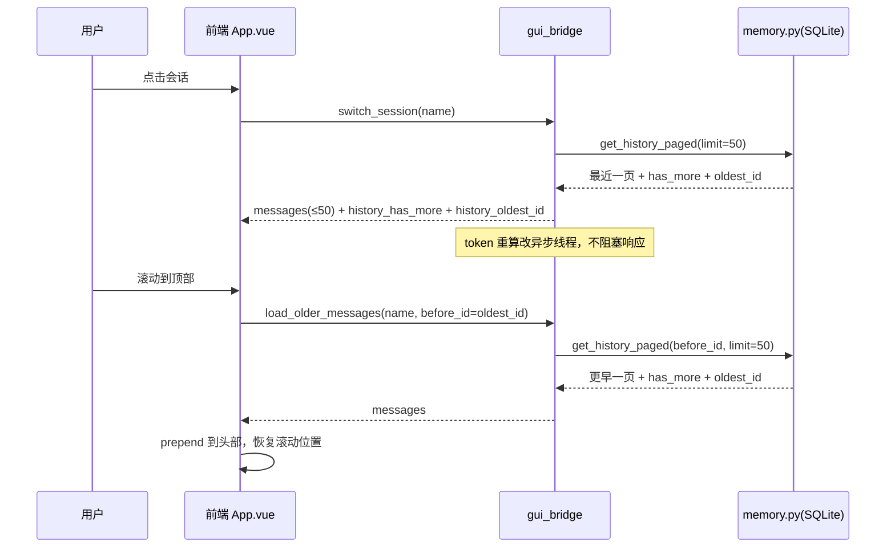

# 会话历史分页懒加载 — 实施方案

> 日期：2026-09-15
> 状态：待评审
> 目标进程：星瑶 GUI（PyWebView + Vue3）

## 1. 背景与问题

用户切换到一个历史会话往往只是"看看记录"，但当前实现是全量加载：

```
点开会话 → 后端 SQLite 读出该会话全部消息（无分页、无缓存）
        → 逐条组装气泡结构 → 整体 JSON 序列化推给前端
        → 同步用 tokenizer 把整个历史重算一遍 token
        → 前端整个消息数组进 Pinia + 全量渲染
```

三个痛点：

1. **后端峰值内存**：大会话（几百条消息含工具输出）全量读出组装，Python pymalloc 峰值上去后不归还系统。
2. **前端驻留内存**：WebView2（Chromium）JS 堆"只进不出"，连逛几个大会话后内存上涨不回落。
3. **附带 CPU 开销**：`switch_session` 内同步 `_recalc_token_usage` 对纯浏览场景是浪费。

## 2. 目标与非目标

**目标**

- 切会话/启动恢复时只加载最近一页（默认 50 条消息），滚动到顶部自动向前翻页。
- 分页边界对齐回合起点（user 消息），保证任一 `TurnGroup` 不被从中间截断。
- `switch_session` 的 token 重算改为异步，切换响应秒回。
- 现有功能零回归：撤销、回合折叠、流式输出、排队消息、媒体附件、错误提示。

**非目标**

- 不改 CLI 端历史展示（终端场景无内存痛点）。
- 不动 `get_history_for_llm`（发给模型的上下文链路保持现状）。
- 不引入虚拟滚动（改动大、收益边际，分页已解决主要矛盾）。
- 不处理会话内消息搜索功能（当前前端无会话内搜索，无需适配）。

## 3. 总体设计



### 3.1 分页协议

- **游标**：消息表自增主键 `messages.id`（比 OFFSET 稳定，新消息插入不影响已加载页的游标）。
- **页大小**：50 条消息（约覆盖数个小回合；常量 `HISTORY_PAGE_SIZE = 50`，便于调优）。
- **回合对齐**：取满一页后，若本页最旧一条不是 `user` 角色且 DB 中还有更早消息，则继续向前取到最近一条 `user` 消息为止（上限 `limit + 30` 条防极端长回合），保证每个 `TurnGroup` 完整。
- **`has_more` 判定**：本页定型（含回合对齐扩展）后，固定执行 `SELECT EXISTS(SELECT 1 FROM messages WHERE session_id=? AND id < 本页最旧消息id)`，存在即 `has_more=True`。

### 3.2 后端改动

**`core/memory.py`**

新增方法（不改动现有 `get_history_with_ids` 签名，CLI 等旧调用方不受影响）：

```python
def get_history_paged(self, session_name, before_id=None, limit=50):
    """分页读取会话历史（含 _msg_id），按 id 正序返回本页。

    before_id=None 时取最新一页；否则取 id < before_id 的一页。
    返回 (messages, has_more)；messages 为时间正序。
    分页边界对齐回合起点：本页最旧一条非 user 且仍有更早消息时，
    向前扩展至最近一条 user（上限 limit+30）。
    """
```

SQL 核心：`WHERE session_id=? AND (before_id 为 NULL 或 id < before_id) ORDER BY id DESC LIMIT ?`，取完反转为正序，再按 3.1 的回合对齐与 `has_more` 规则收尾。

**`gui_bridge.py`**

1. `_load_session_messages(session_name, before_id=None, limit=HISTORY_PAGE_SIZE)`：
   - 内部改调 `get_history_paged`；
   - 返回值从 `List[dict]` 改为 `(msgs, has_more, oldest_id)` 三元组；
   - 现有逐条映射逻辑（strip_context_suffix / sanitize / media / turn_links）原样保留；
   - `_get_session_last_error` 附加逻辑只在 `before_id is None`（首页含末尾消息）时执行。
   - `turn_links` 维持全量加载（msg_id→turn 轻量映射，无内存压力，避免跨页回合缺归属）。
2. `switch_session`：响应中 `messages` 为首页，新增字段 `history_has_more: bool`、`history_oldest_id: int`；`_recalc_token_usage` 改为复用 `_async_recalc_token_usage` 异步执行。
3. `get_initial_state`：`messages` 同样改首页分页 + 分页元信息字段（token 重算本就已异步）。
4. 新增桥接方法：

```python
def load_older_messages(self, session_name: str, before_id: int) -> Dict[str, Any]:
    """向上翻页加载更早历史。返回 {ok, messages, has_more, oldest_id}"""
```

   - 校验：`session_name` 存在、`before_id` 为正整数；会话不存在返回 `ok=False`。
   - 防御：调用方传 `before_id<=0` 或缺省时返回空页 `has_more=False`。

**LAN 端**：`lan_server` 为黑名单制默认放行，`load_older_messages` 自动暴露给手机端；手机端前端复用同一 store 逻辑（见 3.3），无需额外适配。

### 3.3 前端改动

**`frontend/src/types/pywebview.d.ts`**：声明 `load_older_messages` 与 `switch_session` 新返回字段。

**`frontend/src/stores/appStore.ts`**

- 新状态：`historyHasMore: boolean`、`historyOldestId: number | null`、`historyLoading: boolean`（均为当前会话维度，切换会话时随响应重置）。
- `switchSession`：消费响应中的分页元信息写入上述状态。
- 新 action `loadOlderMessages()`：
  1. 守卫：`!historyHasMore || historyLoading || !historyOldestId` 直接返回；
  2. `historyLoading = true`，调 `api.load_older_messages`；
  3. 历史回放清洗（strip_context_suffix / sanitize_protocol_text）统一由后端 `_load_session_messages` 完成，翻页与首页走同一方法，前端拿到消息直接 **prepend** 到 `messages` 头部；
  4. 更新 `historyHasMore/historyOldestId`，`historyLoading = false`；
  5. 竞态防护：请求期间用户切到别的会话，响应回来时校验当前会话名，过期丢弃（沿用 switchSession 已有的竞态模式）。

**`frontend/src/composables/useChatScroll.ts` / `App.vue`**

- `handleScroll` 增加顶部检测：`scrollTop < 120` 且满足守卫 → 调 `store.loadOlderMessages()`。
- **滚动位置保持**（关键体验）：触发加载前记录 `oldScrollHeight` 与 `oldScrollTop`；prepend 完成 `nextTick` 后 `scrollTop = newScrollHeight - oldScrollHeight + oldScrollTop`。贴底跟随（stickToBottom）逻辑不受影响——顶部翻页时用户必然不处于贴底状态。
- 顶部加载指示：`historyLoading` 时在消息流顶部显示"正在加载更早的消息…"细条 spinner；`has_more=false` 且总加载消息数 > 页大小时显示"已到最早记录"轻提示（可选，低成本）。

**`frontend/src/utils/turnGroups.ts`**：无需改动。`buildMessageGroups` 为全量纯函数，prepend 后重算；消息对象身份 key 机制保证已加载部分组件实例复用，只有新 prepend 的旧消息新建组件。

**`MessageNavRail`**：基于已渲染 DOM 统计红点，分页后渐进反映已加载部分，无需改动，行为可接受。

### 3.4 边界与兼容

| 场景 | 行为 |
|---|---|
| 消息数 ≤ 页大小 | `has_more=false`，与现状完全一致 |
| 空会话 | `messages=[]`、`has_more=false` |
| 流式输出中翻页 | 新消息 append 尾部、旧消息 prepend 头部，互不干扰 |
| 翻页请求返回时已有新消息落库 | 游标为旧 id，新消息 id 更大不会被重复拉取 |
| 快速连滚 | `historyLoading` 单飞守卫，不并发请求 |
| 活跃回合快照 / 排队消息 | 走原有字段，不涉及分页 |
| 撤销（turn_undo） | 后端按 session 查 DB，不依赖前端已加载范围，不受影响 |

### 3.5 token 重算异步化

`switch_session` 中 `self._recalc_token_usage(session_name)` → `self._async_recalc_token_usage(session_name)`（已有方法，启动路径在用）。前端 token 用量圆环在异步结果推送后刷新，切换响应本身不再被 tokenizer 阻塞。

## 4. 测试计划（TDD）

**后端 pytest（`tests/`）**

- `test_history_paged.py`：
  - 分页顺序正确（正序返回、游标生效）；
  - `has_more` 边界（恰好一页 / 不足一页 / 空会话）；
  - 回合对齐：边界落在回合中间时向前扩展到 user 消息；
  - 旧接口 `get_history_with_ids` 行为不变（回归）。
- `test_gui_bridge` 增补：
  - `switch_session` 返回 `history_has_more/history_oldest_id` 且消息数 ≤ 页大小+对齐余量；
  - `load_older_messages` 正常页、最后一页、非法 `before_id`、不存在会话；
  - 首页附加 last_error、翻页不附加；
  - `switch_session` 不再同步调用 `_recalc_token_usage`（mock 断言走异步）。

**前端 vitest**

- `appStore`：`loadOlderMessages` prepend 顺序、状态更新、单飞守卫、跨会话竞态丢弃；
- `useChatScroll` / App 集成：滚动到顶部触发加载、prepend 后 scrollTop 补偿公式正确；
- 现有 `switchSession` 相关测试适配新响应字段。

**手工验收**

1. 造一个 200+ 消息的会话，切会话 → 只加载首页，滚动顶部自动翻页，位置不跳动；
2. 翻到最早后出现终止态，不再发请求；
3. 翻页过程中发新消息，流式输出正常；
4. 任务管理器观察：连逛多个大会话，主进程与 WebView2 内存增长幅度较改动前明显收敛；
5. `pytest tests/ -x -q` 与 `npm test` 全绿。

## 5. 实施步骤

1. `memory.get_history_paged` + 单测（先红后绿）。
2. `_load_session_messages` 分页化 + `load_older_messages` 桥接 + 单测。
3. `switch_session` / `get_initial_state` 接入分页与元信息 + token 重算异步化 + 单测。
4. 前端 store 状态与 action + 类型声明 + 单测。
5. `useChatScroll` 顶部触发与滚动补偿 + 加载指示 UI + 测试。
6. 全量回归（pytest + vitest）+ 手工验收 4 项。
7. 更新 `docs/all_features.md` 相关描述。

## 6. 风险

- **滚动补偿在图片/媒体异步加载后偏移**：prepend 的旧消息若含图片，图片加载完成会撑高内容。缓解：补偿在 nextTick 执行，且媒体气泡有固定占位尺寸（现有 media 渲染已带尺寸约束，风险低）；验收时覆盖含图会话。
- **LAN 手机端旧版前端**：未更新的手机端拿到带新字段的响应不受影响（纯增量字段），但不会翻页——可接受，前端随版本升级。
