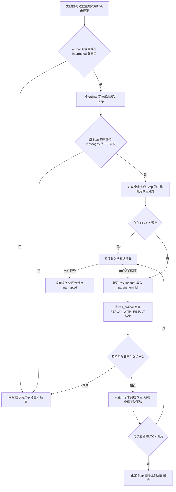

# 星瑶断点续跑（Resume）设计规格

状态：待开发
日期：2026-10-18
适用项目：Y-CODE / 星瑶（Python，GUI + CLI 双端）
文档结构对齐：`待开发/面向ZCode能力借鉴/01-Hooks体系设计规格.md`

> 文中 `文件:符号` 基于 2026-10-18 的 dev 分支，仅供定位；实施时以符号名为准。

## 0. 结论先行

| # | 结论 | 一句话理由 |
|---|---|---|
| 1 | 只读工具允许自动重放，并把已落库结果回灌 | 不产生新副作用，且省掉整段前缀重算 |
| 2 | `workspace` / `network` / `system` 一律**不自动重放**，转显式确认项 | 违反 AGENTS.md「固定 Harness 内核」铁律 |
| 3 | 续跑**新开一个 turn**，用 `parent_turn_id` 关联父回合 | `interrupted` 在状态机里是终态，物理上无法复活 |
| 4 | 续跑**不得触发压缩/摘要/重排**，前缀字节须与父回合最后成功请求一致 | 破坏前缀缓存等于把续跑省下的成本还回去 |
| 5 | 续跑必须可整体关闭（默认关闭），关闭后与现状逐字节一致 | 新能力不得改变既有铁律下的默认语义 |

## 1. 现状与缺口

### 1.1 现有行为（实测代码事实）

| 位置 | 现有行为 |
|---|---|
| `core/harness/models.py:_TURN_TRANSITIONS` | `INTERRUPTED` / `FAILED` / `CANCELLED` / `COMPLETED` 后续集合均为 `frozenset()`——终态不可复活 |
| `core/harness/models.py:_STEP_TRANSITIONS` | 同上，`StepStatus.INTERRUPTED` 亦为终态 |
| `core/memory.py:interrupt_stale_harness_runs` | 心跳过期 owner 名下非终态 Turn/Step 一律 `UPDATE ... SET status='interrupted'`，到此为止 |
| `core/harness/journal.py:HarnessJournal` | 只有 create / transition / append_event / commit_messages；不记录任何正文 |
| `core/harness/runtime.py:StepRuntime.capture_request` | 写入 `protocol / cache_scope / 四类 sha256 / 各类字节数 / attempt_count / deepseek_generation_id` |
| 同上 | `harness_steps.model`、`harness_steps.api_base` 两列**建表存在但全仓无写入点**（无 `SET model`） |
| `core/harness/tool_pipeline.py:build_tool_result_event_draft` | 工具结果**只在提交时**写一条 `TOOL_RESULT_COMMITTED`，带 `call_ordinal / arguments_sha256 / result_sha256 / result_status` |
| `core/harness/models.py:HarnessEventKind` | `TOOL_STARTED` / `TOOL_FINISHED` 已声明，**全仓无写入点**（默认未启用） |
| `core/llm.py:flush_persistence` | 助手/工具消息按序落库，事件与消息同事务提交（`add_messages_with_harness_events`） |
| `core/llm.py:salvage_persistence_on_cancel` | **仅进程存活时**有效：取消时给悬空 `tool_calls` 合成取消占位结果，保住已完成输出 |
| `core/memory.py:export_harness_journal` | 只读导出 turns/steps/events 全列（含全部哈希），可直接作续跑读取面 |

### 1.2 进程被杀与用户取消的差异

| 场景 | 消息落库 | journal | 结果 |
|---|---|---|---|
| 用户按停止 | `salvage_persistence_on_cancel` 打捞并 flush | 收敛 `cancelled` | 半截进度可读，可人工接着做 |
| 模型超时/网关断开 | 已提交 Step 保留，未提交 Step 全丢 | 最终 `failed` | 已提交 Step 的正文在 |
| **进程被杀 / 掉电** | 内存态 `pending_persistence` 全丢 | 重启后被标 `interrupted` | 当前 Step 全部消息（含已算出的工具结果）蒸发 |

### 1.3 当前丢失的东西

| 丢失项 | 证据 | 用户感受 |
|---|---|---|
| 已完成但未提交的只读结果 | 只存在 `pending_persistence` 内存队列；journal 无正文，事件也未写 `TOOL_STARTED` | 「刚读了 30 个文件，全白读」 |
| 模型路由快照（model / api_base / 亲和 lane） | `harness_steps.model`、`.api_base` 空；lane 只有哈希 | 续跑可能悄悄换路由，缓存必挂 |
| 部分结论（半截正文 + reasoning） | 未 flush 即丢；`salvage_streaming_partial` 同样只在进程内生效 | 「写了 800 字的方案没了」 |
| 工具执行粒度 | 只有 Step 级状态；`tools_running` 崩溃后无法区分 0/5 还是 5/5 | 只能整 Step 重来，重来就重复副作用 |

### 1.4 目标与非目标

**目标**：崩溃/失败后一键「从断点继续」；已完成只读工作零重算；写操作永不自动重放；续跑请求前缀字节不变；全链可关闭。

**非目标**：不做跨进程两阶段提交写文件；不做「自动重放写操作 + 事后撤销」补偿事务；不做跨机器续跑；不改 `messages` 表结构与工具入参语义。

## 2. 设计原则

| # | 原则 | 含义 | 硬约束 |
|---|---|---|---|
| P1 | 只读可重放 | 重复执行不改变世界 | 重放前必须过 §3 判定表 |
| P2 | 写操作永不自动重放 | 命中 `workspace/network/system` 即停 | 不存在「允许自动重放写」开关 |
| P3 | 结果可验证 | 回灌前用 `result_sha256` 重算校验 | 只用哈希，不用长度/前缀等弱信号 |
| P4 | 缓存亲和不可破 | 四哈希须与父回合锚点一致 | 不一致直接放弃自动续跑 |
| P5 | 幂等 | 同一父回合只能成功续跑一次 | owner 租约 + 唯一性校验 |
| P6 | 宁停不猜 | 无法确证一律要求手动重来 | 禁止「大概没跑过，试一下」 |

## 3. Step 分类与白名单

### 3.1 判定顺序（三信号联合判定）

```
classify_replay(tool_name, spec, overrides) -> ReplayClass
  1. overrides 例外表命中 → 直接返回（最高优先级，见 3.4）
  2. spec 缺失（下线/未注册）→ BLOCK
  3. 插件 / MCP 动态工具 → BLOCK（其 side_effect_scope 常为默认 none，不可信）
  4. spec.side_effect_scope in {workspace, network, system} → BLOCK
  5. scope == none 且 spec.read_only 为 True → REPLAY_WITH_RESULT
  6. 其余 → BLOCK
```

三值含义：`REPLAY_WITH_RESULT`（回灌旧结果，不发请求）/ `REPLAY_FRESH`（重跑但丢弃旧结果、不校验旧哈希）/ `BLOCK`（暂停转确认）。

### 3.2 判定表

| side_effect_scope | read_only | 分类 | 续跑动作 |
|---|---|---|---|
| `none` | True | `REPLAY_WITH_RESULT` | 直接回灌 `messages` 表已提交结果 |
| `none` | True 但时间敏感（例外表） | `REPLAY_FRESH` | 重新执行，结果新鲜化 |
| `none` | False / 未知 | `BLOCK` | 视同写操作，显式确认 |
| `workspace` | 任意 | `BLOCK` | 显式确认，绝不自动执行 |
| `network` | 任意 | `BLOCK` | 显式确认（外发不可撤销，对端可能已变） |
| `system` | 任意 | `BLOCK` | 显式确认 |
| 未注册 / 插件 / MCP | 任意 | `BLOCK` | 显式确认 + 提示工具可能已下线 |

### 3.3 白名单（按 `core/tool_registry.py:build_default_registry` 实测快照）

| 分类 | 工具 |
|---|---|
| `REPLAY_WITH_RESULT` | `read_file`、`list_directory`、`search_code`、`find_definition`、`glob_files`、`recall_history`、`tool_result_read`、`search_sessions`、`search_conversations`、`plan_read`、`mcp_list_servers`、`automation_list` |
| `REPLAY_FRESH` | `get_weather`（scope 标 `none`，实际出网且结果随时间变化） |
| `BLOCK`（写/网络/系统，节选） | `write_file`、`edit_file`、`plan_write`、`plan_update`、`plan_retry`、`plan_resume_takeover`、`undo_turn`、`browser_set_viewport`、`automation_create/update/delete/run_now`、`fetch_url`、`search_news`、`fetch_image`、`execute_command`、`run_subagent`、`dispatch_task`、`open_session`、`plan_finish`、`mcp_add_server`、`mcp_remove_server`、`mcp_set_enabled`、`ask_user`、`manage_task` |

> `ask_user` 与 `manage_task` 虽 `scope=none`，但一个阻塞等真实用户、一个触碰运行中子代理租约，重放会二次打扰或写错租约，故显式归 `BLOCK`（例外表驱动，不改 scope）。

### 3.4 例外表与「为什么不改 side_effect_scope」

例外表落在新增常量模块 `core/harness/resume_policy.py`，不触碰注册表：

| 例外 | 归类 | 为什么不改 scope |
|---|---|---|
| `get_weather` | `REPLAY_FRESH` | 被 `core/harness/tool_pipeline.py:_PLAN_READ_ONLY_TOOLS` 当只读放行，改 scope 会连带改计划门禁 |
| `ask_user` | `BLOCK` | 属交互而非副作用，改 scope 会误伤 `_PLAN_ROOT_CONTROL_TOOLS` 语义 |
| `manage_task` | `BLOCK` | 归 `none` 是为秘书只读面服务，改 scope 会破坏秘书可用性 |
| 全部插件/MCP 工具 | `BLOCK` | `core/secretary.py` 注释已记录「插件工具的 side_effect_scope 常依赖默认值 none」，字段不可信 |

**结论**：续跑不改任何既有 `side_effect_scope`，只在自己的判定层加例外表，避免牵动秘书门控、计划门禁与 `core/llm.py:_registry_scope_map`。

## 4. 续跑流程

### 4.1 触发与入口

| 入口 | 触发点 | 说明 |
|---|---|---|
| GUI | 可续跑回合的错误条旁给「从断点继续」 | 复用现有 `turn_error` 展示位 |
| CLI | `/resume`（无参数取本会话最近可续跑回合） | 与 `/undo` 同级，终端交互确认 |
| 程序化 | `ResumeExecutor(...).run(plan)` | 供测试与后续自动化调用 |

### 4.2 流程图



### 4.3 续跑属于哪个 turn：新开 turn

| 方案 | 可行性 | 判定 |
|---|---|---|
| 复活父 turn（`interrupted → running`） | `_TURN_TRANSITIONS[INTERRUPTED] = frozenset()`，且 transition 是 CAS（`WHERE status = expected`） | **不可行**，需改状态机铁律 |
| 在父 turn 上追加 Step | `StepRuntime` 需 `TurnRuntime.begin_step` 的 `status is RUNNING` 前置 | **不可行** |
| 新开 turn + `parent_turn_id` 关联 | `core/llm.py:chat_with_model_events` 已支持 `parent_turn_id` 参数 | **采用** |

**建议**：续跑一律新开 turn（新 `turn-<uuid8>`），`parent_turn_id` 指向父回合。理由：① 审计清晰——失败回合与续跑回合是两个独立 Turn，`started_at_ms`/`error_code` 不被覆盖；② cancel 语义清晰——用户按停止只取消 resume turn，不会把父回合从 `interrupted` 改成 `cancelled`；③ 无需破例改状态机，违例风险为零。

### 4.4 接口与数据流

```python
# core/harness/resume.py（新增，只读 journal + 只读 messages）
@dataclass(frozen=True)
class ReplayDecision:
    call_ordinal: int; tool_name: str
    klass: str                    # REPLAY_WITH_RESULT | REPLAY_FRESH | BLOCK
    arguments_sha256: str | None; result_sha256: str | None
    message_row_present: bool

@dataclass(frozen=True)
class ResumePlan:
    session_name: str; parent_turn_id: str; resume_from_step_ordinal: int
    decisions: tuple[ReplayDecision, ...]
    anchor: dict                  # messages/system/tools/cache_lane 四哈希 + message_count
    blockers: tuple[str, ...]     # 非空则必须用户确认

class ResumePlanner:
    def plan(self, session_name: str) -> ResumePlan | None: ...
    def aborts(self, plan: ResumePlan) -> list[str]: ...   # §7 降级判定

class ResumeExecutor:
    def run(self, plan: ResumePlan, *, confirmed: frozenset[int], cancel_event) -> str: ...
```

数据流：`export_harness_journal(session_name=...)`（只读）→ `ResumePlanner` → 用户确认 → `ResumeExecutor` → `chat_with_model_events(..., parent_turn_id=父回合, request_reason="resume")`。

**回灌源必须是 `messages` 表**（唯一事实源），journal 只负责「该不该回灌」与哈希校验，正文禁令因此不被触碰。

## 5. Journal 需要补充记录的字段

### 5.1 允许字段类型（白名单）

只允许：状态枚举、ID、序号、时间戳、耗时、布尔标记、字节数、计数、`sha256` 摘要。**禁止**：用户/助手正文、reasoning、工具参数原文、工具结果原文、凭据、缓存亲和值原文。

### 5.2 字段表与写入时机

| 表.列 | 类型 | 写入时机 | 用途 |
|---|---|---|---|
| `harness_turns.parent_turn_id` | ID TEXT | `create_harness_turn`（普通回合写自身 turn_id） | 续跑追溯父回合 |
| `harness_turns.turn_kind` | 状态 TEXT `normal\|resume` | 同上 | 区分续跑回合，便于审计统计 |
| `harness_turns.resume_from_step_ordinal` | 序号 INTEGER | 同上 | 断点位置，普通回合为 NULL |
| `harness_steps.model`（列已存在） | ID TEXT | `capture_request` 补写 | 路由快照，防换模型 |
| `harness_steps.api_base`（列已存在） | ID TEXT | `capture_request` 补写 | 路由快照，防跨中转 |
| `harness_steps.replay_of_step_id` | ID TEXT | `create_harness_step` | 续跑 Step 指向父 Step |
| `harness_steps.tool_call_count` | 计数 INTEGER | `mark_tools_running` | 区分 0/5 与 5/5 |
| `harness_events` kind `RESUME_STARTED` | 状态 | 续跑回合创建时 | 审计起点 |
| `harness_events` kind `RESUME_READ_REPLAYED` | 事件（带 `step_id/call_ordinal/tool_name/result_sha256`） | 每个回灌调用 | 证明未重复执行 |
| `harness_events` kind `RESUME_WRITE_CONFIRM_REQUIRED` | 事件（带 `call_ordinal/tool_name/arguments_sha256`） | 命中 BLOCK 时 | 确认项留痕 |
| `harness_events` kind `RESUME_ABORTED` | 事件（带 `error_code`） | 降级时 | 用户可见原因 |
| 启用 `TOOL_STARTED` / `TOOL_FINISHED`（已声明） | 事件 | `begin_batch` / `execute_batch` 逐调用即时写 | 补齐粒度 |

> 写放大约束：`TOOL_STARTED`/`TOOL_FINISHED` 从「提交时批量写」变为「逐调用即时写」，开销需实测；若单 Step 工具过多允许按批 flush，但必须保证「已写 STARTED 未写 FINISHED」可被识别为不确定态（→ `BLOCK`）。

> 明确不新增：`*_payload` / `*_json` / `*_text` / `*_preview` 列；需要展示工具结果摘要时从 `messages` 按 `message_id` 取，不复制进 journal。
## 6. 与上下文缓存的关系

### 6.1 三个字节锚点

续跑回合第一条请求必须与父回合锚点逐字节同前缀，用已落库的哈希校验：

| 锚点 | 来源列 | 不符时 |
|---|---|---|
| 消息前缀 | `messages_sha256` + `message_count` | 放弃自动续跑 |
| system 前缀 | `system_sha256` + `system_message_count` | 放弃自动续跑 |
| tools 顺序 | `tools_sha256` | 放弃（不重排、不删减） |
| 缓存亲和 | `cache_lane_sha256` | 放弃（路由/亲和已变） |

### 6.2 续跑绝对不做的四件事

| 禁止动作 | 原因 |
|---|---|
| 触发压缩/摘要 | `core/agent_service.py:prepare_turn_messages` 的 snip/elide/预压缩/摘要都会改写历史字节 |
| 重新摘要或插入新摘要块 | `get_history_for_llm` 的 `history[0]` 摘要变更即前缀变更 |
| 重排 messages / tools | 同上，且 `tools_sha256` 立刻失配 |
| 追加新 user 提示（如「请继续」） | 会改动 `messages_sha256`；续跑语义靠 `request_reason="resume"` 与 journal 事件表达 |

### 6.3 组装路径

续跑**不得复用** `prepare_turn_messages` 的维护段（水位线 snip/elide/预压缩/摘要/滑窗），只复用无副作用部分：

```
续跑组装 = build_stable_system_message(is_gui, session_name)
         + manager.get_history_for_llm(session_name)   # 只读、纯拼接
         + build_dynamic_prompt(...)                    # 与会话级快照一致
```

会话级稳定前缀快照（`get_session_stable_skills_len` / `_render_stable_system_extra_sections`）在父回合已定型，续跑不得重新定型；组装完成后第一件事是断言四哈希，失败立即 `RESUME_ABORTED`。

## 7. 失败与边界

| 场景 | 检测方式 | 降级行为 |
|---|---|---|
| journal 缺失/无记录 | `export_harness_journal` 空或无该 turn | 提示「无断点信息，请手动重来」，不进入续跑 |
| 父回合非 `interrupted` | 比对 `harness_owners.heartbeat_at_ms` 与 `_OWNER_STALE_AFTER_MS` | 拒绝并提示「该回合仍可能在别的进程里运行」 |
| 只读结果哈希不符 | `sha256(messages 行内容) != result_sha256` | 只读项降级 `REPLAY_FRESH`，写项 `BLOCK`；记 `RESUME_ABORTED` |
| 事件与消息行不对应 | `TOOL_RESULT_COMMITTED` 存在但无对应 `message_id` | 该 Step 整体视为未完成，全部重分类 |
| 工具已下线/未注册 | `ToolRegistry.get` 抛错 | 该项 `BLOCK`，提示工具不可用 |
| 权限档位变严 | `get_session_permission_mode` 现值比父回合快照更严 | 写操作一律 `BLOCK`，逐项重走权限链 |
| 权限档位变宽 | 同上，方向相反 | 允许续跑，但写操作仍需确认（不放行免确认） |
| 会话已归档 | `archive_session` 标记存在 | 拒绝续跑，提示先取消归档 |
| 会话在 undo 冻结态 | `core/turn_undo/` 存在 `INTERRUPTED`/`RECOVERING` checkpoint 覆盖目标路径 | 拒绝续跑，提示先 `/undo recover` |
| 四哈希不符 | 组装后断言 | 放弃自动续跑（缓存已破，续跑失去收益且可能错位） |
| 并发续跑 | `harness_turns` 唯一性 + owner 租约 | 第二个请求直接失败，不排队 |
| 续跑回合再失败 | 正常 `failed` | 可二次续跑，`parent_turn_id` 指向紧邻的上一个 resume turn，链式可追 |

**统一原则**：任一条不通过即要求用户手动重来，不猜测、不部分续跑、不「先跑再说」。

## 8. 验收清单

| 编号 | 前置状态 | 操作 | 期望观测 |
|---|---|---|---|
| R-T1 | 功能开关关闭（默认） | 构造崩溃后重启 | 行为与改动前逐字节一致；无 `resume` 事件；`test_prompt_byte_stability.py` 与 `test_provider_payload_golden.py` 通过 |
| R-T2 | 父回合停在 `tools_running`，3 个 `read_file` 已完成 | 触发续跑 | 3 个 `read_file` **不重新执行**；出现 3 条 `RESUME_READ_REPLAYED`；结果与崩溃前 `messages` 行逐字节相同 |
| R-T3 | 同上，含 1 个已完成的 `write_file` | 触发续跑 | 暂停并列出该待确认项；确认前零工具执行、零模型请求 |
| R-T4 | 同 R-T3 | 用户拒绝确认 | 父回合仍 `interrupted`；无 resume turn；`RESUME_ABORTED` 带 `user_declined` |
| R-T5 | 同 R-T3 | 用户逐项同意 | 仅被同意项执行；每个写操作有独立审计事件与 `result_sha256` |
| R-T6 | 父回合 3 Step 已完成 2 | 续跑 | 新 turn 的 `parent_turn_id` = 父 turn_id，`resume_from_step_ordinal=3`，父回合**仍为** `interrupted` |
| R-T7 | 父回合锚点存在 | 续跑首个请求 | 四哈希与父回合最后成功 Step 完全一致；无压缩、无摘要、无新 user 消息 |
| R-T8 | 父回合后用户手工改过历史（触发 snip） | 续跑 | 四哈希断言失败，直接提示手动重来；不发任何模型请求 |
| R-T9 | 只读工具结果行被外部改写 | 续跑 | 该调用为 `REPLAY_FRESH` 或 `BLOCK`；不静默使用不一致结果 |
| R-T10 | 续跑前权限档位由 `full` 降到 `plan` | 续跑 | 所有写操作转 `BLOCK`；先前免确认状态不继承 |
| R-T11 | 会话已被归档 | 触发续跑 | 拒绝并提示先取消归档 |
| R-T12 | 存在 `RECOVERING` 的 turn undo checkpoint | 触发续跑 | 拒绝并提示先 `/undo recover` |
| R-T13 | 父回合 owner 心跳仍新鲜 | 触发续跑 | 拒绝并提示回合可能在别处运行；不抢租约 |
| R-T14 | 连续两次崩溃续跑 | 第二次续跑 | `parent_turn_id` 指向紧邻上一个 resume turn；journal 可回溯成链 |
| R-T15 | 插件/MCP 暴露 `scope=none` 的写工具 | 续跑遇该工具 | 归 `BLOCK`，不因 `scope=none` 被自动重放 |
| R-T16 | 单 Step 含 8 个只读调用 | 续跑 | `TOOL_STARTED` 有记录但 `TOOL_FINISHED` 缺失的调用被识别为不确定态并归 `BLOCK` |

## 9. 红线

1. **不自动重放 `workspace` / `network` / `system` 工具**，也不提供任何「允许自动重放写操作」的配置项。
2. **不破坏 prompt 字节 golden**：`tests/test_prompt_byte_stability.py`、`tests/test_provider_payload_golden.py` 必须保持通过，黄金字节不得为迁就续跑而改写。
3. **不改 `messages` 表的唯一事实源地位**：journal 只做索引，正文一律回 `messages` 取，禁止复制工具结果/助手正文进 journal。
4. **不新增第三方依赖**，续跑只用标准库 + 现有 SQLite 表。
5. **续跑必须可整体关闭**（默认关闭），关闭时状态机、事件序列、请求字节与现状完全一致。
6. **不改 `interrupted` 终态语义**，不改 `_TURN_TRANSITIONS` / `_STEP_TRANSITIONS` 任何一条边。
7. **不改既有 `side_effect_scope` 取值**：例外只落在续跑自己的策略表，避免牵动 `core/secretary.py` 门控与计划门禁。
8. **续跑不得触发压缩/摘要/重排/新 user 消息**；四哈希断言失败必须放弃，不得「先发请求试试」。
9. **不得静默续跑**：命中任何 `BLOCK` 项一律停下等确认，禁止用默认值自动通过。

## 10. 实施拆分建议

| 阶段 | 改动面 | 交付物 | 风险等级 | 独立验收 |
|---|---|---|---|---|
| **S1 记录补全** | `core/memory.py`（三表加列 + 迁移 + 只读导出扩展）、`core/harness/runtime.py`（补写 `model`/`api_base`/`tool_call_count`）、`core/harness/models.py`（新 kind 枚举）、`core/harness/tool_pipeline.py`（启用逐调用事件） | journal 能回答「跑到第几个调用、路由是什么」 | 中（写放大、事件序列新增） | R-T16；既有 `tests/test_harness_*.py` 全绿 |
| **S2 判定层** | 新增 `core/harness/resume_policy.py`（判定表 + 例外表）、`core/harness/resume.py: ResumePlanner` | 纯函数、零副作用，单测全覆盖 | 低（纯新增） | R-T9 / R-T10 / R-T15；判定表逐行单测 |
| **S3 执行层** | `core/harness/resume.py: ResumeExecutor`、`core/llm.py`（`request_reason="resume"` 路径、跳过维护段）、`core/agent_service.py`（新增无副作用续跑组装函数） | 真正可续跑，带四哈希断言 | **高**（触碰请求组装与缓存） | R-T2 / R-T6 / R-T7 / R-T8 / R-T14；byte golden 全绿 |
| **S4 入口与开关** | `gui_bridge.py`（错误条按钮）、`main.py`（`/resume`）、`core/memory.py:set_session_last_error` 状态位、配置项 `resume.enabled`（默认 false） | 用户可用，可整体关闭 | 中（GUI/CLI 双端） | R-T1 / R-T3 / R-T4 / R-T5 / R-T11 / R-T12 / R-T13 |

**纪律**：每阶段独立提交、独立可回滚；S3 前不合并任何入口改动，确保默认线上行为零变化。

**未决风险**：逐调用事件写放大约需 S1 实测，必要时批量 flush + 未完成态识别；读取类结果过期靠 `result_sha256` 兜底；续跑省下的 token 用 `add_cache_request_diagnostic` / `query_cache_diagnostic_summary` 量化；与 `core/turn_undo/` 冻结态、多端并发续跑两处冲突一律拒绝而非排队。
