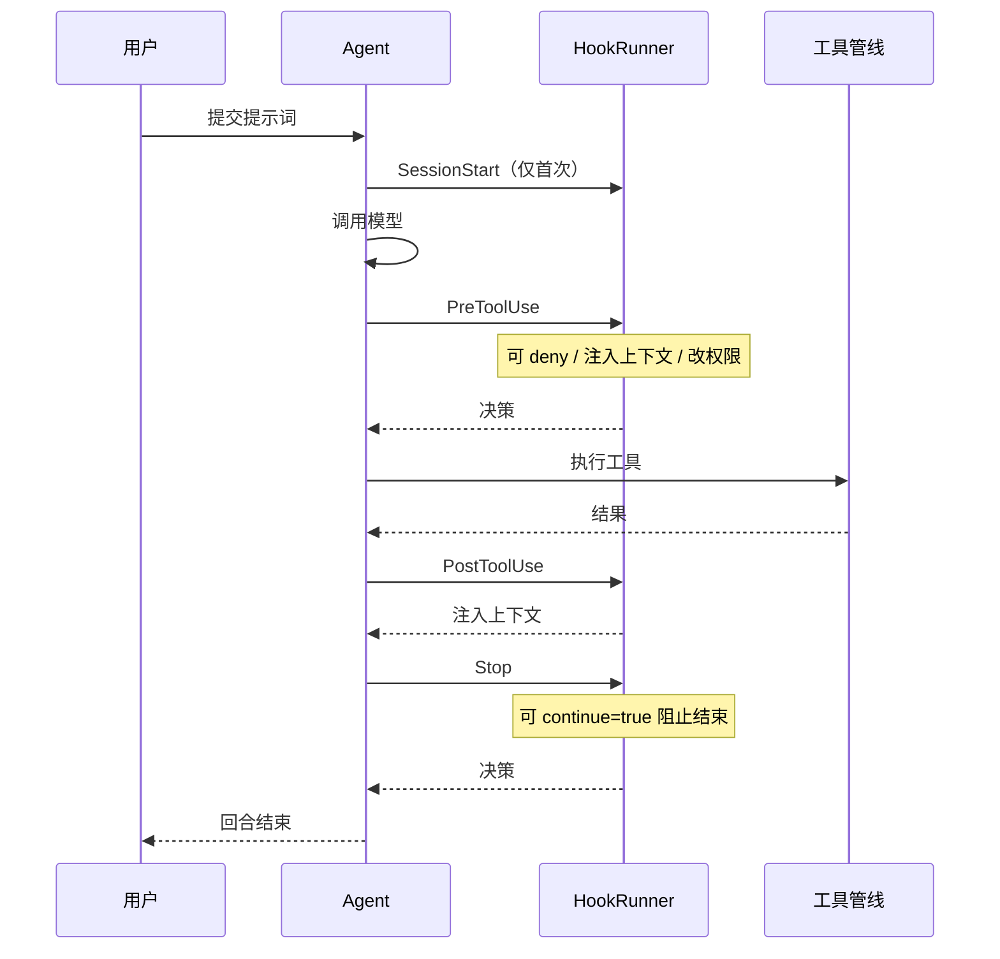
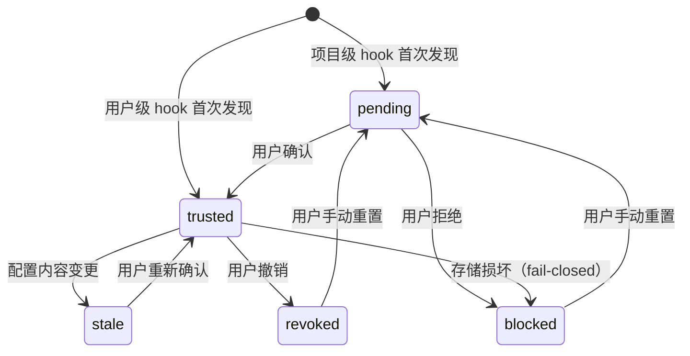

# 星瑶 Hooks 体系设计规格

状态：待开发
日期：2026-09-21
适用项目：Y-CODE / 星瑶（Python，GUI + CLI 双端）

> 文中 `file:line` 基于 2026-09-21 的 dev 分支，仅供定位；实施时以符号名（函数/类/变量名）为准。

---

## 1. 背景与目标

### 1.1 为什么需要 Hooks

星瑶目前无法让用户在 agent 的决策链路上"插针"。用户想实现"改完文件自动跑 formatter"、"拦截危险命令"、"任务没做完别结束回合"这类需求，只能改星瑶源码。

ZCode 用 7 个事件点解决了这个问题（`contracts/src/hooks/index.ts`）：`SessionStart` / `UserPromptSubmit` / `PreToolUse` / `PermissionRequest` / `PostToolUse` / `PostToolUseFailure` / `Stop`。用户写脚本即可在这些点介入。

### 1.2 星瑶现状

**完全空白**。全仓无用户级生命周期钩子。仅有两个内部回调：

- `core/plugin_loader.py` 的 `set_trust_prompt`（插件信任确认弹窗）
- `core/tools.py` 的 `set_on_terminal`（终端输出回调，见 `tests/test_tools.py:677`）

两者都是内部实现细节，非用户可配置。

### 1.3 目标

- 用户可在 `~/.ycode/hooks.json`（用户级）与 `<project>/.ycode/hooks.json`（项目级）声明 hook
- hook 为 shell 命令，通过 stdin 收 JSON、stdout 返回 JSON
- 支持「注入上下文」「阻断执行」「修改权限决策」三种干预能力
- **项目级 hook 必须经过信任确认**，防止 clone 恶意仓库即执行其代码
- 不阻塞回合：hook 有超时与取消语义

### 1.4 非目标

- **不做 `process` 类型 hook**（只做 `command`，即 shell 命令）
- **不支持修改工具入参**（`updatedInput`）——风险高，v2 再议
- **不做 `PermissionRequest` / `PostToolUseFailure` 事件**（v2）
- **不做 async/background hook**（v1 全部前台同步执行）
- **不做 hook 的远程分发**（不随插件市场）

---

## 2. 事件点设计

v1 只做 4 个事件。

| 事件 | 触发时机 | 输入 | 能否阻断 | 能否注入上下文 | 能否改权限 |
|---|---|---|---|---|---|
| `SessionStart` | 会话创建或恢复后 | 会话 ID、工作目录、模型、权限模式、来源（startup/resume） | ✗ | ✓ | ✗ |
| `PreToolUse` | 工具执行前，权限判定之后 | 工具名、入参、风险等级、权限决策 | ✓（deny） | ✓ | ✓（可改 ask→allow / allow→deny） |
| `PostToolUse` | 工具成功执行后 | 工具名、入参、结果摘要、耗时 | ✗ | ✓ | ✗ |
| `Stop` | 模型准备结束回合时 | 回合响应摘要、工具调用次数 | ✓（阻止结束） | ✓ | ✗ |

### 2.1 事件顺序



### 2.2 PreToolUse 的权限决策语义

**关键约束**：hook 的权限决策**只能在用户当前档位范围内调整，不得提权**。

| 用户档位 | hook 可做 | hook 不可做 |
|---|---|---|
| `plan`（只读） | 追加 deny | 放开写操作 |
| `confirm` | ask→deny / ask→allow（仅限已在该档位允许的操作） | 把写操作放行为 allow |
| `accept_edits` | deny | 超出档位的操作 |
| `full` | deny | — |

**实现约束**：hook 返回的 `allow` 必须经过 `core/permission_policy.py` 的档位校验，**不直接生效**。

---

## 3. 配置格式

### 3.1 文件位置

| 位置 | 作用域 | 信任要求 |
|---|---|---|
| `~/.ycode/hooks.json` | 用户级 | 默认信任（用户自己写的），可撤销 |
| `<project>/.ycode/hooks.json` | 项目级 | **默认不信任**，需用户确认 |

### 3.2 格式

```json
{
  "version": 1,
  "hooks": {
    "PreToolUse": [
      {
        "matcher": "write_file|edit_file",
        "command": "python ~/.ycode/hooks/check_write.py",
        "timeout_ms": 10000,
        "status_message": "检查写入规则"
      }
    ],
    "PostToolUse": [
      {
        "matcher": "*",
        "command": "python ~/.ycode/hooks/format.py"
      }
    ],
    "Stop": [
      {
        "matcher": "*",
        "command": "python ~/.ycode/hooks/check_done.py",
        "timeout_ms": 30000
      }
    ]
  }
}
```

**字段说明**：

| 字段 | 必填 | 默认 | 说明 |
|---|---|---|---|
| `matcher` | ✗ | `"*"` | 匹配工具名，支持 `|` 分隔多个、`*` 通配。仅 `PreToolUse` / `PostToolUse` 有效 |
| `command` | ✓ | — | shell 命令，通过系统 shell 执行 |
| `timeout_ms` | ✗ | `60000` | 超时时间，上限 300000 |
| `status_message` | ✗ | — | GUI 展示的状态文案（不参与信任指纹） |
| `disabled` | ✗ | `false` | 单条禁用开关 |

### 3.3 stdin 输入格式

```json
{
  "hook_event_name": "PreToolUse",
  "session_id": "sess_xxx",
  "turn_id": "turn_xxx",
  "cwd": "D:\\project",
  "permission_mode": "confirm",
  "timestamp": "2026-09-21T10:56:15+08:00",
  "tool_name": "write_file",
  "tool_input": {"file_path": "a.py", "content": "..."},
  "risk_level": "medium",
  "permission_decision": "ask"
}
```

**注意**：`tool_input` 可能包含敏感内容。**用户级 hook 可收到完整入参；项目级 hook 默认只收到工具名与参数键名**（防止恶意项目 hook 窃取用户数据）。这需要配置项 `project_hook_full_input`（默认 `false`）显式开启。

### 3.4 stdout 输出格式

hook 通过 stdout 返回 JSON（非 JSON 输出视为无干预）：

```json
{
  "continue": true,
  "decision": "approve",
  "reason": "符合项目规范",
  "additional_context": "注意：本项目的配置文件必须保持 CRLF 换行",
  "permission_decision": "allow"
}
```

**字段语义**：

| 字段 | 适用事件 | 说明 |
|---|---|---|
| `continue` | 全部 | `false` 表示阻断（PreToolUse 拒绝工具、Stop 阻止结束） |
| `decision` | PreToolUse / Stop | `"approve"` / `"block"` |
| `reason` | 全部 | 阻断原因，会展示给用户与模型 |
| `additional_context` | 全部 | 注入的上下文文本 |
| `permission_decision` | PreToolUse | `"allow"` / `"ask"` / `"deny"` |

**退出码语义**：

| 退出码 | 含义 |
|---|---|
| 0 | 正常，解析 stdout |
| 非 0 | hook 执行失败，**不阻断流程**（记为 warning，回合继续） |
| 超时 | 同非 0，记为 timeout |

---

## 4. 信任机制（核心安全设计）

### 4.1 威胁模型

项目级 hook 配置随仓库 clone 而来。用户 clone 一个恶意仓库后，如果直接执行其 hook，等同在本机执行攻击者的任意 shell 命令。

### 4.2 信任状态机



| 状态 | 可执行 | 说明 |
|---|---|---|
| `pending` | ✗ | 待用户确认，GUI 弹出确认卡片 |
| `trusted` | ✓ | 已信任 |
| `blocked` | ✗ | 用户拒绝或存储损坏，不再询问 |
| `stale` | ✗ | 配置内容变更，信任失效 |
| `revoked` | ✗ | 用户主动撤销 |

### 4.3 信任指纹

```python
def compute_hook_digest(hook_entry: dict, source_path: str) -> str:
    """计算单条 hook 的信任指纹。

    只包含「影响执行行为」的字段，不含 status_message 等展示字段：
      - 事件的规范化 JSON（sort_keys=True, separators=(',',':')）
      - command 原文
      - matcher
      - timeout_ms（归一化后的值）
      - source_path（区分同名不同位置的 hook）
    返回 sha256 hexdigest。
    """
```

**关键点**：`status_message` 变更**不**导致信任失效（纯展示字段）；`command` / `matcher` / `timeout_ms` 任一变更**都**导致失效。

### 4.4 存储格式

`~/.ycode/hook_trust.json`：

```json
{
  "version": 1,
  "records": {
    "<workspace_identity>::<hook_digest>": {
      "decision": "trusted",
      "source_path": "D:\\project\\.ycode\\hooks.json",
      "command_at_grant": "python ~/.ycode/hooks/format.py",
      "granted_at": "2026-09-21T10:56:15+08:00",
      "expires_at": null
    }
  },
  "revoked": ["<workspace_identity>::<hook_digest>"]
}
```

`workspace_identity` = 工作目录的规范化绝对路径（与 `core/workspace_context.py` 保持一致）。

### 4.5 与既有插件信任机制的关系

`core/plugin_loader.py` 已有内容指纹 + `plugin_trust.json` 的信任模式。**hook 信任复用同一套设计思路，但独立存储文件**，因为：

- 插件的信任粒度是"整个插件"，hook 是"单条 hook"；
- 插件信任失效条件是 manifest 变更，hook 是 hook 条目变更；
- 混在一起会让语义模糊。

**复用部分**：指纹计算函数（抽到公共模块）、GUI 确认卡片组件、`runtime_warnings` 记录方式。

---

## 5. 架构设计

### 5.1 模块划分

```
core/hooks/
├── __init__.py           # 导出公开 API
├── types.py              # HookEvent / HookRegistration / HookInput / HookOutput 等契约
├── registry.py           # 配置加载、解析、matcher 匹配
├── trust.py              # 信任状态机、指纹计算、存储读写
├── runner.py             # HookRunner：执行、超时、结果聚合
└── executor.py           # 单 hook 执行：spawn shell、stdin/stdout 编解码
```

**为什么拆 5 个文件**：对齐星瑶 `core/harness/` 的既有拆分粒度（该目录 12 个模块负责一条工具管线）。不建议拆得更细（如把 executor 再拆 stdout/退出码处理），会造成阅读跳转成本。

### 5.2 核心数据结构

```python
# core/hooks/types.py

class HookEvent(str, Enum):
    SESSION_START = "SessionStart"
    PRE_TOOL_USE = "PreToolUse"
    POST_TOOL_USE = "PostToolUse"
    STOP = "Stop"

@dataclass(frozen=True)
class HookRegistration:
    """一条已加载、已通过信任校验的 hook。"""
    event: HookEvent
    matcher: str              # "*" 或 "a|b|c"
    command: str
    timeout_ms: int
    status_message: str
    source_path: str
    scope: Literal["user", "project"]
    digest: str

@dataclass(frozen=True)
class HookInput:
    hook_event_name: str
    session_id: str
    turn_id: str
    cwd: str
    permission_mode: str
    timestamp: str
    # 事件特有字段
    tool_name: str = ""
    tool_input: dict | None = None
    risk_level: str = ""
    permission_decision: str = ""
    tool_result_preview: str = ""
    tool_call_count: int = 0
    response_preview: str = ""

@dataclass
class HookRunResult:
    """多个 hook 的聚合结果。"""
    additional_contexts: list[str]
    block_requested: bool          # 需阻断
    block_reason: str
    permission_override: str | None  # "allow" / "ask" / "deny"
    continue_after_stop: bool      # Stop 事件专用
    executed_count: int
    failures: list[str]
```

### 5.3 多 hook 合并规则

同一事件匹配多个 hook 时：

| 字段 | 合并规则 |
|---|---|
| `additional_contexts` | 全部累加（按 hook 声明顺序） |
| `block_requested` | **任一**为 true 即阻断（deny > allow） |
| `permission_override` | **deny > ask > allow**——最严格的胜出 |
| `continue_after_stop` | 任一为 true 即续跑 |

**安全原则**：合并永远向"更严格"的方向收敛。

### 5.4 执行流程

```python
# core/hooks/runner.py

class HookRunner:
    def run(self, event: HookEvent, hook_input: HookInput,
            *, cancel_event=None) -> HookRunResult:
        """执行匹配 event 的全部 hook，聚合结果。

        执行规则：
          1. 按 matcher 过滤出参与本次的 hook；
          2. 逐个串行执行（v1 不做并行）；
          3. 每个 hook 执行前重新校验信任状态（不缓存，防执行期间被撤销）；
          4. 超时或失败记为 warning，不阻断；
          5. 结果按 5.3 的规则合并。

        取消语义：cancel_event 被 set 时立即停止后续 hook，
        已执行的 hook 结果保留。
        """
```

**关键设计点**：**每个 hook 执行前重新校验信任状态**。这是 ZCode 的做法（`core/src/hooks/runner.ts` 注释明确写了"不能缓存 admission——前序 hook 运行期间发生的 revoke/策略收紧必须对尚未开始的 hook 立即生效"）。

### 5.5 Stop 事件的续跑上限

**必须实现**。Stop hook 返回 `continue: true` 会让模型继续执行，如果 hook 逻辑有误（如总是返回 continue），会形成**无限循环**。

```python
# 每次 Stop 事件连续续跑的上限
STOP_CONTINUE_MAX = 5

# 状态记录在回合上下文中（不持久化到会话历史）
# {session_id: {"turn_id": str, "continue_count": int}}
```

超限后：
- 强制结束回合；
- 记录 warning；
- 向用户展示"Stop hook 连续请求续跑 5 次已达上限，已强制结束"。

---

## 6. 接入点

### 6.1 PreToolUse / PostToolUse

**位置**：`core/harness/tool_pipeline.py`

- **PreToolUse**：在 `ToolPipeline.execute_decoded()` 的 `_permission_decision()` **之后**、`adapters.execute()` **之前**（`tool_pipeline.py:880` 附近）。
- **PostToolUse**：在 `ToolPipeline.execute_decoded()` 的 `result.to_message_content()` **之后**、`_tool_message()` **之前**（`tool_pipeline.py:903` 附近）。

**为什么 PreToolUse 在权限判定之后**：
- hook 需要知道权限决策才能做"ask→allow/deny"的调整；
- 若放权限判定之前，hook 无法影响决策。

**改动示例**（PreToolUse）：

```python
# 在 _permission_decision 之后
hook_result = context.hook_runner.run(
    HookEvent.PRE_TOOL_USE,
    HookInput(
        hook_event_name="PreToolUse",
        session_id=context.session_id,
        turn_id=context.turn_id,
        cwd=context.working_dir,
        permission_mode=context.permission_mode,
        timestamp=now_iso(),
        tool_name=decoded.name,
        tool_input=decoded.arguments,
        risk_level=authorization.risk_level,
        permission_decision="ask" if authorization.requires_ask else "allow",
    ),
    cancel_event=context.cancel_event,
)
# 1. 阻断
if hook_result.block_requested:
    return _tool_message(decoded, f"{TOOL_ERROR_PREFIX} {hook_result.block_reason}")
# 2. 权限覆盖（必须经档位校验）
if hook_result.permission_override:
    authorization = _apply_permission_override(
        authorization, hook_result.permission_override, context
    )
# 3. 上下文注入 → 收集到 context.pending_hook_contexts
```

### 6.2 SessionStart

**位置**：`core/agent_service.py` 的回合准备阶段（`prepare_turn_messages` 调用处附近）。

**触发条件**：会话首次创建，或从历史恢复。

**注入方式**：`additional_context` 作为**第一条**注入内容（详见 02 文档的注入通道）。

### 6.3 Stop

**位置**：`core/agent_service.py` 的回合结束判定处（模型返回最终响应、准备结束回合时）。

```python
hook_result = hook_runner.run(HookEvent.STOP, HookInput(...))
if hook_result.continue_after_stop and _under_stop_continue_limit(session_id):
    _increment_stop_continue(session_id)
    # 不结束回合，把 additional_context 注入后继续下一轮模型调用
    continue
else:
    if hook_result.continue_after_stop:
        _warn_stop_limit_reached()
    break  # 正常结束
```

### 6.4 上下文注入通道

hook 的 `additional_context` 需要一个统一的注入落点。**v1 先用 02 文档的注入通道**；若 02 尚未实施，临时方案为：作为 `per_request` 类内容内联到最后一条 user 消息（与 `build_time_note` 同机制）。

**注意**：**不得**直接往 messages 里 append 独立 system 消息——那会破坏 `system_sha256` 的稳定性，导致前缀缓存失效（`core/context_builder.py:build_time_note` 的注释已记录此教训）。

---

## 7. 错误处理

| 场景 | 行为 |
|---|---|
| 配置文件不存在 | 静默跳过（正常情况） |
| 配置 JSON 非法 | warning 日志，跳过该文件，不影响另一个 |
| 单条 hook 字段缺失（如无 command） | warning，跳过该条，不影响其他 |
| hook 执行超时 | warning，记为 timeout，**不阻断** |
| hook 退出码非 0 | warning，记为 failure，**不阻断** |
| hook stdout 非合法 JSON | 视为无干预（不报错） |
| 信任存储损坏 | **fail-closed**：所有项目级 hook 置为 blocked |
| 信任校验时磁盘 IO 失败 | fail-closed：该 hook 不执行 |
| 执行期间 cancel_event 被 set | 立即停止后续 hook，已执行结果保留 |

**原则**：hook 的任何失败**都不应阻断主流程**（除显式阻断外）。hook 是增强能力，不是关键路径。

---

## 8. GUI 集成

### 8.1 hook 管理界面

新增设置页「Hooks」标签：

- 列出所有已加载 hook（来源、事件、matcher、命令、信任状态）
- 信任状态可操作：确认 / 拒绝 / 撤销
- 展示 hook 执行日志（最近 N 条）

### 8.2 信任确认卡片

项目级 hook 首次加载时，在对话流中弹出内联确认卡片（复用插件信任确认的 UI 模式）：

```
检测到项目级 Hook（2 条）
来源：D:\project\.ycode\hooks.json

  PostToolUse  python ~/.ycode/hooks/format.py
  Stop         python ~/.ycode/hooks/check_done.py

⚠ 这些命令将在本机执行。仅在信任该项目时确认。

[ 信任并启用 ]  [ 拒绝 ]
```

### 8.3 执行状态展示

- hook 执行中：显示 `status_message`（若有）
- hook 阻断：在工具结果中展示 `reason`
- hook 失败：以 notice 形式提示（不打断用户）

### 8.4 CLI 支持

CLI 端不提供 hook 管理界面（与"CLI 是辅助端"的定位一致），但：

- hook **正常执行**（不因在 CLI 而禁用）；
- 项目级 hook 的信任确认在 CLI 下走终端交互（`core/permission_terminal.py` 既有模式）；
- CLI 提供 `/hooks` 只读列表命令。

---

## 9. 测试设计

| 编号 | 测试 | 覆盖点 |
|---|---|---|
| H-T1 | 配置加载：合法 / 非法 JSON / 缺字段 | 容错性 |
| H-T2 | matcher 匹配：`*` / `a|b` / 精确名 | 匹配逻辑 |
| H-T3 | PreToolUse 返回 deny → 工具被拒绝 | 阻断 |
| H-T4 | PreToolUse 返回 allow 但超出用户档位 → 仍被拒 | **权限不可提权** |
| H-T5 | 多 hook 合并：deny > ask > allow | 合并规则 |
| H-T6 | additional_context 注入并被模型看到 | 注入 |
| H-T7 | Stop 返回 continue → 回合续跑 | 续跑 |
| H-T8 | Stop 连续 continue 超 5 次 → 强制结束 | **防死循环** |
| H-T9 | hook 超时 → 不阻断，回合继续 | 超时容错 |
| H-T10 | hook 退出码非 0 → 不阻断 | 失败容错 |
| H-T11 | 项目级 hook 未信任 → 不执行 | 信任门禁 |
| H-T12 | 信任后执行；配置变更 → 信任失效 | **指纹机制** |
| H-T13 | 信任存储损坏 → fail-closed | 降级安全 |
| H-T14 | 执行期间撤销信任 → 后续 hook 不执行 | 不缓存 admission |
| H-T15 | cancel_event 触发 → 停止后续 hook | 取消语义 |
| H-T16 | 无 hook 配置时行为与改动前完全一致 | **回归** |
| H-T17 | 项目级 hook 默认收不到完整 tool_input | 数据保护 |

---

## 10. 实施阶段

### 阶段 1：基础设施（types / registry / trust）
- `core/hooks/types.py`、`registry.py`、`trust.py`
- 信任指纹计算 + 存储读写
- 单元测试 H-T1/T2/T11/T12/T13

### 阶段 2：执行器
- `core/hooks/executor.py`、`runner.py`
- 超时、退出码、stdin/stdout 编解码、合并规则
- 单元测试 H-T5/T9/T10/T14/T15

### 阶段 3：接入
- 接入 `tool_pipeline.py`（PreToolUse / PostToolUse）
- 接入 `agent_service.py`（SessionStart / Stop）
- 权限覆盖的档位校验
- 集成测试 H-T3/T4/T6/T7/T8/T16/T17

### 阶段 4：GUI
- 信任确认卡片
- 管理界面
- 状态展示

**每阶段独立提交**。

---

## 11. 风险与缓解

| 风险 | 缓解 |
|---|---|
| hook 执行拖慢回合 | 默认超时 60s；建议用户在 `status_message` 里说明用途；GUI 展示执行中状态 |
| Stop 续跑死循环 | `STOP_CONTINUE_MAX = 5` 硬上限 |
| 项目级 hook 窃取数据 | 默认不传完整 tool_input；信任需确认 |
| hook 破坏缓存亲和 | 注入走 `per_request` 通道，不进历史 |
| 与既有权限体系冲突 | hook 的 allow 必经档位校验 |
| shell 注入 | hook 的 `command` 由用户自己写，非模型生成；但仍需在文档中警告"不要执行不可信来源的 hook 配置" |
